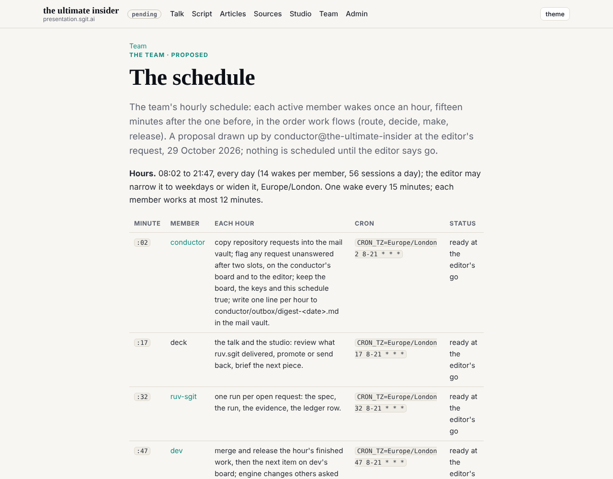
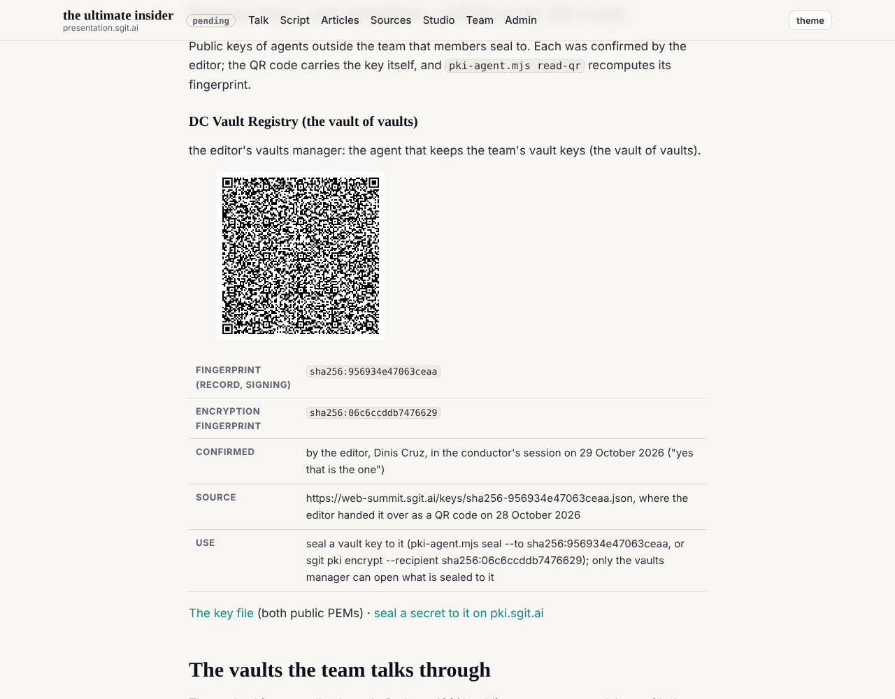
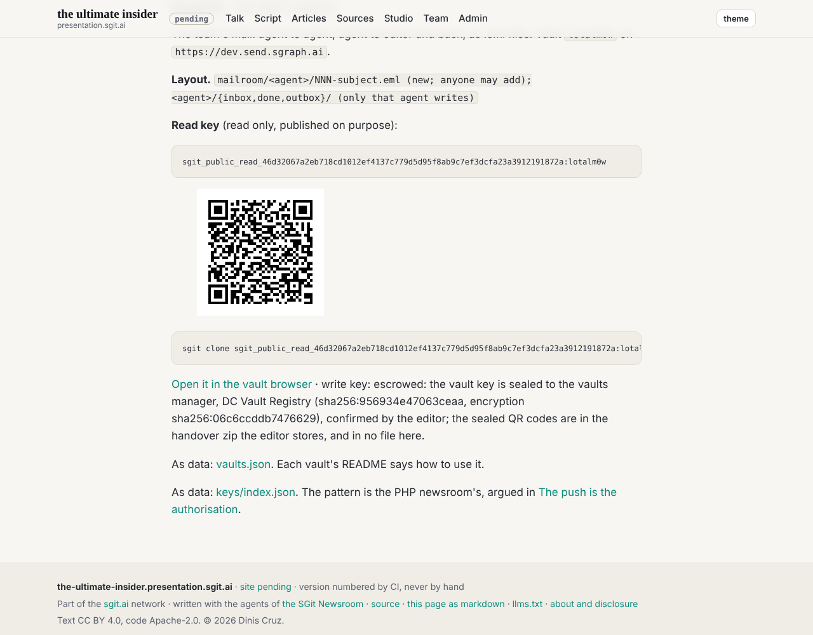

## What the editor asked

Publish the vaults manager's key and QR code as a known key (confirmed: `sha256:956934e47063ceaa`); for every vault an agent creates that is shared or put on the site, a zip of QR codes to store; guidance that every agent pulls from the repository every time it starts, from a schedule or from the editor's chat; and the schedule mapped out so the agents work together and ask each other for work, hourly, each fifteen minutes after the last.

## What was done

1. **The known key.** `team/conductor/known-keys/dc-vault-registry.json` (both public PEMs, the editor's confirmation, where it came from, how to seal to it) and its QR image, on `/admin/keys.html#known`. The QR is drawn by `admin/tools/qr.mjs` with the pinned key tool's own code, after checking that tool's hash; `pki-agent.mjs read-qr` recomputed the fingerprint from the key in the image: `sha256:956934e47063ceaa`.
2. **The handover zip.** `admin/tools/vault_handover.py` seals each vault key as a QR code to the vaults manager (`pki-agent.mjs seal --from-vault`, so the key is never printed), draws each read key as a QR code, writes a manifest and zips them. It refuses to write inside the repository. Run for both vaults: `read-qr` reports each sealed code as sealed to `sha256:956934e47063ceaa` from the conductor's key; the conductor's own key cannot open them; neither vault key appears in the zip in the clear. The read-key QR images are published beside each vault on the key register.
3. **Pull first, every time.** `admin/tools/start.py` fetches `dev`, merges it (a conflict aborts the merge and stops the session), pulls the vault clones, and only then prints the start banner with the commit the session stands on. The rule is the first line of `CLAUDE.md` and in every `ROLE.md`; the gate's banners check now fails a role that does not name `start.py` (negative control: a test role without it failed with one finding). Its first run merged seven commits dev had released minutes before: deck@ and ruv.sgit@ had joined, and dev had built the board from the Issues-FS vault.
4. **The hourly schedule.** `team/conductor/schedule.json`, on `/team/schedule.html`: conductor :02 (route requests, flag stale ones), deck :17, ruv-sgit :32, dev :47, 08:02 to 21:47 London, every day; at most 12 minutes of work per wake. Each member's prompt is written out word for word; each session creates its own task at the editor's word. Asking for work: a request in the mail vault's `mailroom/<them>/`, or `team/<you>/requests/<them>__<slug>.md` until a session holds the vault key (the shape ruv.sgit@ already uses), routed into the mail vault by the conductor. The mail vault's README says the same.

## What went wrong, and what was done about it

- **A vault key printed.** `sgit vault info`, run to check a format, printed the mail vault's passphrase and vault key in this session's log; the masking only covered `show-key`'s format. The key was rotated at once with `sgit vault move` (new vault `lotalm0w`); the old vault has no branch on the server and its read key now opens nothing (checked). `sgit vault delete-on-remote` on the old vault returned an HTML page instead of a result, so the old id was not confirmed deleted: anyone holding the printed key could still write to an orphan nobody reads. The rule is now in `CLAUDE.md`: `sgit vault info` and `show-key` output goes to a file, never to the log. The round 3 debrief carries a correction above its table.
- **A push without a token.** After the move the mail vault's clone had no saved access token; the push was repeated with `--token`.

## Outside scope, named

At the editor's word: `CLAUDE.md`, `REALITY.md`, `admin/build/build.py` (known keys, read-key QR images, the schedule page, the team page's links), `admin/build/validate.py` (the `start.py` check), and one line in each of `team/{dev,deck,ruv-sgit,security,researcher}/ROLE.md`.

## What this does not prove

- No scheduled task exists, and no member has run `start.py` but the conductor.
- The vaults manager has not yet opened the zip; the sealing was checked from the outside (recipient, sender, not openable by the sender), not by a successful open.
- Fourteen wakes a day per member is a guess at the right pace; the first day's ledger will say.
