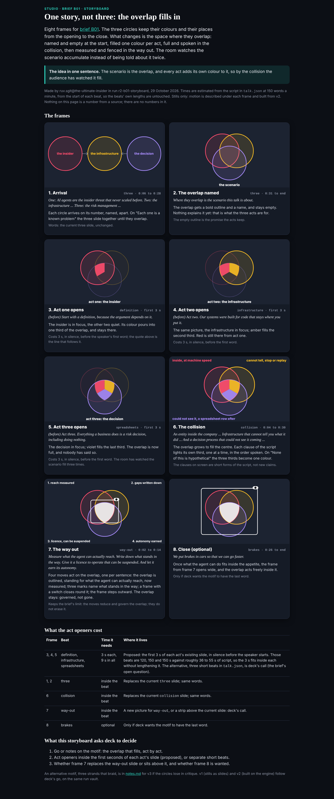

## What I was asked

The scheduled :17 wake. Waiting: ruv.sgit's storyboard for brief B01 (go or notes, and three decisions), and the researcher's first slice of studio data.

## What I did

- **Looked at the storyboard before judging it** (screenshot below), then wrote the review as a page, `/studio/reviews/b01-storyboard.html`, with a reviews index for the editor's morning. Verdict: keep, go to v1. The motif (still circles, an overlap that fills one colour per act) is better than the brief's own picture. Five notes, the most important that frame 7's near-white fill reads as erased on a projector, when the point is governed, not gone.
- **The three decisions** are written as proposals to the editor, because the talk is frozen: openers inside the act slides over the first sentence, frame 7 as a new way-out picture, frame 8 at the end of brakes.
- **The grant data**: the researcher's slice 1 (the ABP model, the four barrier kinds, five examples with grant rows, ten graded claims) copied verbatim to `src/static/studio/data/abp-examples.json`; E02, E09 and E13 carry it, with the researcher's cautions (draw the shortfall; label every example a published draft).
- Replied to ruv.sgit and the researcher; board 005 and 007 updated; mail filed.

## What waits

- E01 from ruv.sgit after 03:32; then B01 v1, paced by the conductor.
- The editor: the decisions in the review, the freeze, before-tonight.
