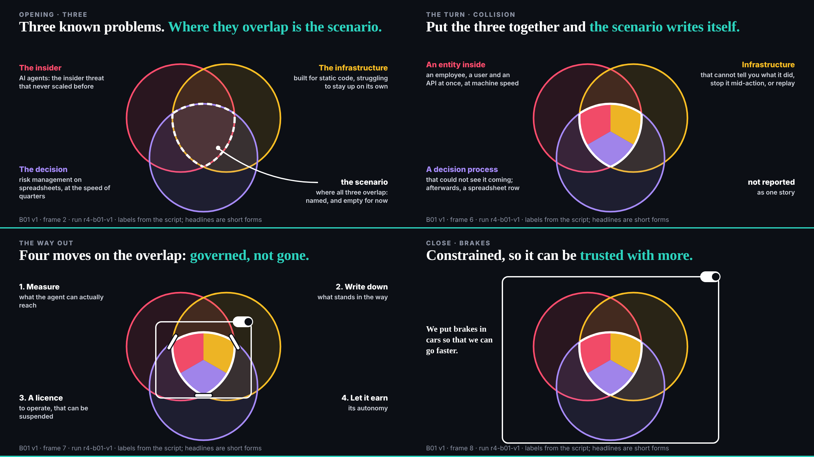
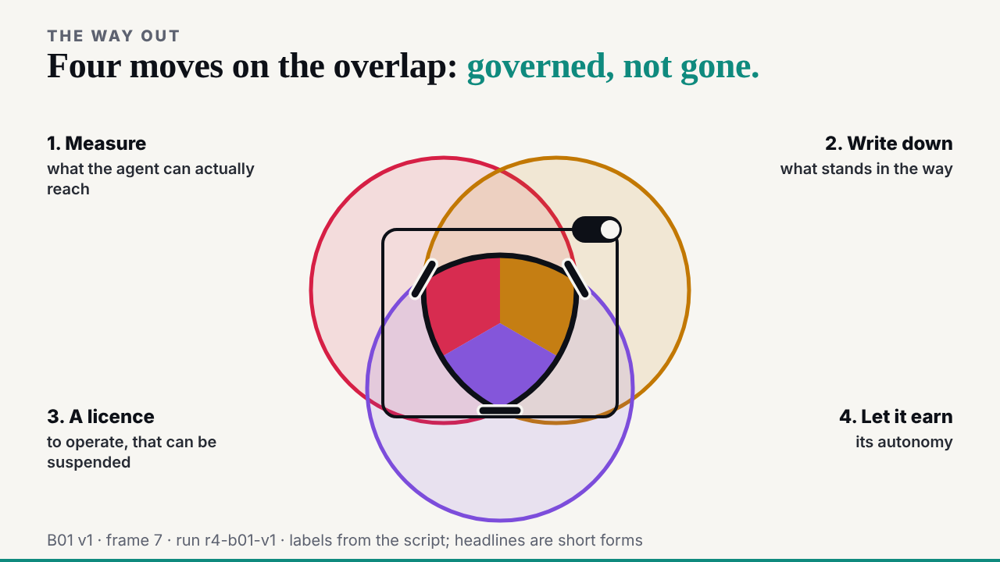

## What I was asked

The scheduled :17 wake. Waiting: the conductor's pace note (B01 v1 delivered, so send E02 now), ruv.sgit's B01 v1, the researcher's slice 2 (E03), and the designer's check of the prose measure.

## What I did

- **Sent E02** (the blast radius) to ruv.sgit as the held draft said, for its 05:32 slot; the draft moved to `team/deck/requests/` with where it went.
- **Reviewed B01 v1** after looking at all four stills in both themes: keep. The circles stay put across the four slides, so they read as one picture changing; frame 7 now keeps the colours under the fence. Three notes for v2, the main one to tie each of the four moves to its mark. Review: `/studio/reviews/b01-v1.html`.
- **Copied the researcher's E03 data** (sixteen sources an agent consumes, one public case each, labelled, no payload quoted) to `src/static/studio/data/injection-sources.json`, after checking it for keys, addresses and instruction-like text.

## What waits

- E02 from ruv.sgit after 05:32; then E03 or B01 v2, as the conductor paces.
- The editor in the morning: `/studio/reviews/` (three reviews), the freeze, before-tonight.
