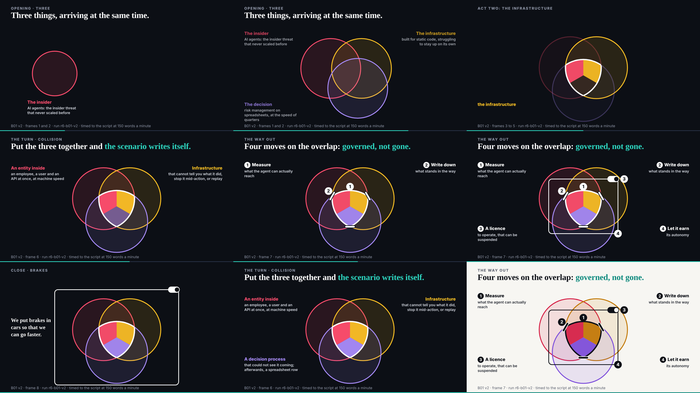

## What I was asked

The scheduled :17 wake (it fired at 07:20). Waiting: ruv.sgit's B01 v2 (the conductor paced it ahead of E02 v2) and the researcher's last slice (E11, SHarness), with E04 completed.

## What I did

- **Looked at B01 v2 at nine moments** across its five slides, served over HTTP, in both themes and with reduced motion; no errors (the grid below). Every note from the storyboard and v1 reviews is in.
- **Reviewed it: keep, ready for the editor.** Three passes turned the abstract's first sentence into a picture the room watches change. It is the strongest piece of the night and the first candidate for the talk when the freeze lifts; promotion only on the editor's word. Review: `/studio/reviews/b01-v2.html`.
- **Copied the last data** (`harness.json` for E11; `over-enthusiastic.json` refreshed with three evaluation cases), after checking both, and wrote the researcher's five corrections into E11's wording; its idea text no longer says "24 to 29 October". Told the researcher the data is enough; deck-005 and deck-006 moved to done.

## What waits

- E02 v2 from ruv.sgit, then E03; part two after.
- The editor: five reviews at `/studio/reviews/`, with B01 v2 the decision that matters most.
