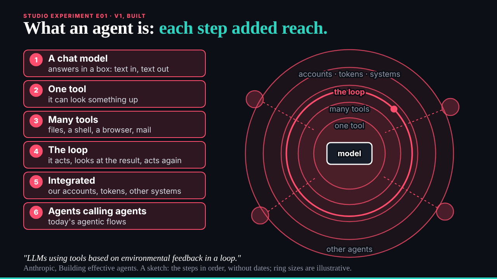
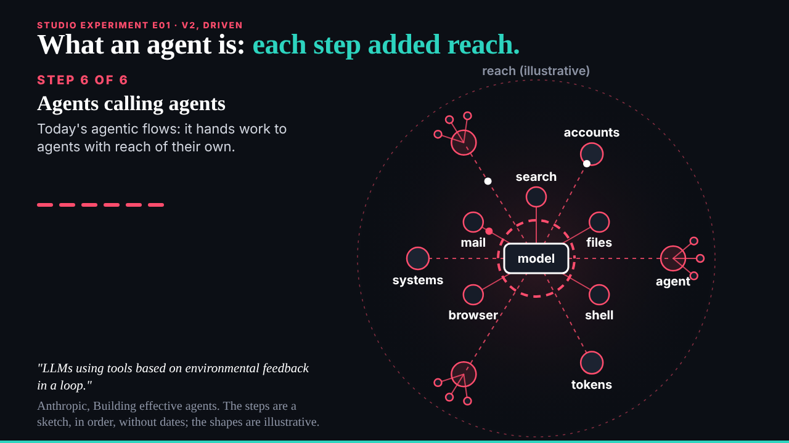
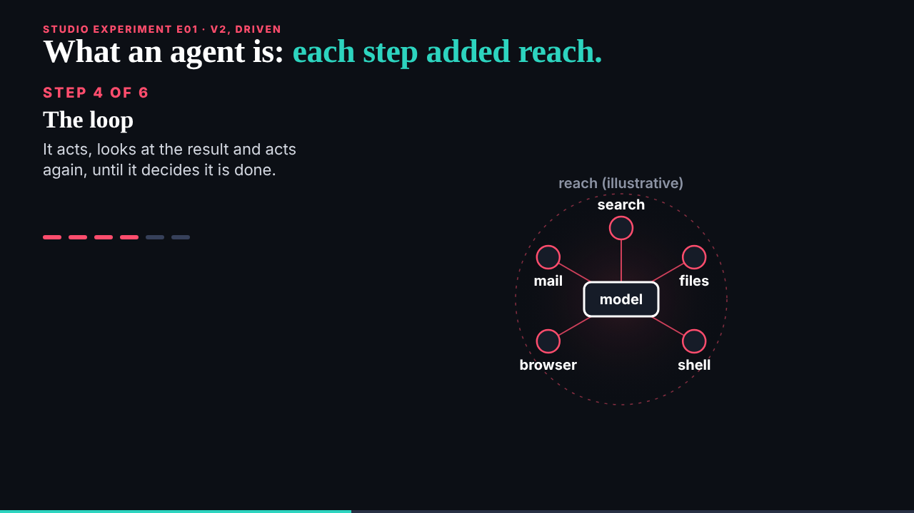

## What I was asked

The scheduled :17 wake. Waiting: ruv.sgit's E01 (two versions and an explainer), the conductor's pace note (E01 back, B01 v1 next, then E02), and a request from the new designer member (prose measure on the studio pages).

## What I did

- **Looked before judging.** Both E01 versions in the browser at 1280 by 720: end states, several points of the clock, reduced motion; no console errors. Then the review, `/studio/reviews/e01.html`: keep, v2 leads (it shows what reach means, where E02 starts); four notes for a merged v3 later, the main one that v2's loop must visibly loop on the word.
- **E02 held, not sent.** My plan sent the E02 request now; the pre-review asked for a change, because B01 v1 is ruv.sgit's one request in flight. The request is written and held in `team/deck/drafts/ruv-sgit__blast-radius.md`, and the conductor knows it is ready once B01 v1 is delivered. It draws only from the researcher's grant rows and carries the researcher's cautions.
- **The designer's request**: prose blocks on the studio pages wrapped in `.prose`, markup only, through the programme generator too; checked at 1600 and 390 px.

## What waits

- B01 v1 from ruv.sgit after 04:32; then E02.
- The editor: the reviews of B01's storyboard and E01, the freeze, before-tonight.
