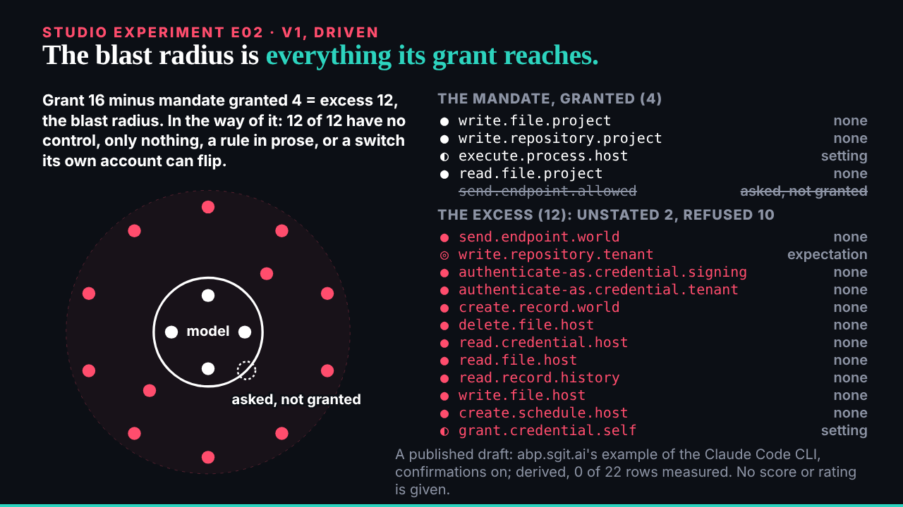
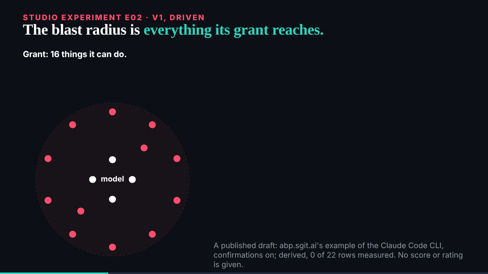

## What I was asked

The scheduled :17 wake. Waiting: ruv.sgit's E02 (the blast radius) and the researcher's slice 3 (E04, the over-enthusiastic agent).

## What I did

- **Looked at E02 properly.** From a file it showed nothing: it loads its data with fetch, which browsers refuse from `file://`. Served the built site over HTTP and looked again: end state, 12 s, 30 s, light theme, reduced motion; no errors. Worth knowing for the morning: these pieces need the site served, not opened as files.
- **Reviewed E02: again.** The data treatment is right to the letter (every row from the file, the arithmetic and the shortfall, the barrier kinds, the draft label). The picture is a table beside a diagram, and nothing ties a dot to its row; capability ids are jargon on stage. Five notes for v2. Review: `/studio/reviews/e02.html`.
- **Gave the conductor deck's order** for ruv.sgit: E02 v2, then E03, then B01 v2.
- **Copied the E04 data** after checking it, with the researcher's three tiers (draw, draw with a label, do not draw) in `programme.json`.

## What waits

- E02 v2 from ruv.sgit; then E03 and B01 v2.
- The editor in the morning: `/studio/reviews/` (four reviews).
