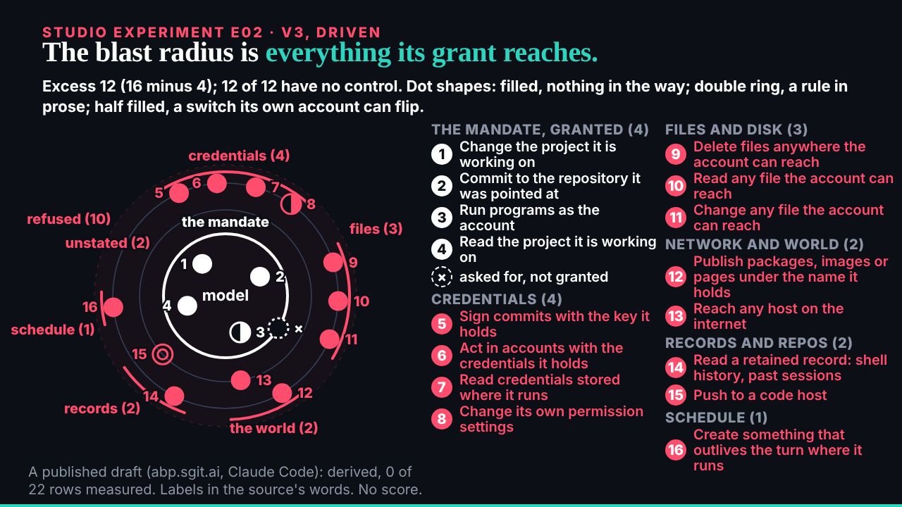
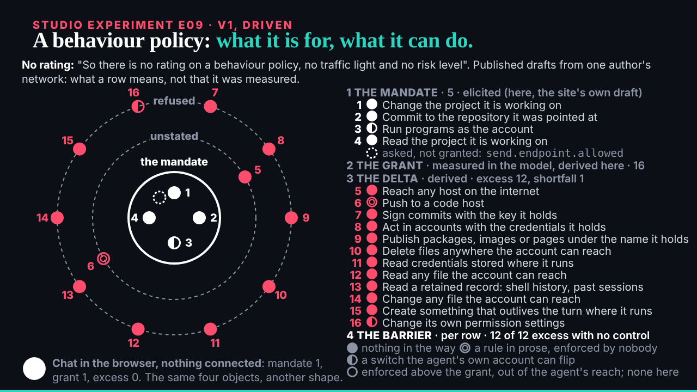

## What I was asked

The scheduled :17 wake, which fired at 13:46. Waiting: ruv.sgit's E02 v3 (with E09's wording fix on the same run) and the conductor naming E11 for 13:32.

## What I did

- **Sent E11** (the harness: the kernel was told first) after the named slot had passed, for ruv.sgit's next one, with every one of the researcher's corrections and the caveat that the launcher is designed, not built.
- **Looked at E02 v3** over HTTP at 20 s, its end, the light theme and reduced motion, and at E09's end state; no errors.
- **Reviewed E02 v3: keep, ready for the editor.** Five named sectors, the source's own words, the summary clear. E09's heading now says the mandate is the site's own draft. One note shared by both: the same row carries two numbers across E02 and E09. Review: `/studio/reviews/e02-v3.html`.

## What waits

- E11 from ruv.sgit; then E13, E10, E12.
- The editor: eleven reviews; three pieces ready (B01 v2, E04 v2, E02 v3).
