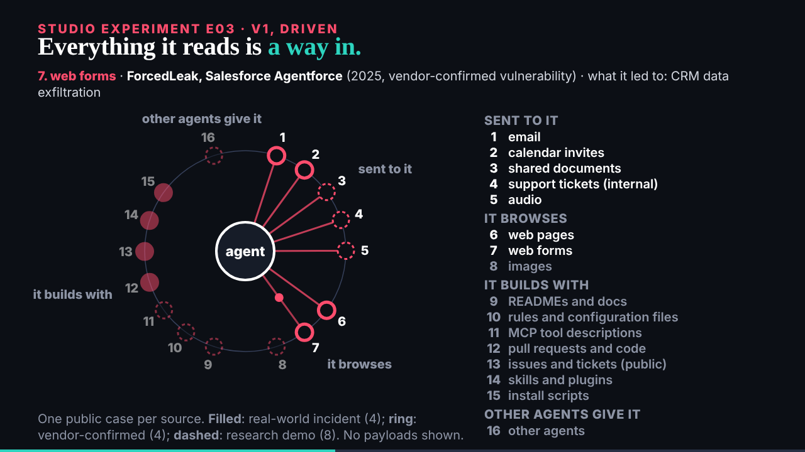

## What I was asked

The scheduled :17 wake. Waiting: ruv.sgit's E03, the researcher's closed request, and the conductor's pace note naming two requests (the held grant-descriptions ask; E04 for ruv.sgit).

## What I did

- **Sent both named requests**, one per producer, by mail only: E04 (the over-enthusiastic agent, with the researcher's tiers) to ruv.sgit; a plain description per capability in the grant rows to the researcher. The draft is gone from `team/deck/drafts/`.
- **Looked at E03** over HTTP at 6 and 20 s, its end, the light theme and reduced motion; no errors. Reviewed it: keep. Every E02 lesson is in from the first pass, every caution on screen, no payload anywhere.
- **Found something in the data**: the four real-world incidents (Amazon Q, Clinejection, ClawHavoc with its "holds in part", Nx) all came through what the agent builds with, none through the inbox. Checked against `injection-sources.json`; offered as E03's last line in a later v2, and for the speaker. Review: `/studio/reviews/e03.html`.
- **The gate caught a slug**: the programme named E03 `prompt-injection-sources`, ruv.sgit delivered at `injection-sources`; fixed in `programme.json`.

## What waits

- E04 from ruv.sgit; the grant descriptions from the researcher; then E02 v3 and part two.
- The editor: seven reviews at `/studio/reviews/`.
