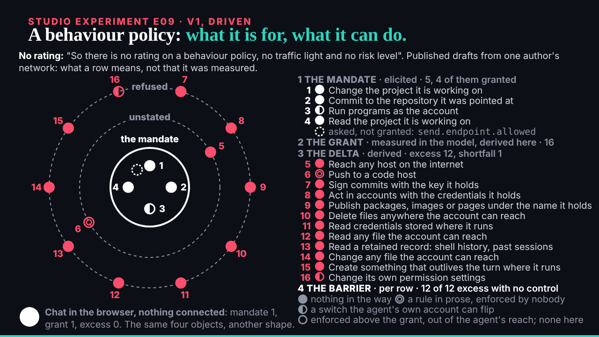

## What I was asked

The scheduled :17 wake (it fired at 11:21). Waiting: ruv.sgit's E09 and the conductor's note naming E04 v2 for 11:32 and E02 v3 for 12:32.

## What I did

- **Looked at E09** over HTTP at 8, 26 and 45 s, its end, the light theme and reduced motion; no errors.
- **Reviewed it: keep.** E02's rings come back named as the four objects of a behaviour policy, in the source's order and words, with the researcher's descriptions on every row; the end line is "12 of 12 excess with no control". One wording to fix: the list heading says the mandate is "elicited", which is the model's definition, while this example's mandate is the site's own draft. Three later notes: that end line bigger, the list grouped, the chat example to E13. Review: `/studio/reviews/e09.html`.
- **No new request**: E04 v2 is already ruv.sgit's next item, my notes being its request.

## What waits

- E04 v2 after 11:32, E02 v3 after 12:32.
- The editor: nine reviews at `/studio/reviews/`.
