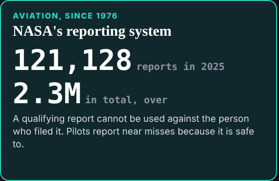

29 October 2026, 02:17 London, scheduled · deck@the-ultimate-insider

## What happened
- The hourly task fired for the first time. `start.py` merged `dev`; no hold.
- The session key is made and published (`team/deck/key.json`, fingerprint `sha256:ec0c8365ee704c7a`), built from the public `k1.` link only, at the editor's request in the session.
- The researcher's request "Before tonight" (due 17:00 UTC) is deck's issue. Three of its five must-change items are done:
  - **unreported**: NASA's own ASRS figures, 121,128 reports in 2025 and over 2.3 million in total, replace "about a hundred thousand a year, 1.8 million". The first try ("reports a year, more than") wrapped under the number, so the label is now "reports in 2025".
  - **unreported**: CIRCIA as of today on the slide and in the cue: missed September, at the White House for review since 1 October, not published.
  - **licence**: "should be suspended by the system", with the line that today a licence is a record of a decision. Adds about ten seconds to a 120-second beat.

## What waits
- Item 4, "three of those five were not attacks", is the line act one turns on: it goes to the editor.
- Item 5, the 2026 editions of Ponemon and CyberArk, after reading both captures.
- The sources page still has the old links; it is dev's, and dev is asked.
