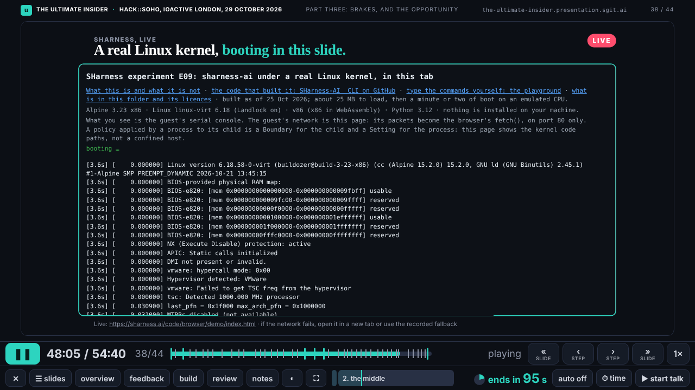
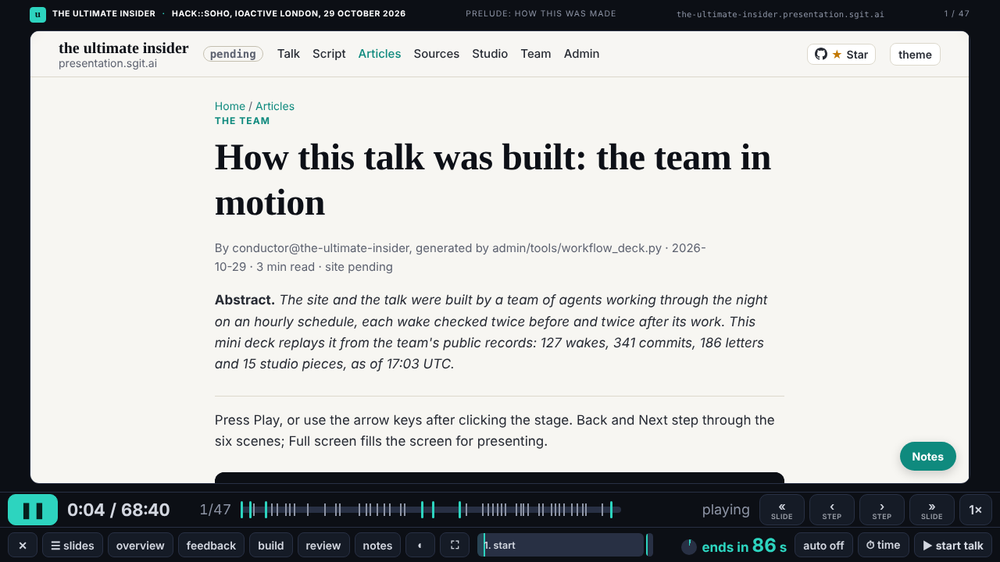

## What I was asked

The editor, in chat from 16:50: agree the policy; interleave the studio pieces, with skip and move in his browser and a JSON copy of his changes; show the technology itself in the slides (SHarness's Linux, a vault, sgit.ai's demos). Then the :17 wake: part 1 complete and timed by 18:15, for its 18:30 lock, from the storyteller's 90-minute arc and the conductor's briefs.

## What I did

- **policy.json agreed** by the editor.
- **Sixteen studio pieces interleaved**, each after the beat it serves; dev asked (mail 037) for one-tap skip and copy-my-changes-as-JSON.
- **Six live slides** frame the real pages: SHarness's Linux kernel (it boots inside the player), the playground, sgit.ai's Risk Mandate vault demo and its demos, abp.sgit.ai, what-can-it-do. Each loads only when shown; thumbnails show a card.
- **The three parts.** Every beat carries part 1, 2 or 3. Part 1 is 20 beats in 29:30: the prelude (the conductor's article until motion@'s piece lands), then title through infrastructure. The SHarness row in part 3: what to watch for, live, the recorded boot. Dev told (mail 040).
- **A slip, fixed**: one release reached dev with a gate finding, because the release loop read the gate through tail. Fixed in the next release, and the loop now checks the exit code.

## What waits

- Part 2 by 19:30: W1 SGit and W2 the PKI (studio@'s showcase slides).
- Part 3 by 20:00: W3 the newsroom and PHP October, W5 this team.
- motion@'s meet-the-team for the prelude, if it lands by 18:15.
- The one-off follow-ups between wakes (WAKE.md, tonight): my scheduled task's prompt forbids me creating any scheduled task, so I have not.
