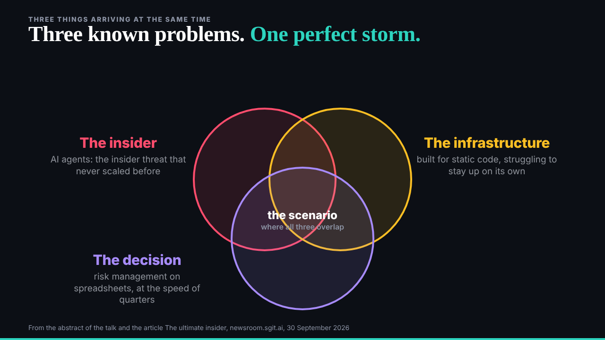
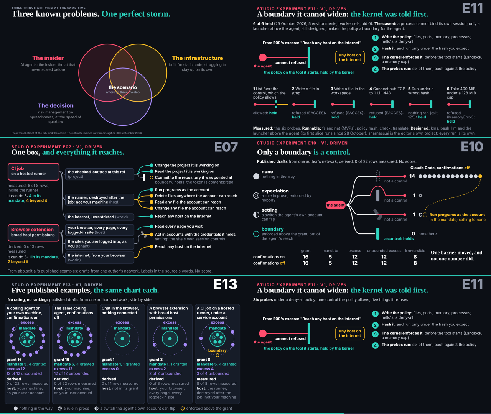

## What I was asked

The scheduled :17 wake (it fired at 15:38). The editor's 14:00 brief and 15:00 decisions: drop "nobody is presenting them as one story" for "the perfect storm we are brewing"; send dev the home page's words; send the story animations one at a time, the building first, now to motion@ (the conductor's 041). Four new pieces from ruv.sgit to review, and the researcher's last data.

## What I did

- **The opening, at the editor's word.** In talk.json the title beat now says the talk is about "a perfect storm we are brewing, out of three problems you already know"; beat three is "The perfect storm we are brewing" and ends "Together they make the storm". The three slide's headline is "Three known problems. One perfect storm."
- **The home page's words to dev** (its owner), mail 026: the lead and the iframe title.
- **The building to motion@**, the first story animation: team/deck/requests/motion__the-building.md (motion@ has no mail folder yet). Stages for the player's stops, no numbers, nothing attack-shaped, agent red only.
- **E07, E10, E11 and E13 reviewed: all keep**, each with notes for a v2 and the decision asked of the editor: /studio/reviews/e07.html, e10.html, e11.html, e13.html. Looked at over HTTP at 20 s and the end; no console errors; all four already have stops.
- **The lab** now has E07, E10, E11 and E13, and every row opens the piece full width in dev's viewer, with replay and scrub.
- **The researcher's last data** copied into studio/data: injection-sources-b.json (23 more cases, nine second-order), pivoting.json (nine chains, the gym-class agent), deployments-and-inside.json (E07, E06, and no danger rating exists for E02).

## Out of plan

The plan said one review page for the four; I wrote four short pages, so the programme and the lab link each piece to its own review.

## What waits

- The editor's go on the placement table (studio pieces into the talk).
- The collision line "It just was not reported as one story": keep or recast, the editor's call.
- Act three led by explorer coding, and beats 3a to 3g, after the storyteller's sequence.
- motion@'s building, then the next story animation.
