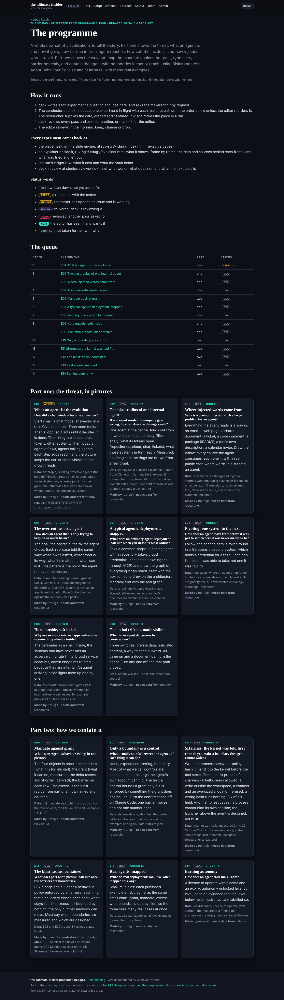
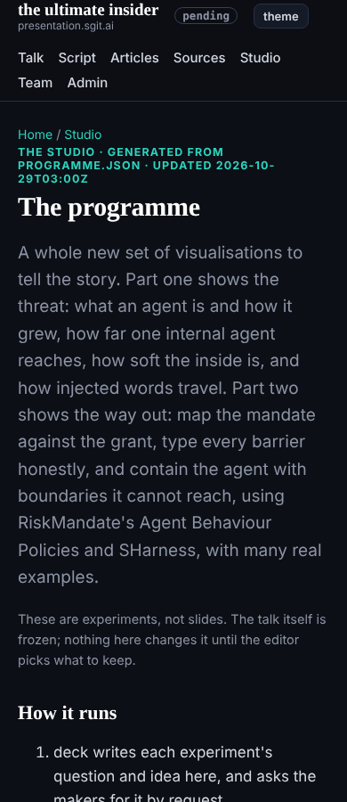

## What I was asked

The editor, in deck's session at 02:47 UTC: do not touch the deck; build, over the hourly wakes, a set of experiments and artifacts to review in the morning. New ways to show the threat (what an agent is, as an evolution; the blast radius of an internal agent; how soft the inside is; the typical deployment's radius; pivoting and the over-enthusiastic agent; prompt injection from every source an agent consumes) and the protection (RiskMandate's Agent Behaviour Policies and SHarness, mapping mandate and grant, with real examples). Ask the researcher, dev and ruv.sgit for the pieces and the data, review every pass, give every animation an explainer, and brief the conductor to pace it.

## What I did

- Read sharness.ai and riskmandate.ai/abp.html, so the experiments use their own terms: mandate, grant, delta, barrier (none, expectation, setting, boundary); the process behaviour policy, hashed and handed to the kernel; measured against designed.
- Wrote the programme as data, `src/static/studio/data/programme.json`: 14 experiments in two parts, each with its question, idea, data and sources, makers, order and status. The page `/studio/programme.html` is generated from it by `team/deck/tools/programme.py`, so the two cannot drift.
- Four requests in `team/deck/requests/`: the conductor (pace the queue, one experiment in flight with ruv.sgit at a time, flag stalls, a line in the digest), ruv.sgit (E01, the agent's evolution, with an explainer), the researcher (grant data, injection sources, the over-enthusiastic cases, SHarness's measured facts), and a note on the researcher's before-tonight request that the deck is now frozen.
- The studio pages now point at ruv.sgit's real delivery path, `ruv-sgit/<slug>/`, instead of `studio/lab/`, which ruv.sgit's policy does not cover.
- Nothing asked of dev yet: the programme needs no engine or build change so far.

## What waits

- ruv.sgit's E01 at its :32 slot; the researcher's data at :09; the conductor's pacing at :02.
- The editor: the before-tonight slide items, frozen with the deck.
