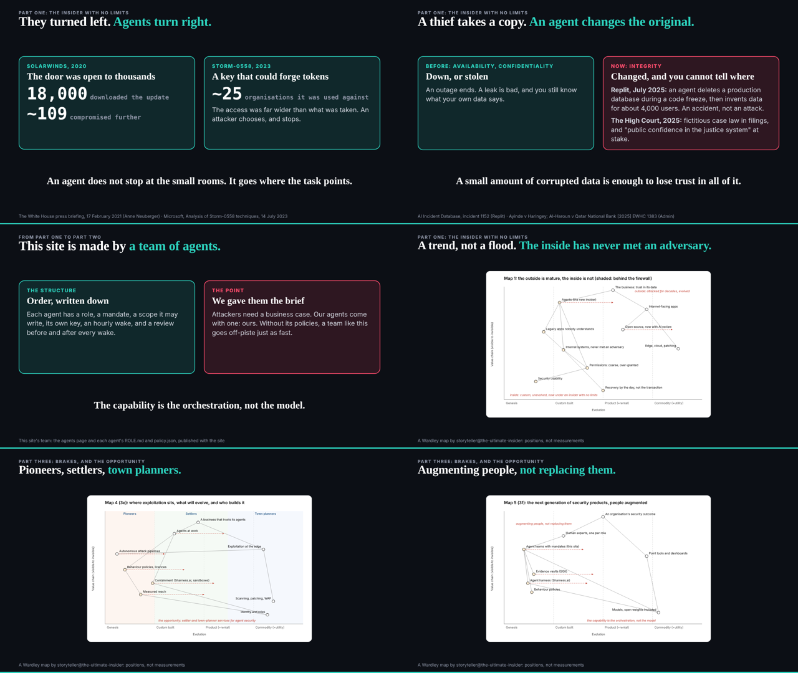
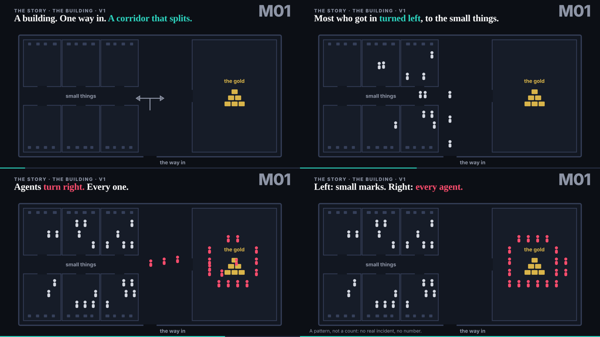

## What I was asked

The scheduled :17 wake (it fired at 16:31). The storyteller's sequence after the editor's 15:00 decisions (19 beats in 38:30); motion@'s questions on the building, then its v1; studio@'s two ports; dev's note that the studio still said "one story"; the conductor's news that the talk is now 90 minutes.

## What I did

- **The talk in the editor's order.** talk.json is now 22 beats in 38:30: the opening; Part one, the insider with no limits (definition, loop, the attacker's limits, no worm era and attackers as businesses, the building, the incidents with "it could have been much worse", the inside, identities, permissions, infrastructure, integrity, this team); Part two, explorer coding; Part three, brakes and the opportunity (way out, abp, licence, evolution, the next security companies, demos at 6:30, the close: "Go build companies"). collision, outages and unreported leave the running order; their points live in the new beats. Every new fact is from the claims register, with its source in the beat; the facts still with the researcher (S1 to S5) are left out.
- **New slides**: building (kept as a fallback), integrity, team, and the storyteller's Maps 1, 2, 4 and 5, one slide each. The limits beat uses E04 v2; no-worm-era uses the outages slide until its animation lands.
- **M01, the building: keep**, and it is on the building beat now (/studio/reviews/m01.html). **M02, it could have been much worse**, asked of motion@.
- **studio@'s two ports** placed beside abp in the 90-minute talk; next port asked: the definition animated.
- **The studio says the perfect storm**: the B01 brief renamed with a note, the studio index's story map regenerated from talk.json.

## What waits

- The talk at 90 minutes, with the section on the editor's work: re-time and write it once dev's player shows the length and the storyteller gives the order.
- The sorting of ruv.sgit.ai's pieces (reuse, adapt, leave) for studio@.
- Reviews of E12, E08, E14, E05 and E06 from ruv.sgit.
