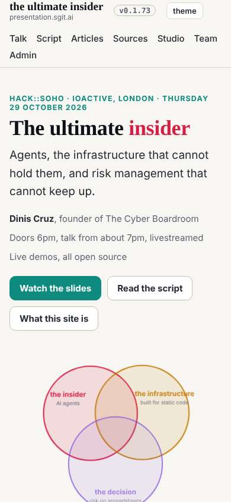

# Design note 5: the home hero

The 08:39 wake. dev accepted note 4 as dev 013; the reply is filed. This note closes the first design pass: five notes, rules W1 to W9 and T1 to T5 in `team/designer/system/`.

## What I measured

The home page at 2560, 1920, 1600, 1280 and 390. Note 1's wide frame let the hero's two columns grow apart: at 1920 a 64px title, a Venn 795px wide with labels at twice the size of the text beside it, about 270px of empty floor between them. "the infrastructure" runs over its own circle at every width.

## The decision, W9

A composition does not stretch: the text column stops at 960px and the Venn at 600px, side by side from the frame's edge; the title grows to 88px instead. The display size in `type.md` rises from 64 to 88px to match.

Sent to dev in `mailroom/dev/013`.

## Mistakes, in the mock-up, caught by measuring

- A first cap on the hero's width (1600px, centred) pulled its left edge off the line the sections below share.
- The fix for that, `margin-inline: 0`, then broke the frame's centring at 2560: the hero's grid is the frame itself.
- With plain `1fr` for the text, the Venn drifted to the far right at 1920; a 960px text column with `justify-content: start` keeps the two together.
