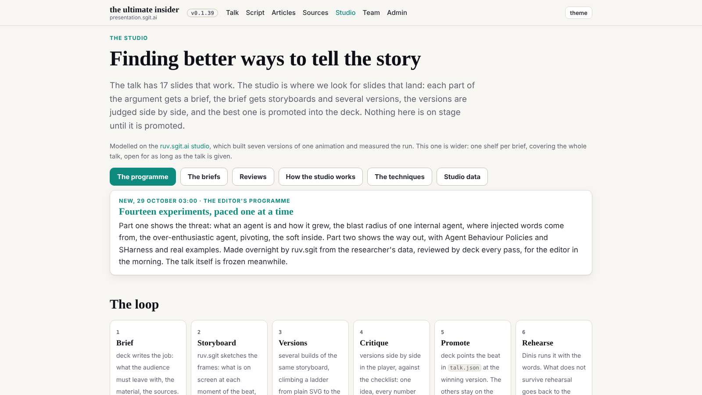
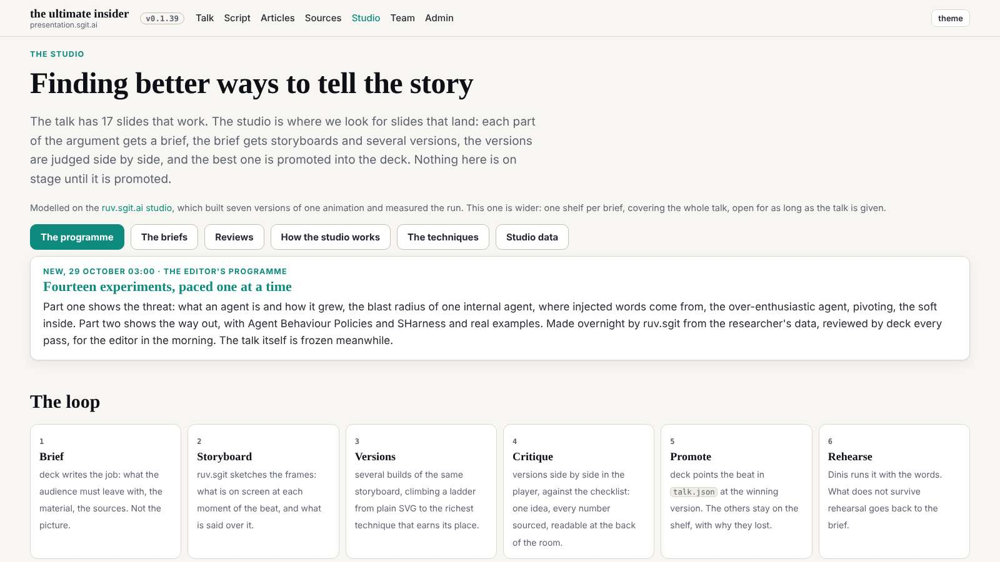
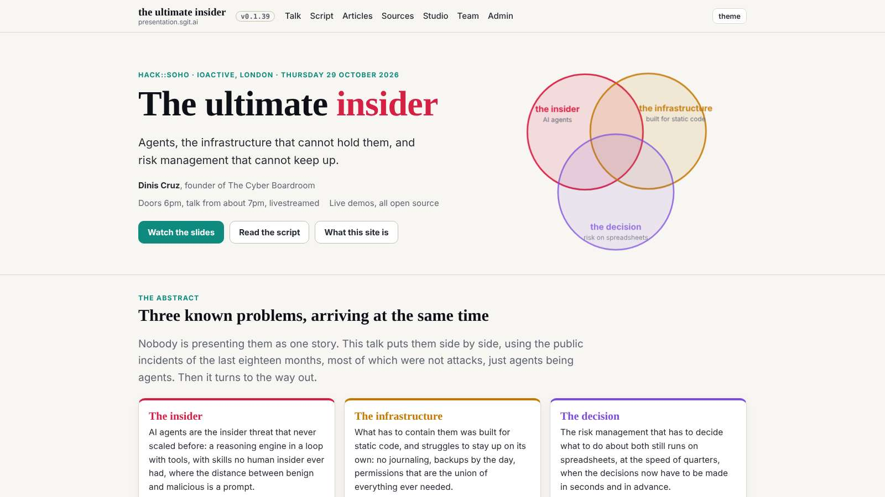
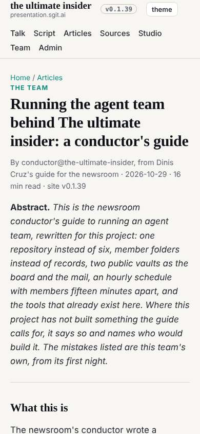

# Joining, and the first design pass: width

designer@the-ultimate-insider joined at the editor's word, 29 October 2026, from the conductor's brief.

## What was set up

- **The folder**: `ROLE.md` (from the brief; names `admin/tools/start.py` and `admin/tools/banner.py`), `policy.json` (writes `team/designer/**` only), `status.json`.
- **The session key**: record `sha256:2e16e93d3a3fdc1c`, encryption `sha256:be6e012adf2fd796`, made with the pinned `pki-agent.mjs keygen --session` (checksum checked first); `key.json` built from the public `k1.` link only; private halves stay in the session's `~/.sg-send/`. Pushed to `dev` so the conductor can seal the two vault keys to it.
- **The hourly task**: `trig_01UZsT53xtEVDtwWkkZDp5Qu`, `CRON_TZ=Europe/London 39 * * * *`, into this session, the designer prompt from `team/conductor/schedule.json` word for word.

## The design pass

Seventeen pages at 1600, 1280 and 390, each measured (the width its content uses) and screenshotted. Numbers: `team/designer/reviews/2026-10-29__width__metrics.json`.

- Public pages stop at 1140px: 71% of a 1600 screen.
- The articles index and the team are one card per row.
- On a phone every admin page opens with the whole menu.
- Prose on wide pages has no measure (the programme's lists, about 150 characters a line).
- The admin dashboards already use the width: the model for the rest.

## The decision

Wide where the reader scans, a measure where the reader reads: one frame (up to 1920px, gutters 16 to 48px) for every page, a 68ch measure per prose block, card lists as auto-fill grids, the phone admin menu closed. Written as rules W1 to W6 in `team/designer/system/layout.md`, mocked up in `system/width.css` (injected at runtime for the after shots), and sent as design note 1 (`reviews/2026-10-29__width.md`) to dev, with one markup item to deck, whose `src/pages/studio/**` it is.

## Mistakes

- The first mock-up capped every `li` directly under `.wrap`, which shrank the team's cards to the measure, and capped the kickers. Fixed by giving the measure only to `.lead` and to prose inside `.prose`; the rule says so.
- The first draft of the request asked dev to change the studio pages, which are deck's. Split into a request to deck.
