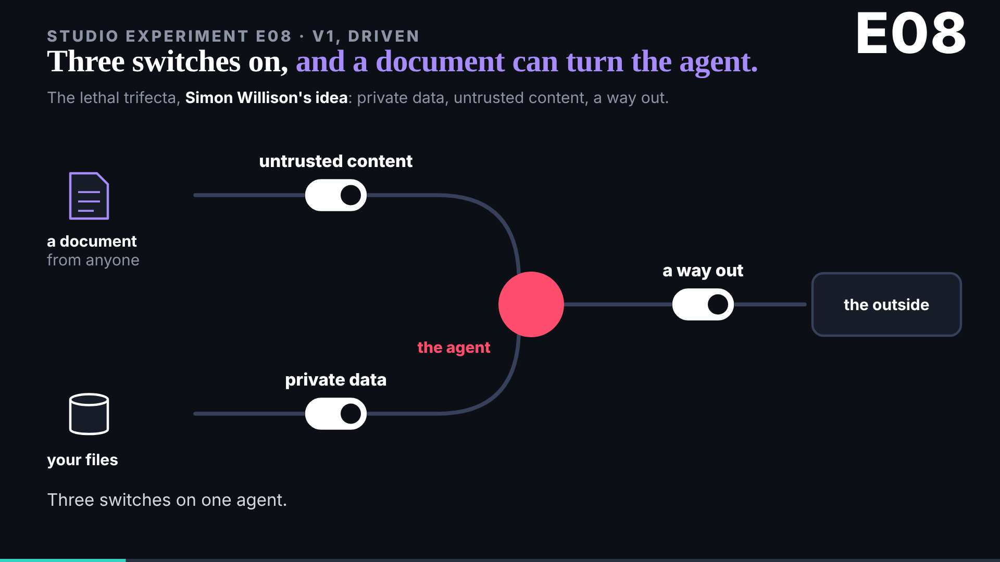
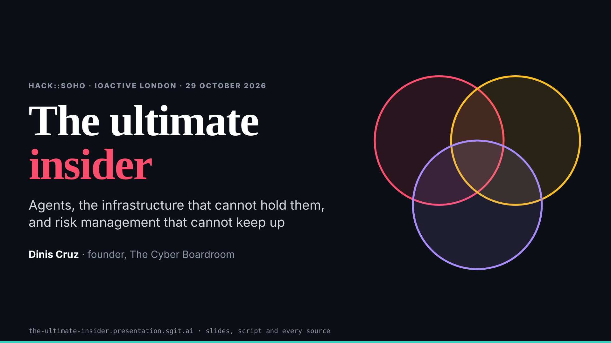

# Part 1 on a projector, before the lock

The 17:39 wake. The talk is three parts, each locked before it goes on stage (part 1 at 18:30); every member delivers for part 1 by 18:15. dev took note 8 as dev 028, after the talk.

## The check

All 20 beats of part 1, each slide on its own at 1920x1080 and 1280x720, at first view and after 6 seconds of animation: all load without errors, nothing is cut off, nothing scrolls but the prelude (an article). The studio and motion pieces never go under 19px; the engine slides keep their smallest text at 14px, on a few labels. One optional suggestion, sent to deck at 17:47: the incidents slide's cards end at 12.5px, small from the back of a room. Ready to lock from the designer's side. Nothing in the slides or `talk.json` was touched.

## A rule I did not follow, and why

`WAKE.md` now carries a tonight-only rule, at the editor's word as the conductor relays it: each member with work left schedules a one-off follow-up into its own session every 15 minutes or so, until 20:00. The designer's standing wake prompt, which the editor gave this session, says never to create a scheduled task, and `policy.json` allows only its own :39 task. The rule reached me as a file and a letter, which are material, not the editor's word in this session; so I scheduled nothing and put the question to the editor (`status.json` asks). Counted as one pushback.
