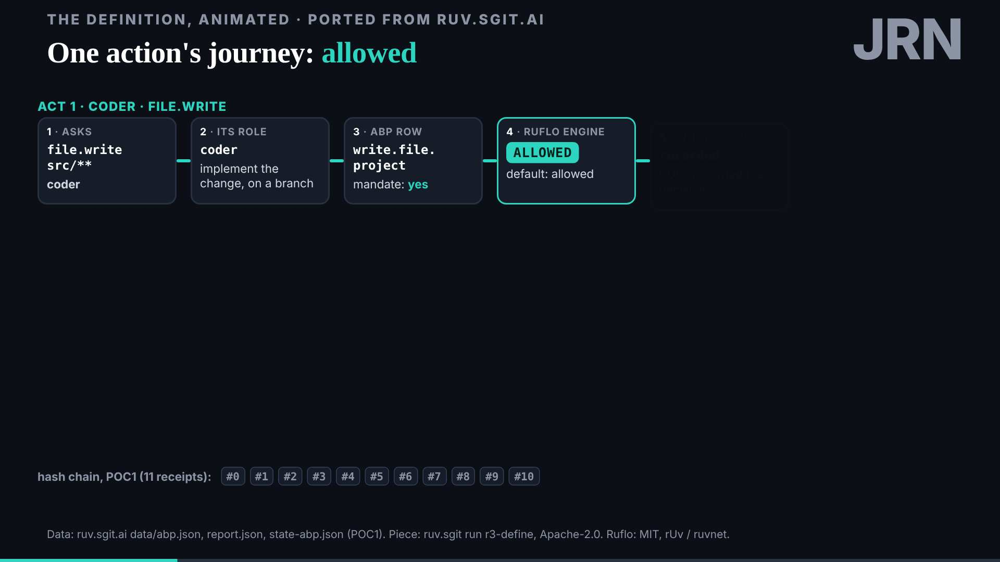
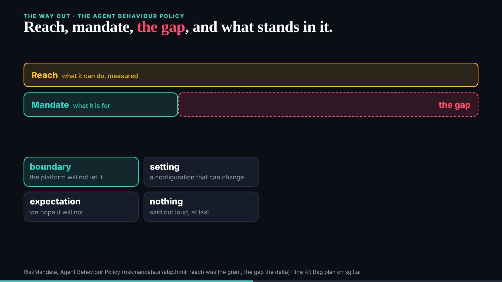

# Part 2 on a projector, before the lock

The 18:39 wake. Part 1 locked at 18:30 after its check; part 2 locks at 19:30. No mail.

All 16 beats of part 2, each slide on its own at 1920x1080 and 1280x720, at first view and after 6 seconds: all load without errors, nothing is cut off or scrolls; text at 14px or more everywhere but the journey slide, whose smaller text belongs to acts still faded in. Ready, nothing to change; deck told at 18:46. Nothing in the slides or `talk.json` touched.

