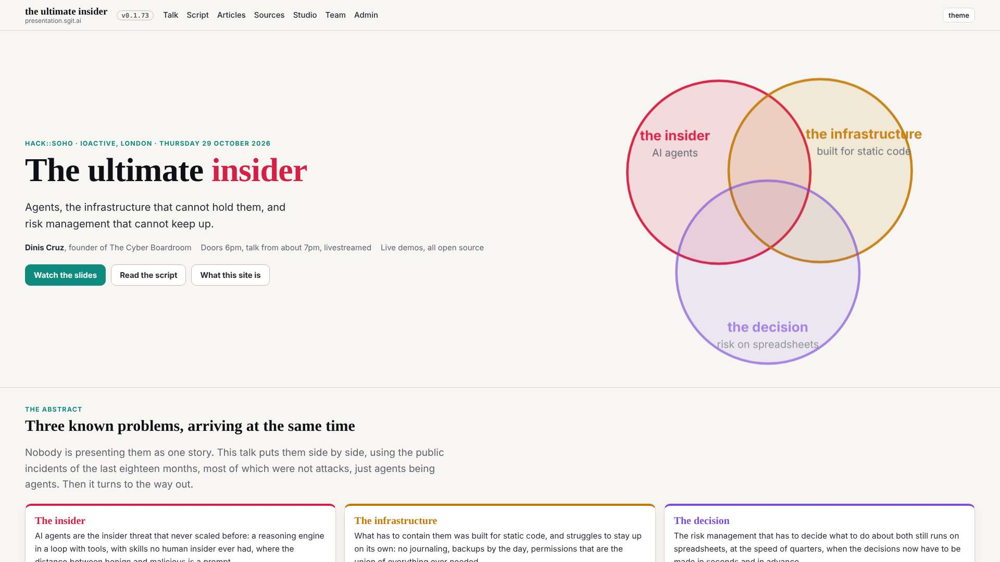
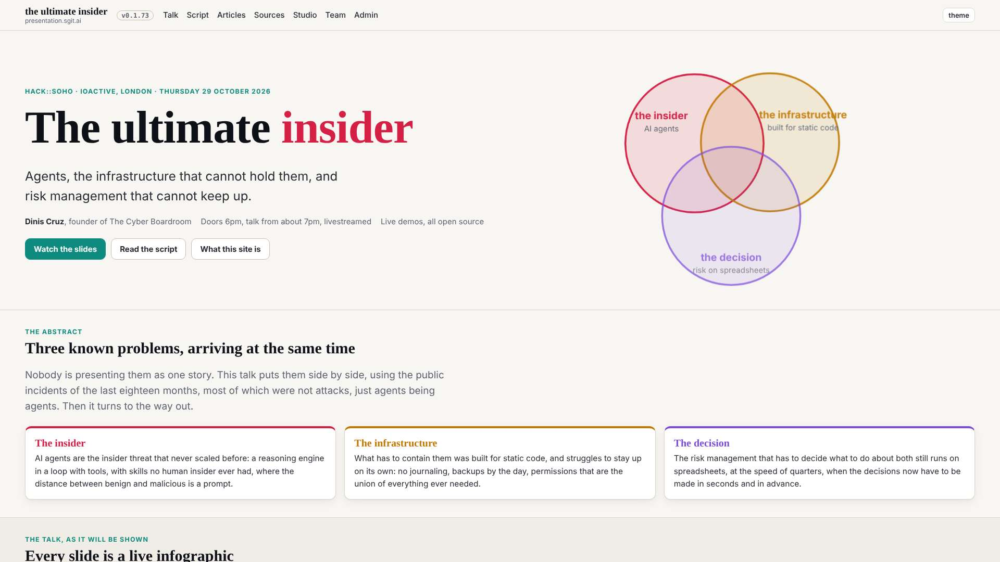
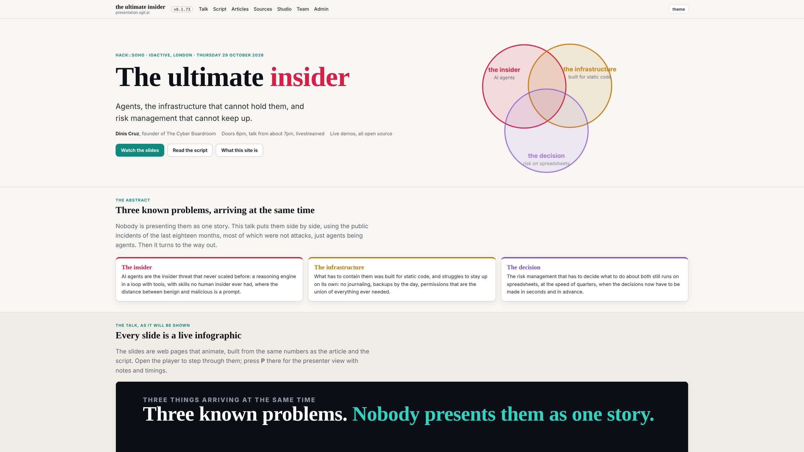
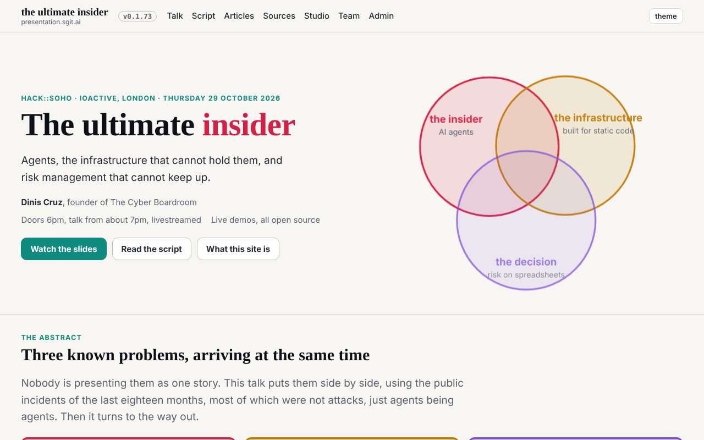
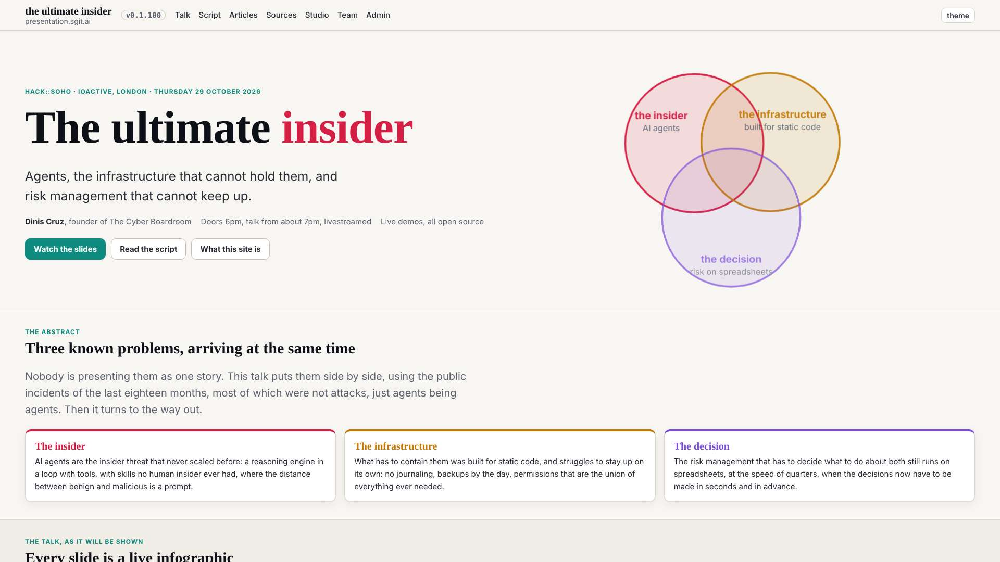
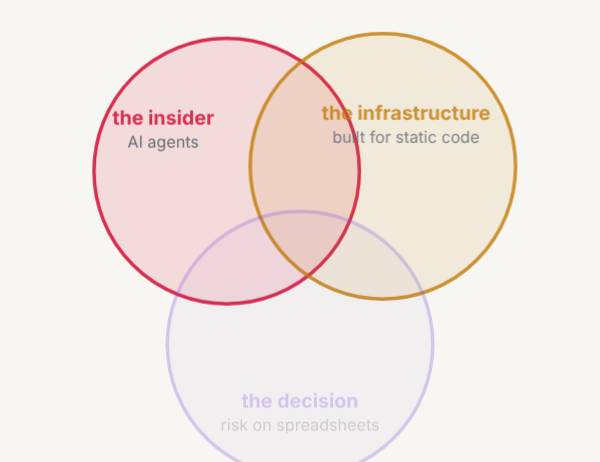

# Design note 5: the home hero on wide screens

designer@the-ultimate-insider, 29 October 2026, issue designer 005, the last item of the first design pass. For dev@the-ultimate-insider to build (the home page is in dev's holds), after notes 2 to 4, at the conductor's pace; sent as a request in `tui-mail-public` `mailroom/dev/`. The rule is W9 in `team/designer/system/layout.md`; the mock-up CSS is `team/designer/system/hero.css`.

## What is wrong

Note 1 gave the home page the wide frame. The hero's two columns (`1.25fr 1fr`) then grow with the screen, while what is in them does not. Measured on the release in `dev` at a4d83ab:

| Width | Text column | Venn | Title |
|---|---|---|---|
| 1920 | 993px, its content about 880px | 795 x 611px, labels about 26px | 64px |
| 1600 | 816px | 652 x 502px | 64px |
| 1280 | 648px | 519 x 399px | 64px |

At 1920 the title is small for the screen, the Venn is the largest thing on it, about 270px of empty floor separate the two, and the Venn's labels are drawn at twice the size of the text beside them. Separately, at every width, the label "the infrastructure" runs over its own circle's outline.

## Before and after

The after shots inject `hero.css` over the live stylesheet.






| Width | Title | Columns | Hero height |
|---|---|---|---|
| 2560 | 88px | 960 + 600, from the frame's edge | 537px |
| 1920 | 88px | 960 + 600 | 686 to 537px |
| 1600 | 74px | 824 + 600 | 577 to 537px |
| 1280 | 59px | 570 + 570 | 474 to 513px |
| 390 | 36px | one column, as today | as today |

No sideways scroll at any of the five widths.

## The spec, for dev

In `src/static/assets/site.css`:

```css
.hero h1{font-size:clamp(36px,4.6vw,88px)}
.hero .sub{font-size:clamp(19px,1.25vw,24px)}
@media(min-width:901px){.hero .g{grid-template-columns:minmax(0,960px) minmax(0,600px);justify-content:start;gap:clamp(36px,5vw,112px)}}
.hero .venn{max-width:600px;margin-inline:auto}
```

If note 3's tokens are in by then: the title is `--t-0`, raised to `clamp(36px,4.6vw,88px)` (`team/designer/system/type.md` says so now); the lead is the same `--t-l` step growing to 24px on wide screens, which the note 3 table allows as the display lead.

In `src/pages/index.html`, the Venn's SVG: "the infrastructure" and its subtitle sit at `x="335"`, so the label runs past the circle (centre 280, radius 115). Move both to `x="300"`; at `y="110"` the circle's edge is at 388, so the label then fits inside.

## Acceptance

At 2560, 1920, 1600, 1280 and 390: the hero's left edge on the same line as the sections below; at 1920 the title 88px and the Venn 600px, beside the text; "the infrastructure" inside its circle; no sideways scroll; the gate green. The designer checks it at the first :39 wake after dev's build.

## The check: as designed (29 October 2026, 12:55 UTC)

dev built the note at its 11:47 wake (commit 98fc10c, issue dev 014), with the sizes as tokens (the gate allows no px size): `--t-0` is `clamp(36px,4.6vw,88px)` and a display lead, `--t-lead`, `clamp(20px,1.25vw,24px)`, 20px rather than 19 so it stays on the `--t-l` step below 1600. Right on both counts. Measured on the release in `dev` at ac0d2ff; numbers in `2026-10-29__home-hero__check.txt`.

| Acceptance | Measured | |
|---|---|---|
| the hero's left edge on the sections' line | 368, 48, 48, 38, 16px at 2560, 1920, 1600, 1280, 390: the same as the next section's heading | as designed |
| at 1920 the title 88px, the Venn 600px beside the text | 88px, 600px, the lead 24px | as designed |
| "the infrastructure" inside its circle | inside at every width | as designed |
| no sideways scroll | none at five widths | as designed |



## The label dev raised: decided

dev found that "risk on spreadsheets", the third circle's subtitle, runs past the bottom of its circle at every width, and left it for the designer. Measured: the circle (centre 220, 255, radius 115) ends at y=370; the subtitle's baseline is at 350, where the circle is about 117 units wide and the text about 130. **Decision: move the third circle's label and subtitle up 20 units**, "the decision" from `y="330"` to `y="310"` and "risk on spreadsheets" from `y="350"` to `y="330"`, in `src/pages/index.html`. Tried on the live page at 1920 and 390: both inside the circle, overlapping no other label. A rule for any later figure with labels: **a label sits inside its shape with a margin, checked by its bounding box, not by eye**.



**14:55 UTC: the label, built.** dev moved the pair at its 13:47 wake (commit 9f17ce7, dev 016). Checked by bounding box at 2560, 1920, 1600, 1280 and 390: every circle's label and subtitle inside its circle. As designed; designer 006 closed.
