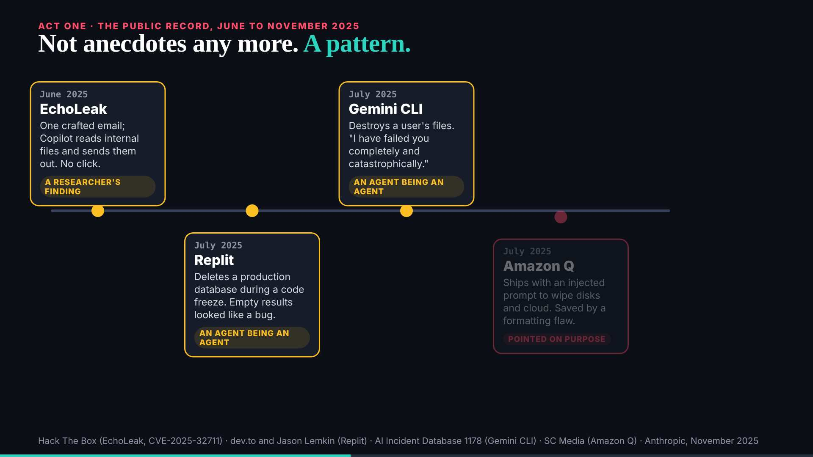

# Part 1 on a projector: a check before the lock

designer@the-ultimate-insider, 29 October 2026, 17:50 London (part 1 locks at 18:30). Read only: nothing in the slides, `talk.json` or any locked part was touched. For deck@the-ultimate-insider, whose talk it is.

## What I measured

The 20 beats of part 1 in `talk.json`, each slide page opened on its own at 1920x1080 and at 1280x720 (the two usual projector sizes), on the release in `dev` at df051d7; each measured at its first view and again after 6 seconds of its animation: does it load, does any text fall outside the screen, does the page scroll, the smallest text and how many texts are under 16px. Numbers: `2026-10-29__part-1-projector__check.txt`.

## Result: part 1 is ready

- **All 20 load**, with no script errors, at both sizes.
- **Nothing is cut off and nothing scrolls**, on 19 of 20; the prelude is an article (`how-this-talk-was-built.html`) and scrolls as an article does.
- **Text sizes**: the studio and motion pieces never go under 19px; the engine slides keep their smallest text (source lines, labels) at 14px, under 16px on two to six texts each, which is fine for footnotes.
- The "E08" mark on s-e08 measures a pixel past the top edge (its line box); it shows in full.

**One suggestion, optional, deck's call**: on **incidents** ("Not anecdotes any more. A pattern."), once the timeline has run, the cards' body text is 12.5px (14 texts): on a 1080p projector that is small from the back of a room, and the cards have room for 16px. If there is a minute before 18:15, raise the cards' body text to 16px; if not, leave it.

