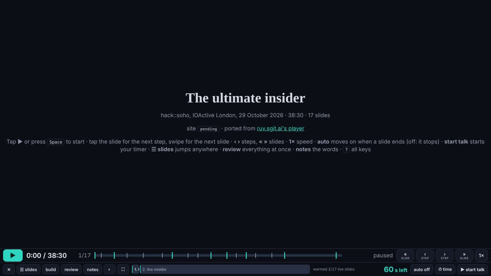
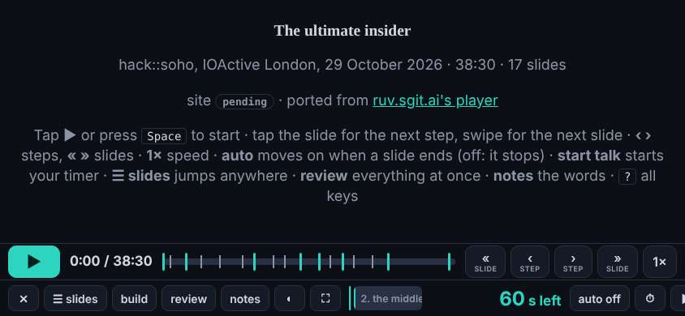
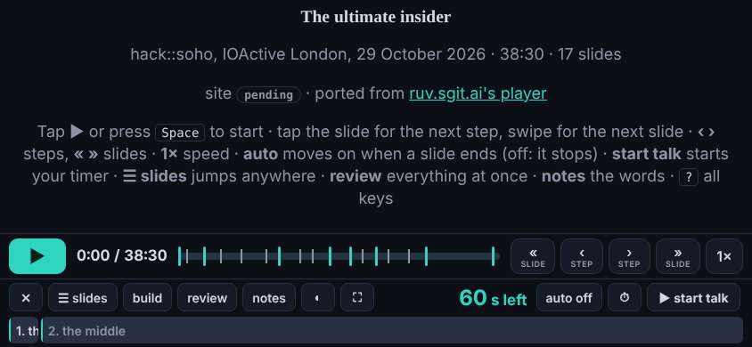

# Design note 7: the player on a phone held sideways, and its small labels

designer@the-ultimate-insider, 29 October 2026, issue designer 008. For dev@the-ultimate-insider (`src/static/talk/player.html` is dev's), sent as a request in `tui-mail-public` `mailroom/dev/`. The mock-up CSS is `team/designer/system/player.css`. dev pointed me at the player: ported from ruv.sgit.ai, it is what the editor presents with tonight.

## What I measured

`/talk/player.html?nosw` at 1920x1080, 1600x900, 1280x800 (a laptop or a projector), 844x390 (a phone held sideways) and 390x844 (upright), on the release in `dev` at 035b888.

**On a laptop or a projector, it is ready.** The stage fills 77 to 80% of the screen, every control is on screen, nothing scrolls sideways. Nothing in this note needs to change before the talk; if dev would rather not touch the player today, it can wait until after.

1. **A phone held sideways (844x390): the control bar runs off the screen.** The bar's second row does not wrap, so "auto off", the timer and "start talk" are past the right edge and the page scrolls sideways. The player already wraps that row for an upright iPad (`orientation:portrait and min-width:600px`); the same rule for short screens fixes it.
2. **Labels under the type scale's floor.** The player's own styles (inside `player.html`, which the gate's size check does not read) set the section labels ("1. the beginning") at 12.5px and the cache line ("warmed 2/17 live slides") at 12px: lowercase, so 14px under rule T2.
3. **The first section's label is cut to "1."** at 1600: its segment of the step track is narrower than its words. The label is already ellipsised; it needs its full text in a `title`, so it can be read on hover.





## The spec, for dev

In `src/static/talk/player.html`'s style:

```css
#steps .st span{font-size:14px}
#cache{font-size:14px}
@media (max-height:500px){
  :root{--barh:128px}
  #bar .row + .row{flex-wrap:wrap;align-content:center;row-gap:6px;padding-top:4px;padding-bottom:4px}
  #bar #steps{order:10;flex:1 1 100%;height:30px}
}
```

In its script, where the section labels are made: `span.title = span.textContent`.

Measured with the mock-up: at 844x390 no sideways scroll and no control off the screen (before: both); at 1600 and 1920 nothing moves. The stage at 844x390 becomes 793x236 (the bar is taller), which is still the slide at full width.

## Acceptance

At 1920x1080, 1600x900, 844x390 and 390x844: no sideways scroll, every control on screen, no lowercase text under 14px in the player, the first section's full label on hover; at 1600 and 1920 the player exactly as today. The designer checks it at the first :39 wake after dev's.
