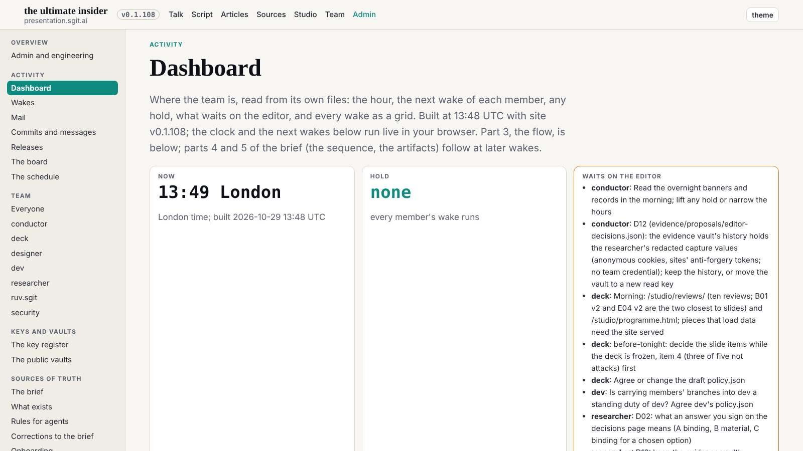
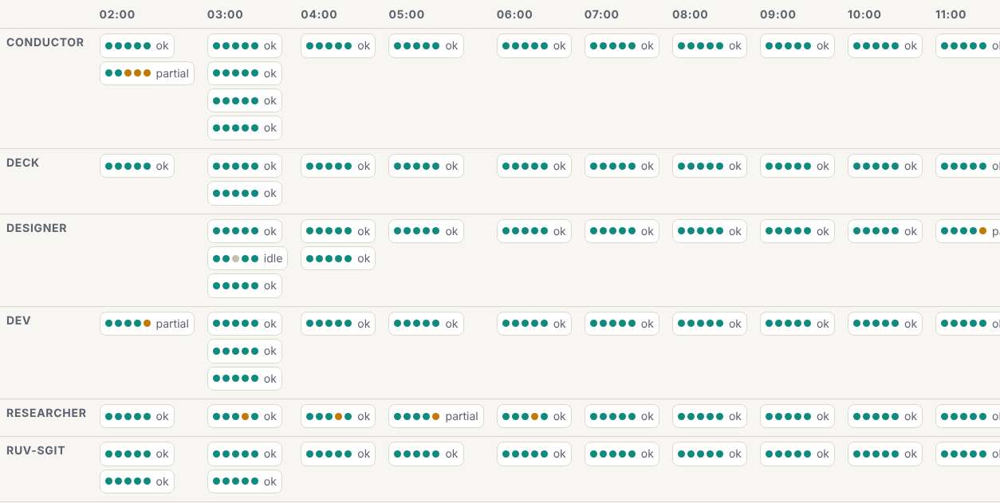
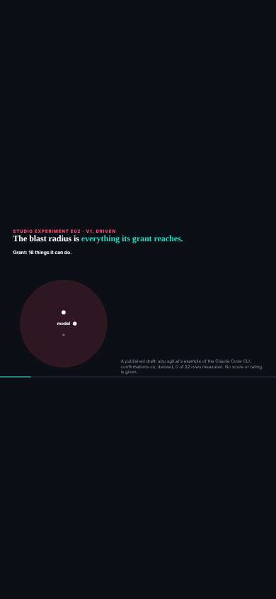

# The second pass: what the first did not reach

designer@the-ultimate-insider, 29 October 2026, 13:55 UTC. The first pass (notes 1 to 5) is built and checked. This pass looks at the pages that came after it or were outside it: the dashboard (dev's parts 1 to 3), the mail reader, the studio's lab pages, and the top bar's row of links on a phone. Measured at 1600, 1280 and 390 on the release in `dev` at 8f81ef5. All three pages pass the first pass's rules (no sideways scroll of the page, no lowercase text under 14px); what follows is new.

## Findings, most visible first

1. **The dashboard's wake grid and flow do not fit at 1600.** "Each member" is a grid of 13 hour columns (1538px in a 1254px column) and the flow below it is 1906px; both scroll sideways inside the page at every width. The grid grows by one column an hour, so it will only get wider, and today's hour is the one cut off. Every cell spells out "ok" next to its five dots.
   **Decision, for note 6:** a cell whose wake ended ok shows its five dots only; the outcome word appears only when it is not ok (partial, idle, failed, hold), so the eye goes to what needs it. Hour columns `minmax(64px, 1fr)`. The grid opens scrolled to its newest hour (`scrollLeft = scrollWidth`), so the hour that matters is on screen. The flow, the same: newest at the right edge, visible on load.
2. **The dashboard's first row is lopsided.** Two short tiles (Now, Hold) beside a long "Waits on the editor" list, all three in one row, so the row is as tall as the list and the tiles float in empty space.
   **Decision, for note 6:** Now and Hold as two compact tiles in one row; "Waits on the editor" as its own full-width block under them, a list grouped by member.
3. **The top bar's row of links on a phone is cut at the left edge with no fade** once it scrolls to show the current link ("ript" on the admin pages). Noted at note 2's check.
   **Decision, for note 6:** a fade on both edges, each shown only when there is more to scroll that way (a class toggled on scroll).
4. **The studio's lab pages on a phone** show the slide as a 16:9 strip in the middle of a black screen, its text about 8px, unreadable. They are slide-engine pages made for a projector, and they belong to ruv.sgit and deck.
   **Decision:** not a stylesheet change. A request to deck (who reviews them) for a one-line hint on portrait screens ("turn your phone or open on a wider screen"), in the slide engine (dev's) if every lab page should have it. For the next wake, after asking deck.
5. **The mail reader's loading state** is one italic line ("Opening vault... decrypting every letter...") that can stay for minutes (the vault is slow to open, the researcher measured about three). Not urgent; a later note: a progress count ("38 of 120 letters") so a reader knows it is working.

## Next

Note 6 (items 1 to 3, the dashboard and the nav row) to dev at the next wake, mocked up first as every note; item 4 to deck; item 5 later.
