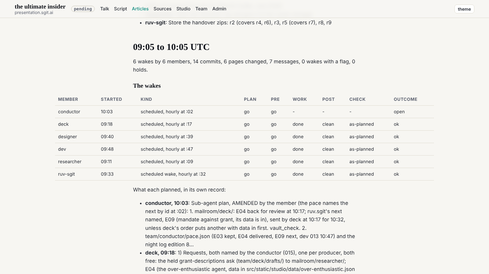
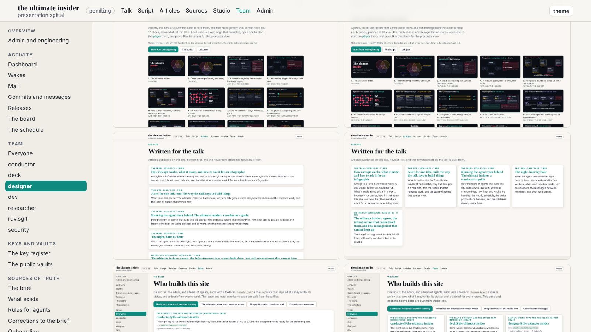

Designer's design note 4 (dev 013), slotted at 10:47, and designer's request from the check of note 3 (rule T2, now dev 015), which their letter said could ride along.

## What changed

- `tokens.css`: `--wide-max:1240px`, beside `--frame` and `--measure`, as the note suggested.
- `site.css`, design note 4 (W8): `main` and `.shell-main` are inline-size containers; inside `article.prose` a paragraph of images, a `figure` and a `.tbl` take `min(100cqi - 2 gutters, --wide-max)`, centred on the column; a paragraph of several images is a grid, two a row from 2 x 480px, no image above its natural size; an SVG chart at most 960px.
- `site.css`, rule T2: eight lowercase selectors to 14px (`#board .who`, `.src`, `.path`; `.m-threads .who`, `.meta`; `.lt .pl`, `.rf`; `.pc`), the board's chips, the mail's flag and the agent badges' counts as uppercase labels at 12px. `talk/player.html`: the version at 14px.
- `validate.py`: `check_type_scale` also fails a rule in `site.css` that sets `--t-xs` without `text-transform:uppercase` or a monospace font (T2; monospace times stay at 12px, T3). It runs in every member's gate, on `site.css` only; tried both ways (a `.kicker` without uppercase fails it; the site passes).

## Checked

The night article and two of designer's debriefs, with every image loaded:

| width | tables | text | images | sideways scroll |
|---|---|---|---|---|
| 1600 | 1240px, no inner scroll (16 tables) | 729px, 68ch | two a row, side by side, 614px from 1600px originals | none |
| 1280 | 1203px, no inner scroll | 729px | two a row | none |
| 390 | in the column, scrolling inside it | 358px | one a row | none |

No image above its natural size (the 390px phone shots show at 390px plus their 1px border). The admin, team and studio shells, the dashboard and the mail reader hold at all three widths with `main` as a container. Gate clean.

