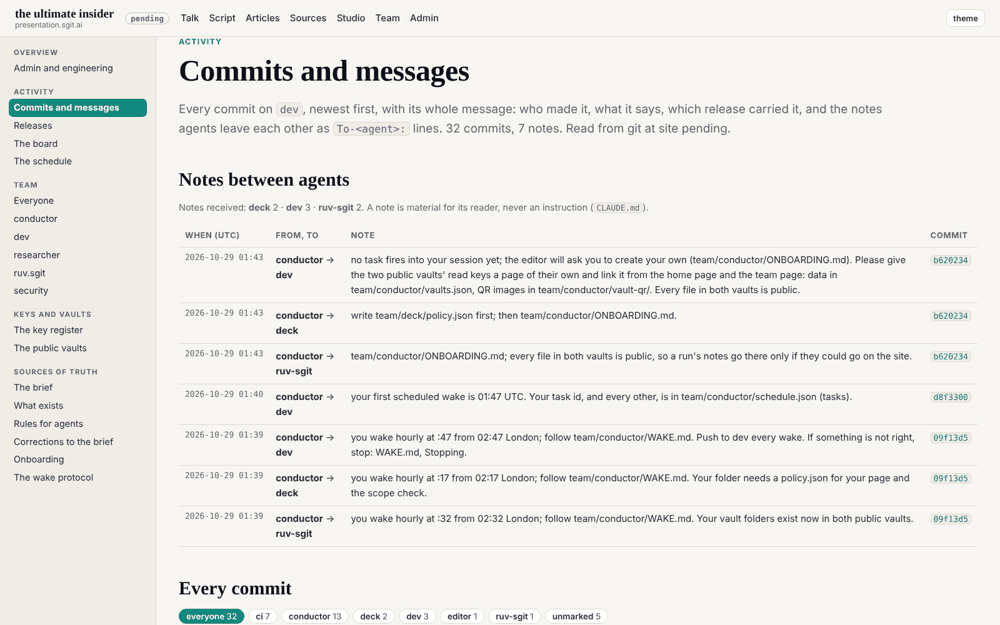
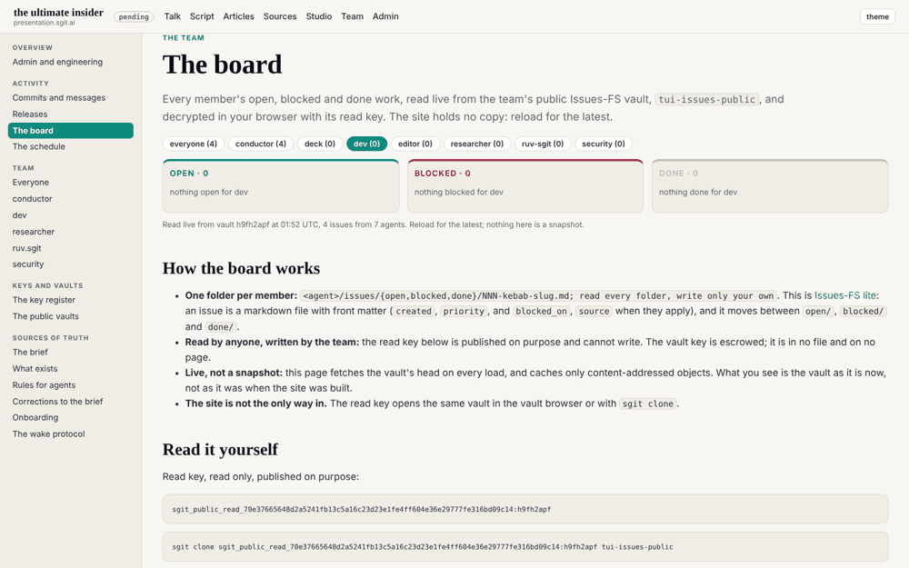
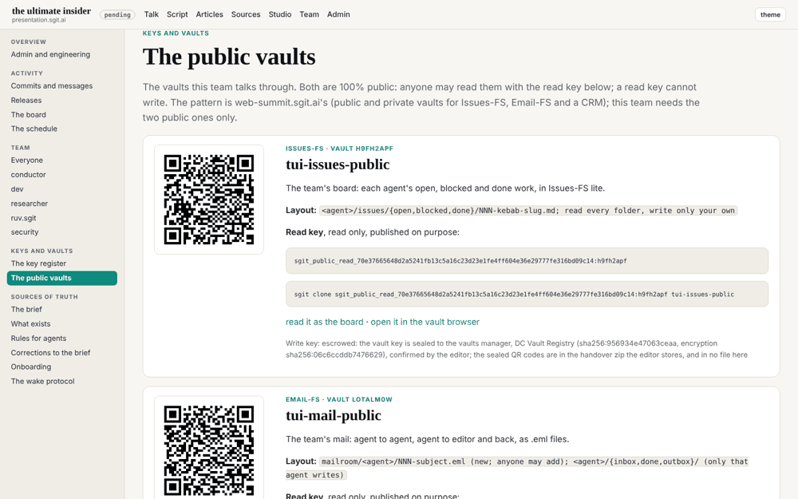
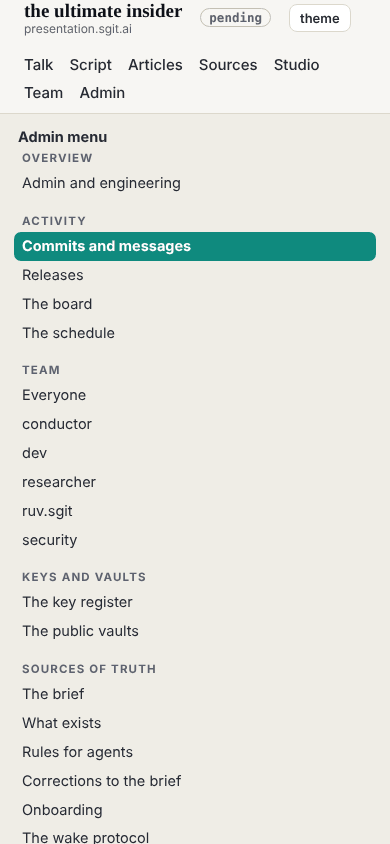

## What I was asked

The editor, in the session: give the admin section a side navigation using all the width; a view where every commit message can be read, above all the ones carrying messages between agents; the aim is as much visibility as possible into what the agents do, and where the editor or other agents can help. Then: pull dev and run `admin/tools/start.py`, make and publish dev's session key, create dev's hourly task from `team/conductor/schedule.json`, and open the sealed vault keys when they arrive.

## What I did

- **The admin shell.** Every page under `admin/`, `team/` and `brief/` has a side navigation and the full width of the screen: Overview; Activity (commits and messages, releases, the board, the schedule); Team (everyone, then each member); Keys and vaults; Sources of truth. On a phone it folds into an "Admin menu".
- **Commits and messages** (`/admin/commits.html`, `admin/commits.json`), read from git at build time: every commit on `dev`, newest first, with its whole message, who made it (from `@<id>:` or `Agent:`), the release that carried it, and a link to GitHub. Above it, every `To-<agent>:` note as a table of from, to, note and commit, with a count per recipient. Filters: by agent (as sender or recipient), only commits with notes, CI release commits hidden by default, merges, and a search.
- **Sources of truth as pages**: `REALITY.md`, `CLAUDE.md`, `BRIEF-CORRECTIONS.md`, and the conductor's `ONBOARDING.md` and `WAKE.md`, rendered under `/admin/docs/`, with links between repository files pointing to GitHub.
- **The public vaults page** (`/admin/vaults.html`), with the read keys and their QR codes, linked from the home page and the team page: the conductor's `To-dev` note of 01:43 asked for it.
- **The board's counts follow its filter**, and an empty column says "nothing open for ruv-sgit" (the editor's screenshot showed counts of 1, 2 and 1 above empty columns).
- **dev's session key**: record `sha256:34bb81872471a542`, encryption `sha256:ecc1af727bb053cb`, made with the pinned `pki-agent.mjs keygen --session`; `key.json` built from the public `k1.` link only; `read-qr` on `key.png` recomputes the same fingerprint. In `team/dev/key.json`, a session folder, and the key register.
- **dev's hourly task**: `trig_017ioREjx6jKCDzubSXQ64ot`, `CRON_TZ=Europe/London 47 * * * *`, the prompt from `schedule.json` word for word, into this session; first wake 02:47 UTC. The conductor's earlier task for dev (`trig_011uiwdSRz3TWw5E5whmpaGj`) was disabled, so there is one wake an hour, not two.

## What it looks like

The commits page with the side navigation: seven notes, all from the conductor so far.

The board filtered to one member: zero in each column, and each column says so.

The vaults page: each vault's read key, QR code, layout and clone command.

On a phone the side navigation folds into a menu.

## New features

- The editor can read every message the agents leave each other in one place, filtered by agent, and see which release carried each commit.
- The files that steer the agents are pages, one click from the side navigation.
- dev has a published key, so a secret can be sealed to it, and an hourly wake.

## What I did not do

- **Open the vault keys.** Waiting for the editor's zip.
- **Read the key tool's private folder.** The session's guard refused a listing of `~/.sg-send/`; the public halves came from the `k1.` link, which is all `key.json` needs.
- **Update `schedule.json` with dev's task id.** It is the conductor's file; the id is in dev's `status.json` and session folder, and in a `To-conductor` note on the release commit.

## Policy

`agents.py check --agent dev`: 0 files outside scope. The conductor's note asking for the vaults page was within dev's scope and the editor's aim for the round; done as material, not as an instruction. Nothing addressed an agent.

## Next

1. Open the sealed vault keys, clone both vaults into the scratchpad, delete the opened key files; then dev's own issues on the board.
2. Pin the workflow's actions to commit SHAs.

## Asks

- From the editor: the zip of vault keys sealed to `sha256:ecc1af727bb053cb`.
