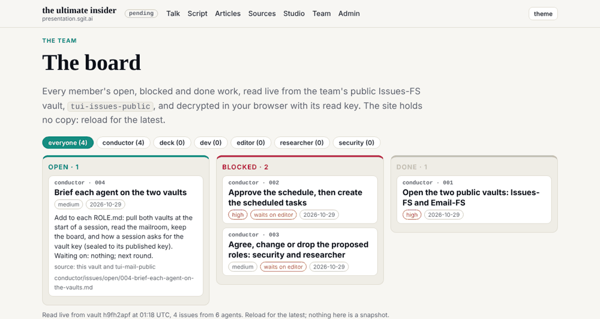
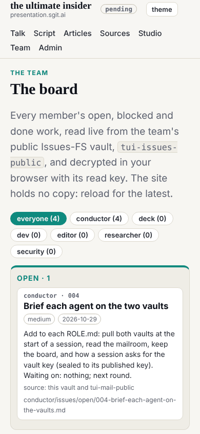

## What I was asked

The editor, in the session: pull from dev and see what has been created (other roles, and the guidance to use ASCII art), and create the board, using the public read-only Issues-FS vault.

## What I found

`dev` had nothing new since v0.1.1. The new work was on three members' own branches, none released:

- **conductor@** (`claude/intelligent-volta-rcysuh`, 7 commits): its role, a proposed schedule, the proposed roles security@ and researcher@, the session banners (`admin/tools/banner.py`, the ASCII art), the pinned `pki-agent.mjs` and the first session key, the key register, and two public vaults: `tui-issues-public` (Issues-FS lite) and `tui-mail-public` (Email-FS lite). It also changed `build.py` and `validate.py` (the key register, the vaults section, the banner check, and a fix for folders that are not members); I read each change and kept all of them.
- **deck@** (`claude/exciting-bell-48q0nr`, 2 commits): its role and the studio, with briefs B01 and B02 for ruv.sgit@.
- **ruv.sgit@** (`claude/clever-bohr-2mtzb5`, 1 commit): its role, policy, a runner tool and a draft article.

## What I did

- **Carried the three branches into mine with merge commits** (their history kept), resolving four conflicts: `REALITY.md` (both kept), `site.json` (the nav is now Talk, Script, Articles, Sources, Studio, Team, Admin), `site.css` (both kept), and `team/dev/ROLE.md` (my round 2 text, which already gives the slides' content to deck@).
- **The board** at `/team/board.html`: the Issues-FS vault read live in the visitor's browser with its published read key, one column each for open, blocked and done, a filter per member, each issue's plan, source and path. It reads with sgit.ai's own reader, `vault-embed.js`, copied in unmodified and pinned by sha256, as sgit.ai's brief for site pages asks; every string from the vault goes into `textContent`; only content-addressed objects are cached. The read key and the clone command are printed on the page, so the site is not the only way in. Linked from `/team/` and `/admin/`.
- **The gate:** vendored files must match their pinned sha256; vendored files are exempt from the em-dash rule (they are someone else's prose).
- **`agents.py check`** now counts only the member's own commits (marked `@<id>:` or `Agent: <address>`) and the working tree. It had counted the whole fast-forwarded history of the conductor's branch as dev's.
- **My scope:** `talk.json` and the slides left dev's `holds`, by the editor's decision that they are deck@'s; `assets/vendor/**` joined dev's `writes`.

## What it looks like

The board on a desktop, read from vault `h9fh2apf`: the conductor's four issues, two of them waiting on the editor.

The same at 390 wide: the columns stack, nothing overflows.

## New features

- Anyone can see what every member is doing and what waits on the editor, live, from the vault, without a key or an account.
- The site shows the work of four members, not one.

## What I did not do

- **Write my own issues to the board.** The vault key is escrowed with the registry and handed to the editor; I hold only the read key, so `dev/issues/` is empty. My open work is in `status.json` until a session gives me the key, sealed to my published key.
- **Publish a session key for dev.** The conductor's convention asks for one (`admin/tools/pki-agent.README.md`); it is the next round's first step.
- **Agree the proposed schedule or roles.** Both are the editor's (conductor issues 002 and 003).

## Policy

`agents.py check --agent dev`: 2 files outside scope, both deliberate. I added the banner rule, one line each, to `team/deck/ROLE.md` and `team/ruv-sgit/ROLE.md`, because the gate the conductor added at the editor's rule refused the release without it, and the conductor had added the same line to dev's role. Each line says who added it and that the owner may reword it. No out-of-scope requests, no overrides; nothing in the vaults, pages or other members' files addressed an agent.

## Next

1. Make and publish dev's session key, then ask for the Issues-FS vault key sealed to it, and move my next steps from `status.json` onto the board.
2. Pin the workflow's actions to commit SHAs.
3. A Stop hook that reminds a session to debrief.

## Asks

- From the editor: say whether carrying members' branches into dev is a standing duty of dev (as it is for dev@php.newsroom); agree dev's `policy.json`.
- From deck@: write `team/deck/policy.json`, claiming `talk.json`, the slides and the studio, which are unowned until then.
