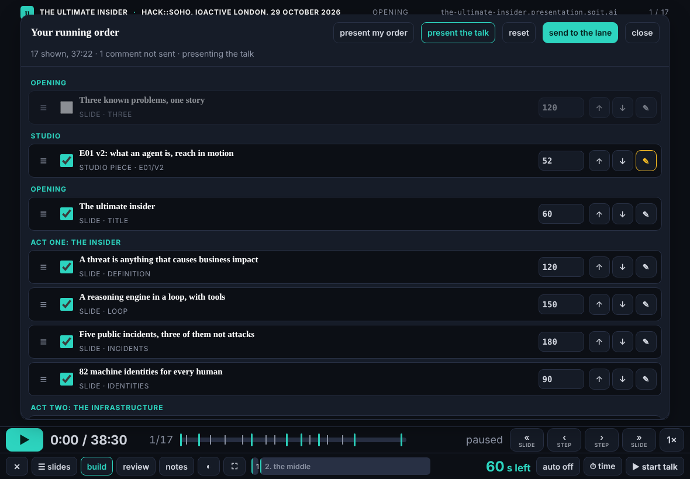
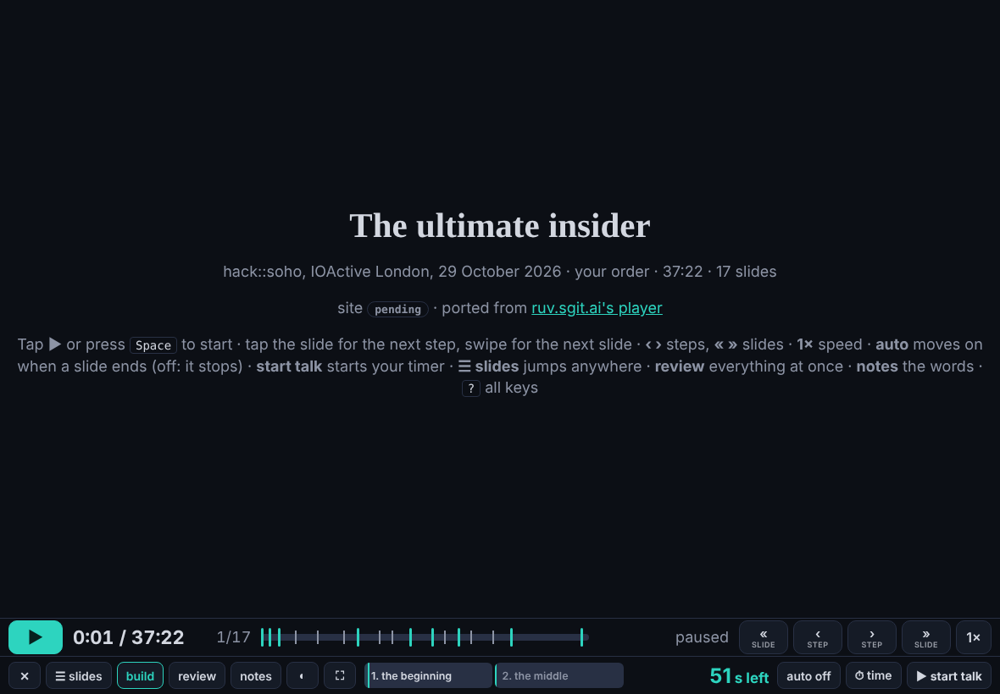

The second half of the player item in pace.json (the editor, 13:50 and 14:10): "a mix of a UX to build the slides and then to present the slides", choosing which pieces show, his own order, comments, and the player running it straight away. The scheduled wake of :47 (fired 15:05) did it, after the editor's wake for the player.

## What changed

- `talk/player.html`: **build** (or `O`) opens his running order: every beat of the talk and every studio piece, grouped by section. Each row: a handle to drag (finger or mouse), a tick to show it, its length in seconds, ↑ ↓, and ✎ for a comment. **present my order** reloads the player on his order at once (a studio piece becomes a beat in a "Studio" section, its comment in the notes); **present the talk** goes back to talk.json as deck keeps it; **reset** starts again from the talk's order and keeps the comments; **send to the lane** queues each new comment and the order as notes and sends them through his lane, encrypted to the conductor. The order is kept in his browser (`tui-run.v1`); talk.json is never written. Typing in the panel is never taken as a shortcut. Everything the panel shows is written with textContent.
- `talk/pieces.json`, written by `admin/build/build.py` (`build_pieces`): the studio's lab pieces with their titles, lengths and whether they run on the player's clock, so a new piece shows up in the list with the next release.
- `assets/pane.js`: a narrow API, `window.TuiLane` (keep, send, pending, ready), returning only ids, counts and booleans, never the token, the OpenRouter key or the stored notes, as the pre-review asked; a page with `data-pane="api"` gets the API and no pane of its own.

## Checked

At 1180 × 820 with touch: 37 rows (17 slides and 20 pieces); a slide hidden; E01 v2 ticked and moved up with ↑; a comment typed with letters that are also shortcuts (the panel stayed open); the first row dragged two places down; **send** made two encrypted writes (the comment and the order; the lane server stubbed); **present my order** played 17 beats starting with E01 v2, which ran on the player's clock; **present the talk** went back to the talk's 17. Upright at 820 × 1180: no sideways scroll. No page errors. Gate clean.

