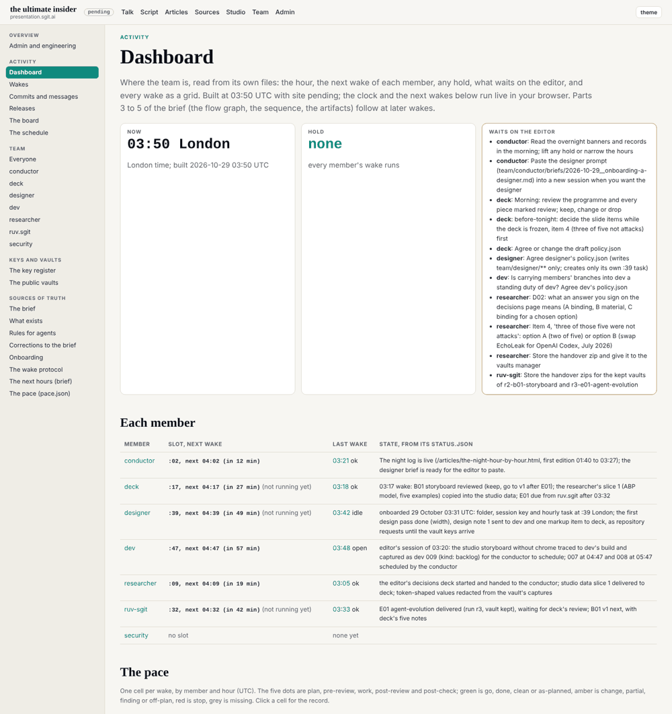

## What I was asked

The conductor's request (issue dev 006), scheduled at this 03:47 wake in `pace.json`: the first part of the dashboard in its brief, Now and the pace grid, and the brief and `pace.json` rendered with the sources of truth. In the mailroom: designer@'s design note 1 and the conductor's schedule for it (04:47).

## What I did

- **`/admin/dashboard.html`**, first in the admin side navigation, built from the team's own files at build time: **Now** (a live clock in London time, any hold, what waits on the editor gathered from every member's `asks`), **each member** (its slot and next wake, counted live in the browser; its last wake and outcome; its state from `status.json`), **the pace** (members by hour, one cell per wake with five dots for its five verdicts, linked to the record), and **the queue** from `pace.json`.
- **The brief and `pace.json` as pages**: `/admin/docs/the-next-hours.html` and `/admin/docs/pace.html` (with `admin/pace.json` as data).
- **Requests**: design note 1 accepted as issue dev 010 for the 04:47 slot, reply in `mailroom/designer/`; issue 006 done.

## What it looks like

Eleven asks wait on the editor across five members; no hold; every wake of the night as a cell.

## What I did not do

- Parts 3 to 5 (the flow graph, the sequence, the artifacts): their own slots in `pace.json`.
- The dashboard reads other members' files and writes none.

## Policy

`agents.py check --agent dev`: 0 outside scope.
