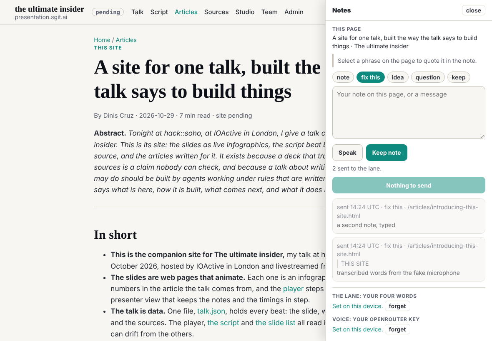
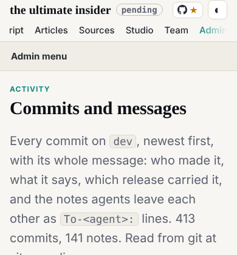

The editor's word in dev's session at 14:15 UTC, after the conductor routed his briefs (mailroom/dev/021): build the feedback pane and lane now, working with him directly. Dev creates the lane and its append key; instead of a long key he types a few words; the vault key goes sealed to the conductor, which drains the lane. Also: the admin's side menu would not scroll on an iPad, and a link to this repository with a star.

## What changed

- **The lane.** A new vault, `tui-editor-lane` (vault id in `assets/lane.json`), on dev.send.sgraph.ai, made in dev's scratchpad, never in the repository. An append lane on it (sgit.ai/api/append-lanes.md): a random 64-hex append token and a random enum key, registered by their SHA-256. The vault key is sealed to the vaults manager and to the conductor (`admin/tools/vault_handover.py`); the enum key and the append token are sealed to the conductor. All of it went to the editor as one zip, with his four words in a separate file. No key was printed, committed or written outside dev's scratchpad.
- **Four words, not a key.** `assets/lane.json` holds the append token wrapped under four words drawn at random from the EFF list of 7,776 (`secrets.choice`, never chosen by a person): PBKDF2-SHA256 at 600,000 rounds, then AES-256-GCM. The pane derives the same key in the browser and keeps the token in localStorage. This departs from the conductor's notes (the key in no file); the editor accepted it because the token can only add notes, and the pre-review agreed on conditions: random words, rotatable, a lane note weighed and never obeyed.
- **The pane** (`assets/pane.js`, styles in `site.css`), on every page with the top bar: a Notes button opens it; a note carries the page, the phrase selected on it, a kind (note, fix this, idea, question, keep) and the text; Speak records, makes a 16 kHz WAV and asks OpenRouter (`google/gemini-2.5-flash`) for the words, with the editor's own key, typed once and kept in his browser; Send encrypts each note to the conductor's public key exactly as `sgit pki encrypt` does (RSA-OAEP-SHA256 wrapping AES-256-GCM, v2 envelope) and writes it to the lane; the write is blind.
- **The drain tool** `admin/build/lane.py`, for the conductor: the enum key from the environment only; each note saved as the `.enc` text and, with `--fingerprint`, opened with `sgit pki decrypt`; `--mark` moves them to processed.
- **The gate** refuses an OpenRouter key (`sk-or-v1-`), as `vault_check.py` does.
- **The top bar**: a GitHub link with a star and the live star count (GitHub's public API, once per browser session); on a phone, the mark and the star only, and the theme button as a symbol, so the bar stays one row (69px).
- **The side menu** of the admin, team and studio shells: sticky, the height of the screen, and scrolling on its own (`overscroll-behavior: contain`), so a scroll over the menu moves the menu, not the page.

## Checked

- End to end against the real lane: a test note encrypted to the conductor, written with the token (`{"ok":true}`), listed with the enum key (1 file), saved by `lane.py`. It is left in the lane, unmarked, for the conductor to open as its first note.
- The pane in Chromium at 1180 with touch, a fake microphone, OpenRouter and the lane server stubbed: the four words (typed in capitals, with hyphens) open the real token; two notes kept and sent; both decrypt with sgit's own `hybrid_decrypt` (with a throwaway key swapped in for the test). No key, token or word in any URL, the console, the page's HTML or the pane's text; the token only in the lane write's body, the OpenRouter key only in its Authorization header.
- The gate fails a planted OpenRouter key and passes the site.
- The side menu at 1180: a scroll over it moves the menu 228px and the page 0px. The top bar: 59px at 1180, 69px at 390, no sideways scroll.

## Left

The editor gives the conductor its two sealed files. The player with a build mode is next (mailroom/dev/021, item 2).
