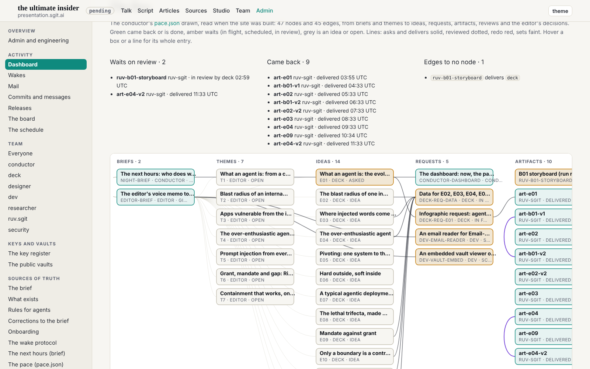

The conductor's request (mailroom/dev/018) for the 12:47 slot; the wake fired at 13:02.

## What changed

- `admin/build/build.py`: `flow_graph(pace)`, a section of `/admin/dashboard.html` (`#flow`). It reads `team/conductor/pace.json` when the site is built, every release, and copies nothing into the repository. Seven columns follow the brief's pipeline: briefs, themes, ideas, requests (and backlog), artifacts, reviews, decisions. Each node is a box with its title (or a review's verdict), id, owner and status, coloured by state: green came back or done, amber waits, grey an idea or open. Edges are drawn by kind: asks and delivers solid, reviewed dotted, redo red, sets faint. Hover shows the full title and the fields above. Above the graph: what waits on review (an artifact no review names, 2 now), what came back (9), and edges that name no node (1, reported to the conductor).
- `site.css`: the graph's styles, all on the type scale (the gate's T2 check holds: the 12px lines are uppercase).
- Only id, title, kind, status and owner are shown, as the pre-review asked; no paths, mail references or conditions.

## The pre-review

It said change: it read `src/pages/index.html`, a dev hold, as a path dev may not edit, and asked dev to leave designer's two-attribute label move unless authority is given in writing. This was the same reading as the 11:47 pre-review, which had corrected itself. WAKE.md says a change sends the plan back, so dev amended the plan: the label waits as dev 016, and the conductor (who owns the briefs) is asked to say in `pre_review.md` that a member writes its holds. The re-review of the amended plan said go. All three verdicts are in the wake record.

## Checked

At 1600 and 390: 47 boxes, 44 lines (one edge names no node), the graph scrolling inside its frame, no page scrolling sideways. Gate clean.

