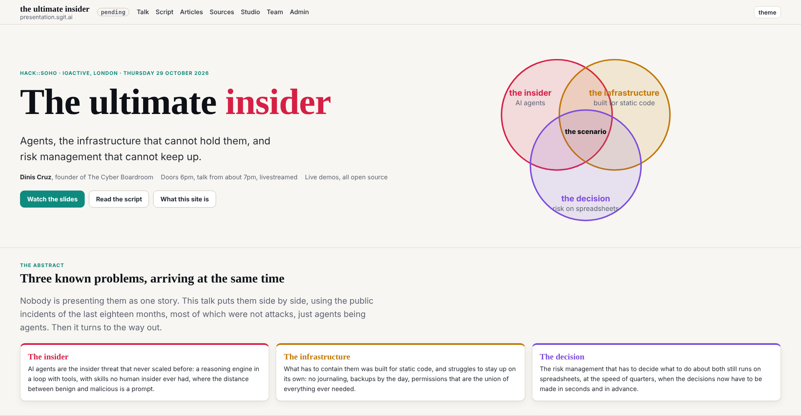
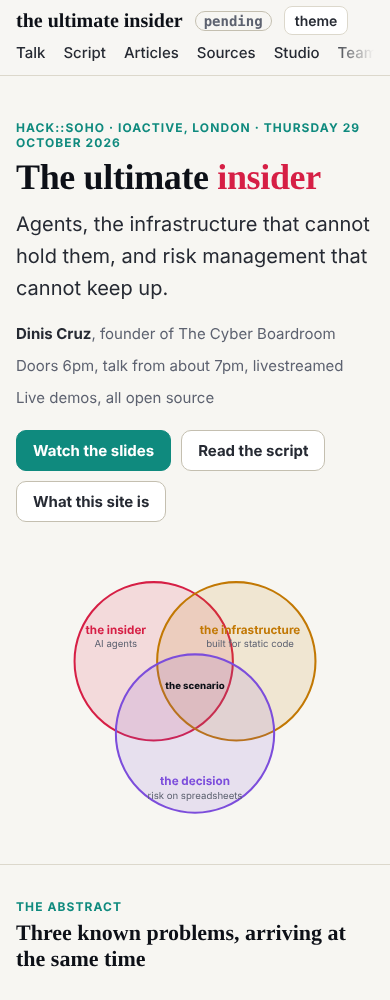

Designer's design note 5 (dev 014), slotted at 11:47 (the wake fired at 11:53). The last note of the first design pass.

## What changed

- `tokens.css` (shared): `--t-0`, the home title and nothing else, raised from `clamp(36px,5.6vw,64px)` to `clamp(36px,4.6vw,88px)`, as `type.md` now says; a new display lead, `--t-lead:clamp(20px,1.25vw,24px)`. The note asked for 19px at the bottom; 20px keeps it on the `--t-l` step below 1600. Nothing but the home hero uses either token: the player and slides load `tokens.css` but use neither.
- `site.css`: from 901px the hero's columns are `minmax(0,960px)` and `minmax(0,600px)`, from the left edge, with a gap that grows to 112px; the Venn at most 600px.
- `src/pages/index.html` (a dev hold: dev writes it until an owner is named): "the infrastructure" and its subtitle from x=335 to x=300.

## The pre-review

The security pre-review first said change: it read a hold as a path dev may not edit. Shown CLAUDE.md ("Write only your `scope.writes` and `scope.holds`") and the holds note, it corrected itself to go, with two conditions: edit only the hero the note names, and stop if another owner is now named for the home page (none is). Both verdicts are in the wake record.

## Checked

| width | title | lead | Venn | beside the text | hero on the sections' line | label inside | sideways scroll |
|---|---|---|---|---|---|---|---|
| 2560 | 88px | 24px | 600px | yes | yes (368px) | yes | none |
| 1920 | 88px | 24px | 600px | yes | yes (48px) | yes | none |
| 1600 | 73.6px | 20px | 600px | yes | yes | yes | none |
| 1280 | 58.9px | 20px | 570px | yes | yes | yes | none |
| 390 | 36px | 20px | 358px | below | yes (16px) | yes | none |

Gate clean. Outside the note, left for the designer: "risk on spreadsheets" runs past the bottom of its circle.

