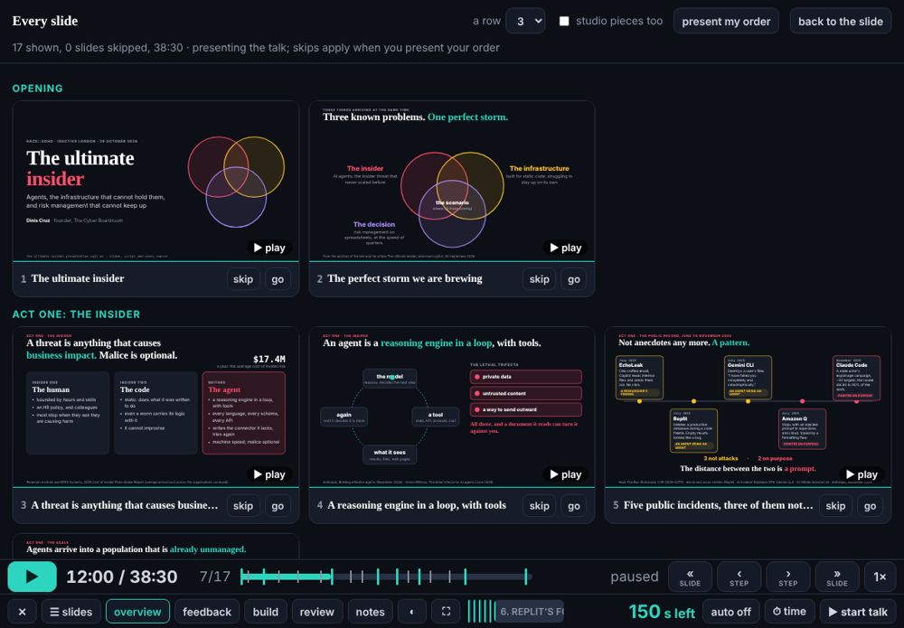
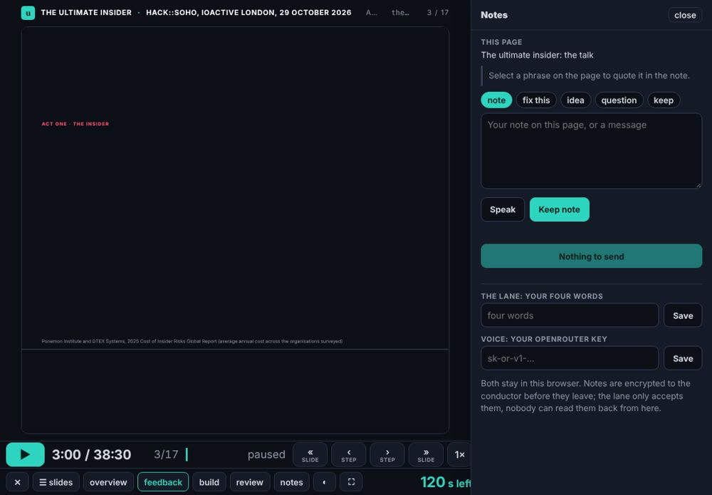
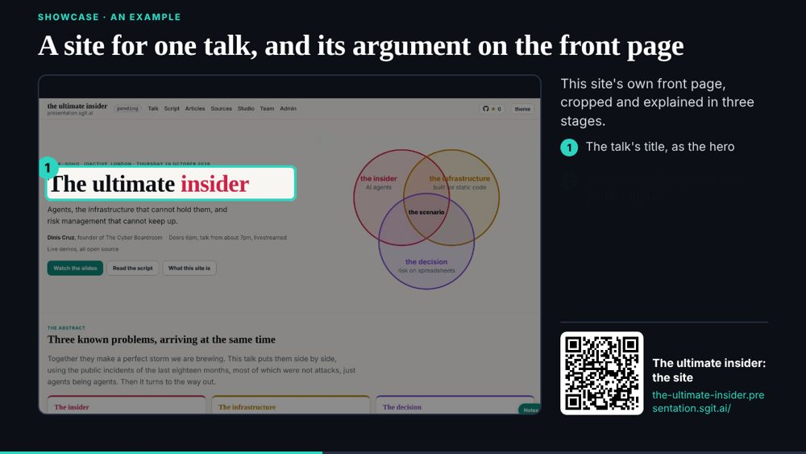

# The player's overview, offline from a cold start, and the showcase template

## The editor's wake, 16:24 (in session)

The editor's words (16:20): the talk is 90 minutes; screenshots of the team's websites; every transition its own step; ←/→ by step and on into the next slide, ↑/↓ by slide; an overview of every slide by section, a choice of how many a row, each playable, each skippable through his order and lane; Esc back to the slide; the feedback pane on the right of the player.

- **A step per reveal.** `talk/engine/slide.js` derives one step per `data-in`, `-on`, `-count`, `-grow` and `-draw` when a piece declares none, named by its text (the infrastructure slide: Recovery, Identity, Permissions, Containment ...). Fewer than two reveals keeps the beginning and the middle.
- **Keys.** → walks every reveal and on into the next slide; ↑ is always the previous slide; Esc closes the overview, the picker, the build panel, help and the pane. A link `player.html#infrastructure` opens on that slide, and the address follows the slide.
- **The overview (W).** Every slide by section, 2 to 6 a row (kept), lazy frames, tap to play and tap to stop, skip or show into his running order (`tui-run.v1`), go.
- **The feedback pane (E)**, docked on the right; the stage moves over; each note names its page and slide. `assets/pane.css` split from site.css and under the gate's type-scale check.
- **Offline from a cold start.** The editor asked, on his way to the venue, whether it works offline. It did not: the player's own files were fetched before the worker took over, so a reload with no network had the shell and no slides. The player now fetches its own files again once the worker controls the page. Tested live (v0.1.155): three cold reloads offline, all 17 slides, first to last. "✓ ready offline: all 17 slides" now stays on the bar.
- Released before the post steps, to have it on his iPad before the tube; the post-review (clean) and post-check (partial, with the facts beside it) ran at 16:5x.

## The scheduled wake, 16:47

- **The conductor's 030: the showcase slide template.** `talk/engine/showcase.js`, `showcase.css`, `qrcode.js` (qrcode-generator, MIT, vendored from `admin/tools/pki-agent.mjs`), `showcase.md` (how to fill one, and the rule: no key in any screenshot, cropped out of the image itself) and `talk/engine/showcase-example/`. A slide is its JSON: a screenshot, a crop per stage, numbered callouts, the title, the link and a QR of the link; each stage is a step. Nothing in the player changed (the pre-review's condition before 19:00).
- **Linux in the browser in the player**: after the talk (dev 027). **Design note 8** (designer 033): after the talk (dev 028).

