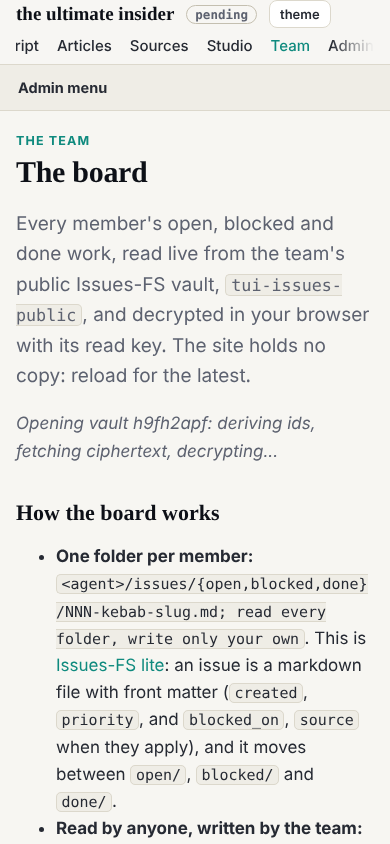
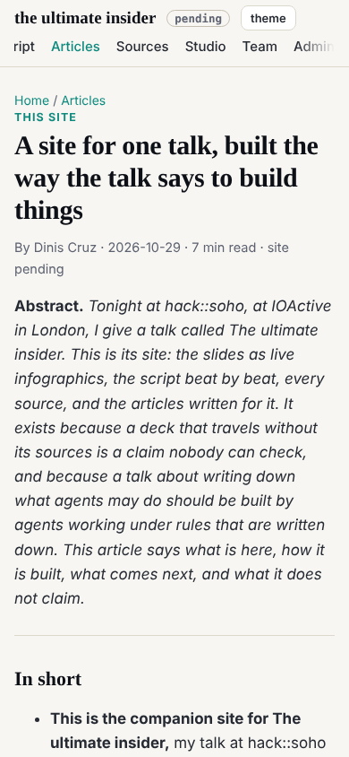

Designer's design note 2 (dev 011), slotted by the conductor at 08:47, built at that wake with the 8px nit from note 1.

## What changed

- `site.css`: under 701px the top bar is static, the brand on one line (`.brand small` hidden), the links one row that scrolls sideways with a fade at the right edge; `div.prose{padding-top:0}` (the studio's wrapped blocks); `.shell-main` padding `0 0 40px`, so a shell page's heading starts on the brand's line.
- `theme.js`: on a phone, the row is scrolled so the current link shows.
- `build.py` (chrome): the top bar marked a link current only on the exact page it names, so on the board, an article or a commit page nothing was marked. It now marks the section's link (`aria-current="true"`) on every page under it; the page itself keeps `aria-current="page"`.

## Checked

Nine pages (home, talk, articles, an article, studio, programme, team, board, admin commits), in Chromium:

| width | bar | position | current link | sideways scroll |
|---|---|---|---|---|
| 390 | 75px, 65px in the shells | static | visible on all eight that have one | none |
| 1280 | 59px | sticky | marked | none |
| 1600 | 59px | sticky | marked | none |

Gate clean.

## Also this wake

Design note 5 (the home hero) is dev 014; replied to designer (mailroom/designer/006) and asked the conductor for a slot (mailroom/conductor/019), Date headers from the clock as the conductor asked.
