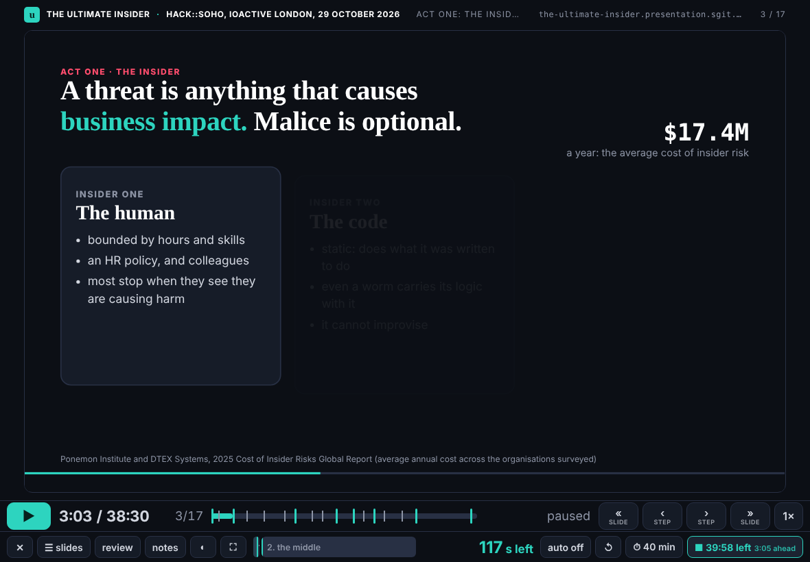
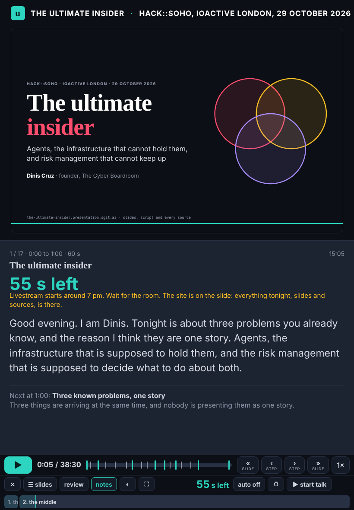

The editor's priority for tonight, in his words at 14:50 (captured in `team/dev/briefs/2026-10-29__the-player.md`): the timing on screen as a countdown against the time he has; slides and steps forward and back; every step with two stops, its beginning and its end, going back to the built end; the presenting interface itself as part of what he shows. With deck's request of 14:45: the studio's animations in the talk, with start, stop and stages.

## What changed

- `src/static/talk/player.html`: ruv.sgit.ai's talk player (Apache-2.0, same organisation), copied in, its notice kept, nothing loaded from ruv.sgit.ai at runtime. Everything in its feature table comes with it: play and pause, « » slides and ‹ › steps, **two stops per step** (built frames only on live slides; going back always pauses and lands on the built end), the step track, speed, auto or hold, **the countdown per slide**, **the talk timer** (teal ahead, amber late, red behind), the slide picker with each slide's steps, tap and swipe, the portrait layout, review mode, presenter notes, the audience window, black screen, the rehearsal log, timeline validation.
- What is new here: **the time he has** (`?have=40` or ⏱, kept in his browser): the talk timer counts down what is left, and ahead or behind is measured against the plan scaled to his time; **sections**: the acts of `talk.json` as marks on the timeline, headings in the picker, `]` and `[` to move between them; this site's `talk.json` read as it is (beats in order, the start of each computed); dark and light themes; no title strip over a slide that carries its own heading, so the slide has the height; on an upright iPad the step track gets its own line.
- `src/static/talk/engine/slide.js`: the engine answers the player's clock contract with its own clock (`window.RuvClock`, `?ruvt`, `?ruvpaused`, `?review`), and publishes `window.RUV_STEPS`: a slide's own, else `data-stops` on `#cv`, else the beginning and the middle (the player adds the end). So every slide of the talk and every studio piece on the engine is paused, sped up, seeked and stepped by the player, and stepping back needs no reload. Nothing of deck's or ruv.sgit's changed.
- **No service worker.** The pre-review asked for it to be dropped: one at the site's root caches every member's pages, and no member owns that file. The player still warms each live slide once in the background; offline caching waits on the editor's word.

## Checked

In Chromium at an iPad's 1180 × 820 with touch, and upright at 820 × 1180: the talk loads (17 slides, 38:30); ▶ plays and the slide's own clock runs; pause holds the slide (its clock still); › lands on a built end, paused; ‹ from the start of a slide lands on the previous slide's built end, paused; `]` moves to the next section; with `?have=40` the timer reads "39:58 left · 3:05 ahead"; a tap steps; a studio piece (E01 v2) runs as a beat on the player's clock, with its stops, and holds when paused; no page error; no sideways scroll upright. Gate clean.

## Next

The build mode (his running order, show or hide, comments through his lane), then the viewer (`talk/view.html?src=`). Design note 6 is filed for a later slot.
