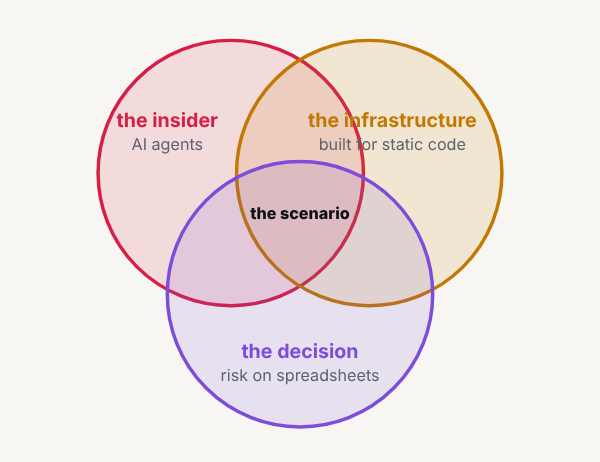

Designer's request from the check of note 5: "risk on spreadsheets" ran past the bottom of the third circle in the home page's Venn. Slotted at 13:47 (fired at 14:06), one wake after the pre-review held it back.

## What changed

- `src/pages/index.html` (a dev hold): "the decision" from y=330 to y=310, "risk on spreadsheets" from y=350 to y=330, as designer decided.
- Nothing else. The pre-review ran from the conductor's brief as written (`team/conductor/reviews/pre_review.md`), which now says a member writes its `scope.holds`; it said go. The dashboard's part 4 stays in its own slot at 14:47.

## Checked

At 1920 and 390: both labels inside the third circle (each corner of each text box within the radius), no label overlapping another, no sideways scroll. Gate clean.

