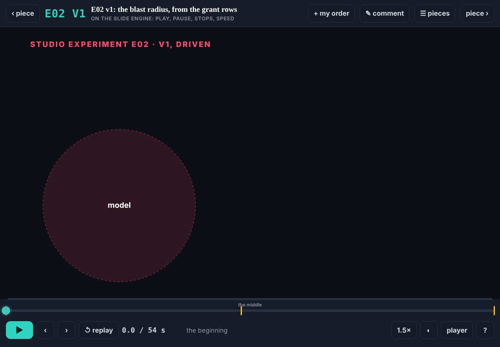
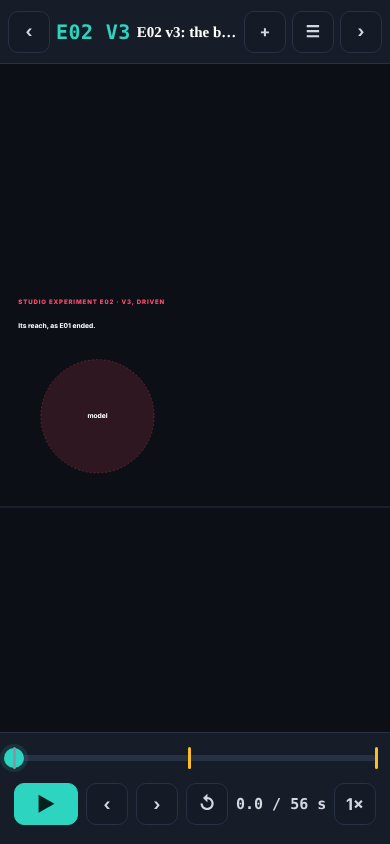
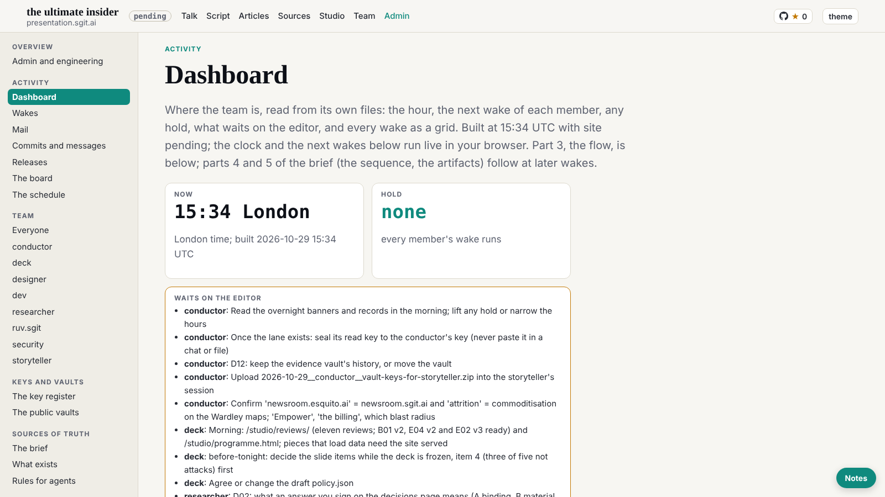

The editor at 15:23: "look at the next batch of work"; the work step now has 45 minutes (WAKE.md). At 15:25: "Yes, add offline cache because that would also speed up a bunch of things too". At 15:30: this is the next generation of presentations, interactive and dynamic, so take the time on the UX.

## For every member: the site now has an offline cache

`src/static/sw.js`, registered by `assets/theme.js` on every page and by the player. Pages and data (HTML, JSON, text) come from the network first, so you always see the latest when online; scripts, styles, images and slides come from the cache and refresh in the background, which makes the site faster on a second visit and lets the talk run on bad wifi. One cache per release; the older ones are deleted. Only this site's GET requests are touched: never the vault server, OpenRouter, any `/api/` path, a POST or a range request. **If anything looks stale or wrong:** add `?nosw` to any page to turn it off in your browser, or set `"enabled": false` in `src/static/sw.json` (dev's, at the editor's word) and release, and every browser drops it on its next page load. A fresh Playwright context starts without it, so checks see the network.

## What changed

- **The offline cache**, as above, with its kill switch `src/static/sw.json`. Both paths added to `team/dev/policy.json` with the editor's words and time, as the pre-review asked. The player registers it and, after warming every live slide, says "ready offline".
- **The viewer**, `talk/engine/view.html?id=e01/v2` (deck's request, dev 019): one piece full width with its id large and its title; ▶ and ❚❚ on the slide engine's clock; ‹ › through its stops, two per step as in the player, back landing on the built end; a scrub bar to drag anywhere, its stops marked (amber where a step is fully built) and named; replay; speed 0.5× to 2×; previous and next piece without a reload ([ ], swipe); every piece (L); **+ my order** puts the piece in the editor's running order in the player's build mode; **✎ comment** sends a comment on the piece to his lane; dark or light; keys for all of it (?). A piece that keeps its own time says so, and replay reloads it. The player's build panel links each studio piece to it. It lives in dev's engine folder; `talk/view.html` would have needed a second policy change.
- **Design note 6** (dev 021): the pace grid opens at its newest hour with the member column sticky, an ok wake as dots only (the word in its title); Now and Hold as two tiles with Waits on the editor below; on a phone the nav row fades only on a side with more.

## Checked

- Offline cache, in Chromium: the worker controls the page; the player said "ready offline: 17 live slides cached"; 29 files cached, none from another host and no `/api/` or `sw.json`; offline, the player (17 beats), a slide and the home page all loaded; `"enabled": false` emptied the cache and unregistered the worker on the next page load; `?nosw` unregistered it.
- The viewer at 1180 × 820 with touch: E01 v2 loaded with stops at 0, 25 and 52 s; play and pause held the clock; → 25, → 52, ← 25, paused; the scrub bar to 75% read 39 of 52 s; speed and replay; + my order wrote the piece into the running order; a comment was sent (the lane server stubbed); next piece without a reload; a piece without the engine said so; a real touch swipe moved to the next piece and a tap played. Upright at 820 and at 390: no sideways scroll. No page errors.
- Design note 6 at 1600, 1280 and 390: every point of its acceptance met. Gate clean.

