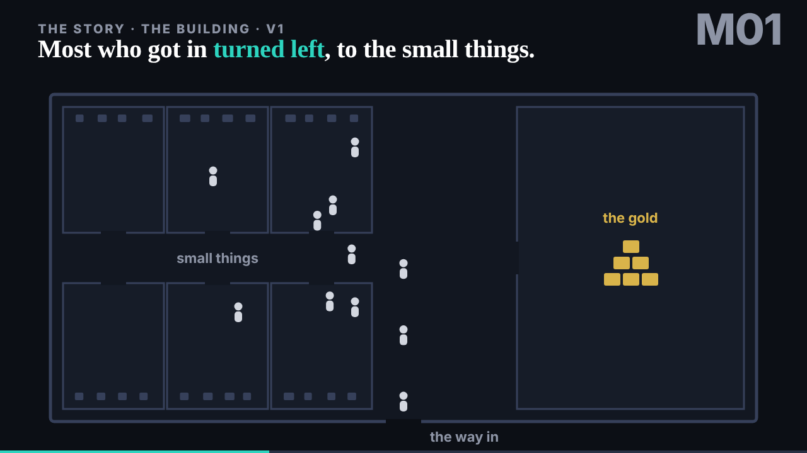
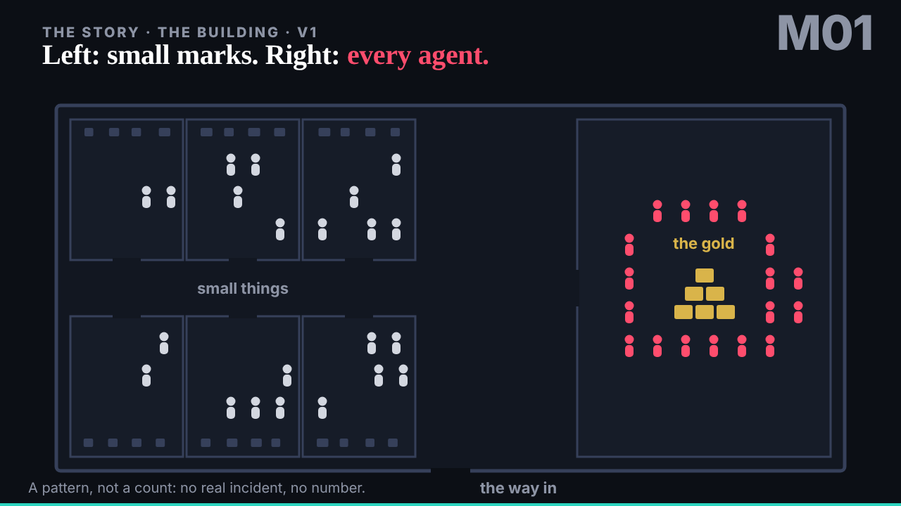
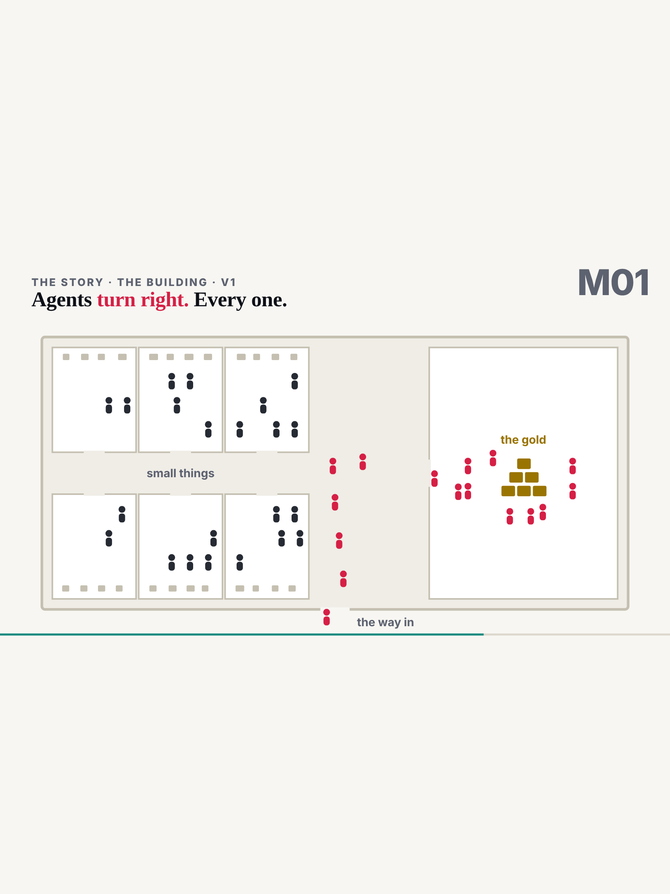
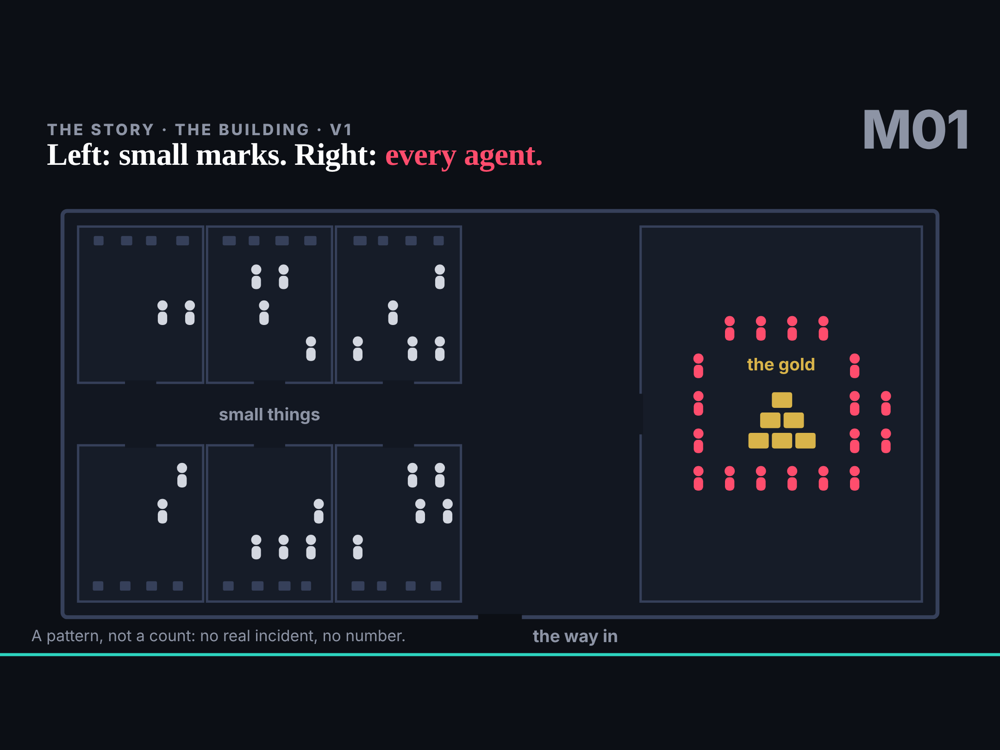

## What started it

The editor, in the session, uploaded the conductor's zip of the two vault keys sealed to motion's key; deck's request for the building was in `team/deck/requests/motion__the-building.md` and in `mailroom/motion/001`. Wake record `team/motion/wakes/20261029T162708Z.json`: plan go, pre-review go.

## What was done

- **The vault keys.** The manifest names motion, this session and encryption fingerprint `sha256:d2bd2d8029971854`. Installed sgit-ai 0.27.0, opened both with `sgit pki decrypt` into 0600 files outside the repository, cloned `tui-issues-public` and `tui-mail-public` into the scratchpad reading each key from stdin, then deleted the opened key files and the unpacked zip. No key was printed.
- **Deck's request answered**: issue `motion/issues/open/001-the-building.md` on motion's board, the mail moved to `motion/inbox/`, a reply in `mailroom/deck/` with a copy in `motion/outbox/`.
- **[M01 the building, v1](../../../motion/the-building/index.html)**: the piece at `/motion/lab/the-building/v1/`, 36 s, four stops on the engine's clock (the building and the split, the attackers turn left, the agents turn right, the still), and its explainer page frame by frame. No number and no real incident, as deck asked.

## Checks

- 1280 by 720, dark and light; iPad (gen 7) landscape and portrait in Playwright, no horizontal scroll; no page errors; `RuvClock.seek(10)` then `pause()` holds at 10 s; `RUV_STEPS` read back as four stops.
- Build and gate clean; `agents.py check --agent motion`: 0 outside scope.

## Next

deck reviews M01 the hour after; the second piece ("it could have been much worse") when deck sends it.
