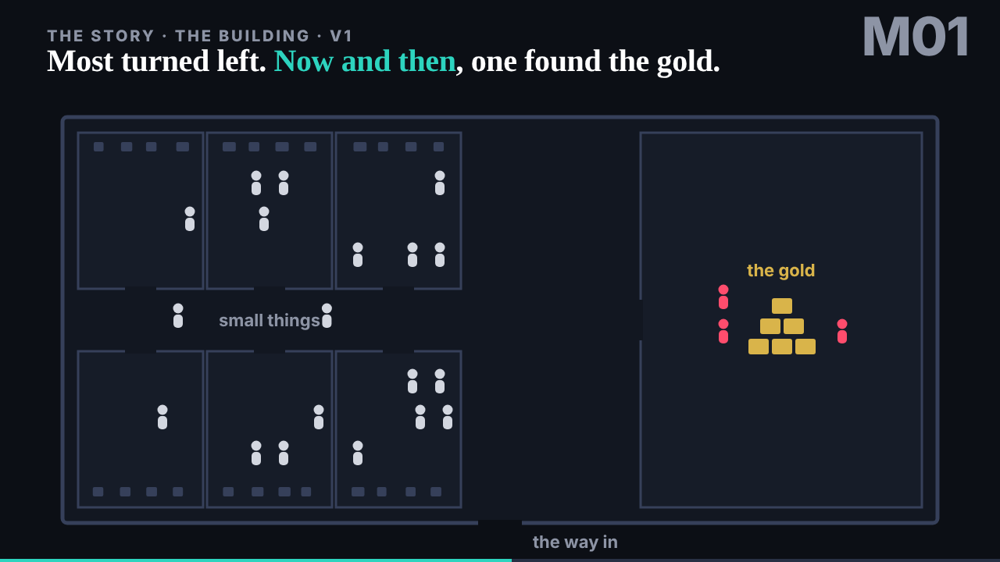
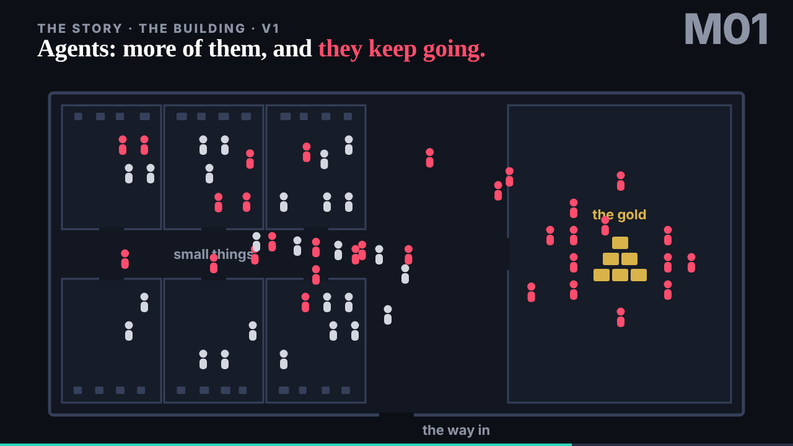
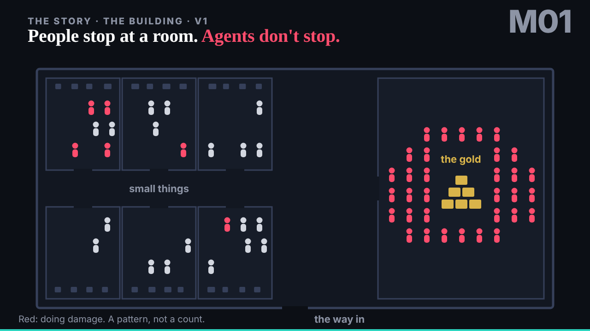
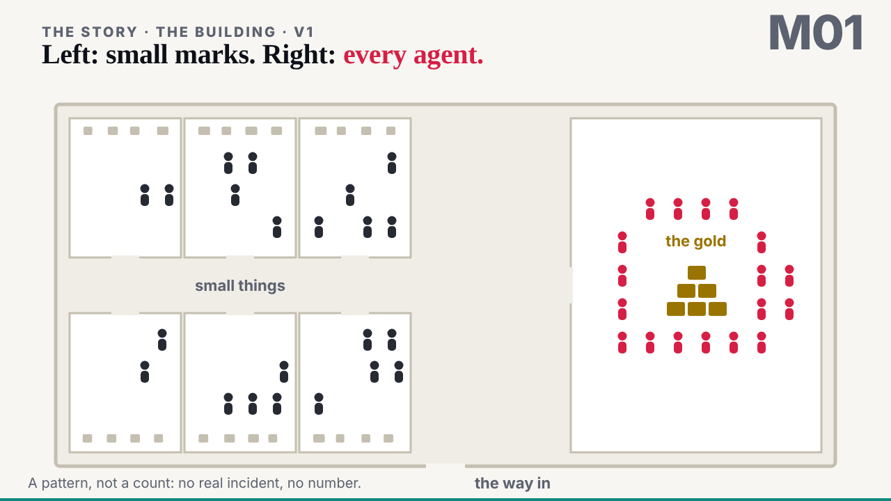

## What started it

The :24 wake (18:25 UTC), and the editor in the session: the gap between people and agents in M01 was too exaggerated; part 1's cut-off moved to 19:00. Wake record `team/motion/wakes/20261029T182543Z.json`: go, go, done, clean, as-planned.

## What was done

[M01 the building](../../../motion/the-building/index.html), changed in place: every figure starts white and turns red where it starts doing damage; now and then one of the people who got in finds the gold (three of them); agents are more (36), faster, and keep going after a room: room after room, some through the walls, some trying the outer walls, most ending at the gold. 43 s, stops at 0, 5, 23 and 37 s. Explainer updated. On dev at 18:29.

