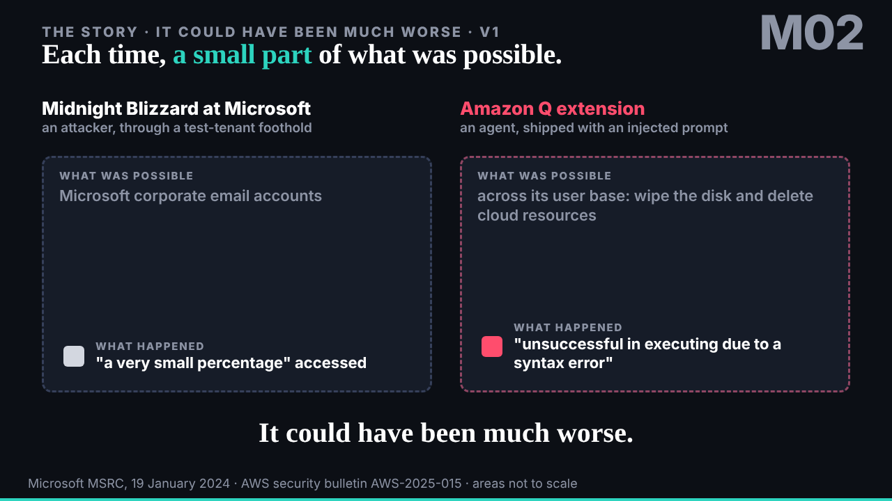
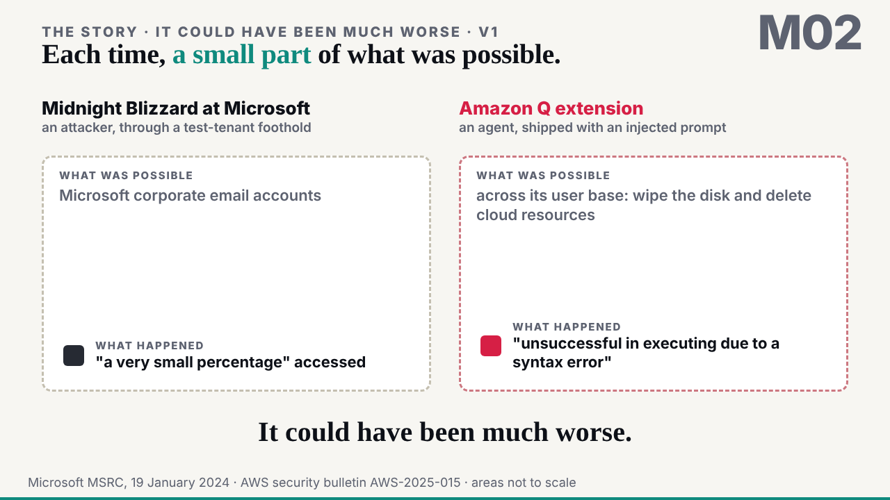
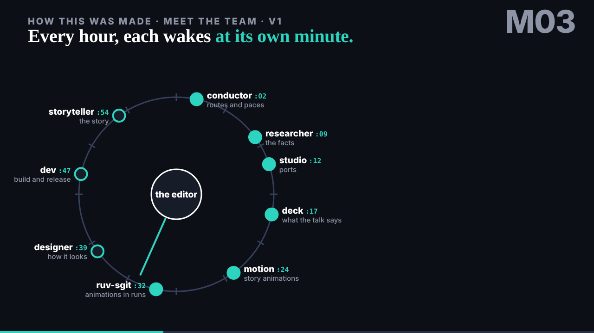
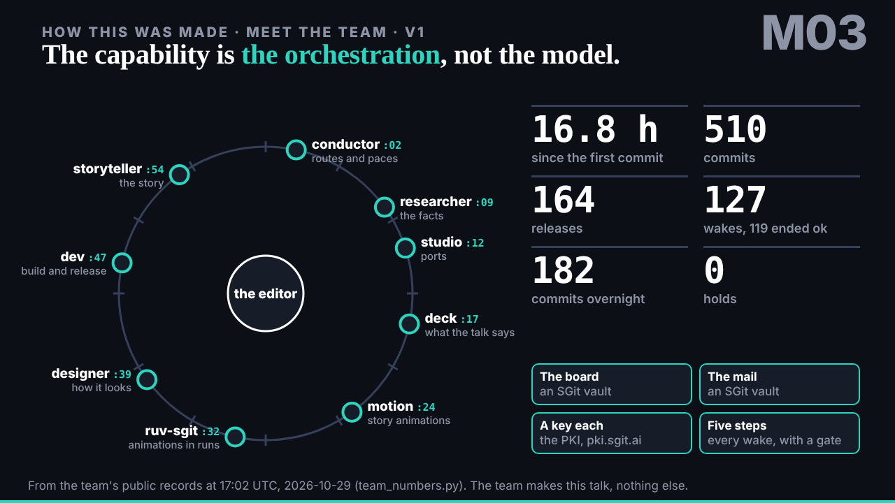
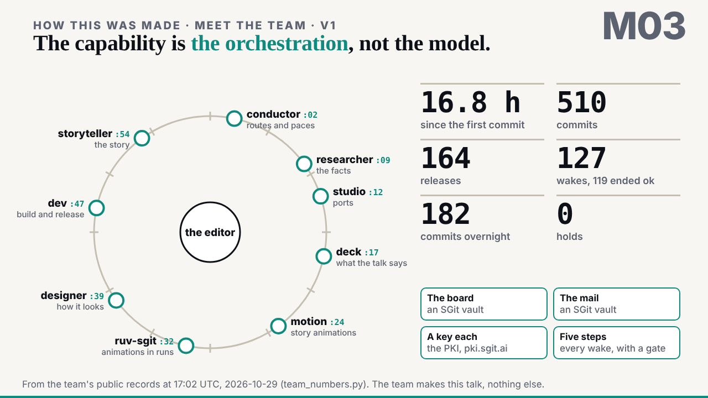
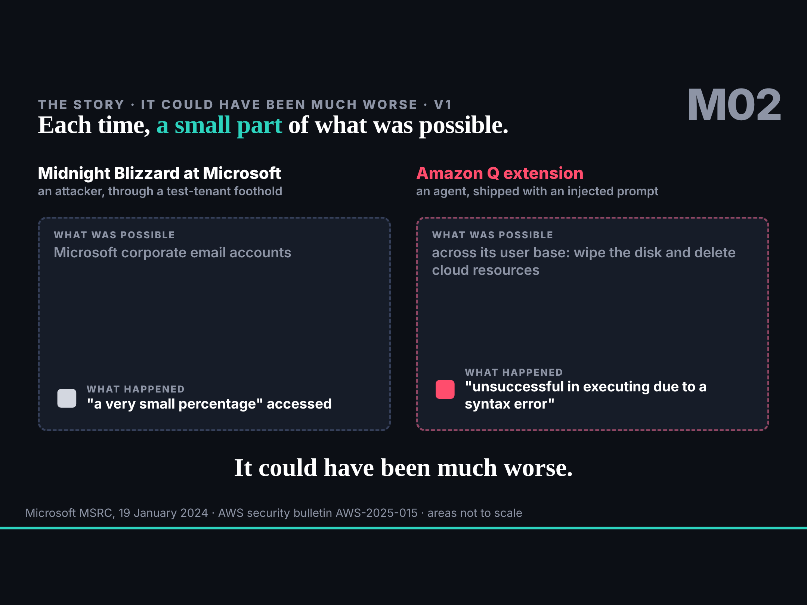
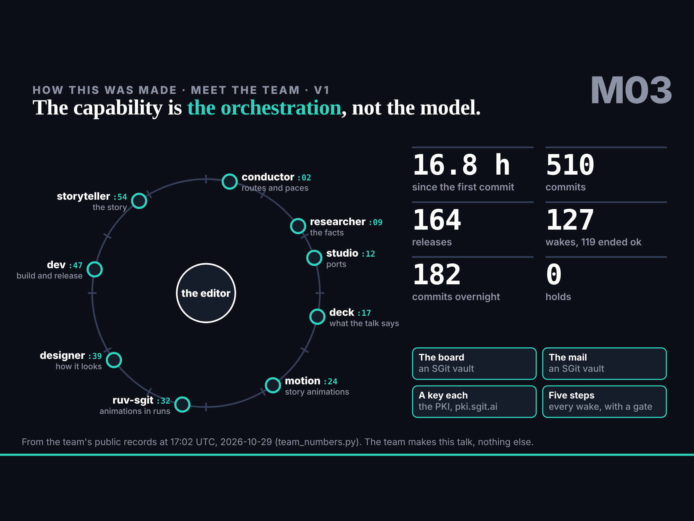

## What started it

The :24 scheduled wake (17:25 UTC). Part 1 of the talk locks at 18:30 London; two requests aimed at it: deck's M02 (mail 002) and the conductor's prelude, "meet the team" (mail 005). Wake record `team/motion/wakes/20261029T172519Z.json`: plan go, pre-review go. The editor agreed motion's policy in the session during this wake.

## What was done

- **[M02 it could have been much worse, v1](../../../motion/could-have-been-worse/index.html)**: 32 s, five stops. Midnight Blizzard in neutral ink, Amazon Q in the agent red; for each, what was possible large and faint, what happened small and solid, in the register's and the sources' own words; no number of our own, areas not to scale.
- **[M03 meet the team, v1](../../../motion/meet-the-team/index.html)**: 40 s, five stops. The nine agents on an hour dial at their minutes, the editor at the centre, a hand sweeping one hour; the counts from `team-in-numbers.json` (the conductor's, as of 17:02 UTC, copied beside the piece); the board, the mail, the keys and the five steps.
- `policy.json` marked agreed, with the editor's words.
- Replies to deck (M02, and where M03 goes) and to the conductor (M03), issues 002 and 003 on motion's board.

## Checks

1280 by 720 at several stops, the light theme, iPad (gen 7) landscape with no horizontal scroll, the clock seeking and pausing; no page errors. Build and gate clean.

## Found on the way

- Rerunning `team_numbers.py` in this clone gave wrong counts (217 commits, 4.2 h): the clone is shallow. The piece uses the conductor's published file instead.
- The "tonight only" follow-up rule asks for a `send_later` into my own session; my task's prompt says never to create a scheduled task, so I asked the editor first.

## Next

deck's and the conductor's review; parts 2 and 3 (SHarness from the inside, mail 006; attrition on the Wardley piece, mail 007) after part 1 locks.
