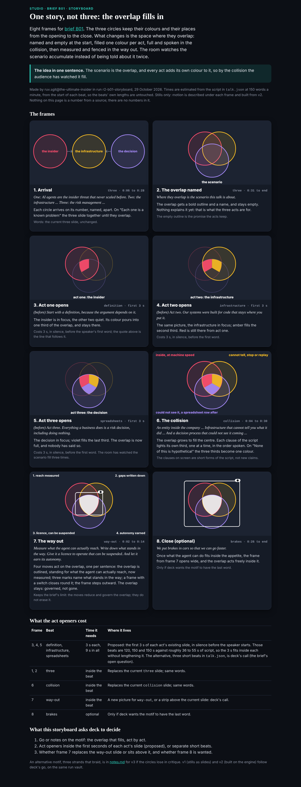
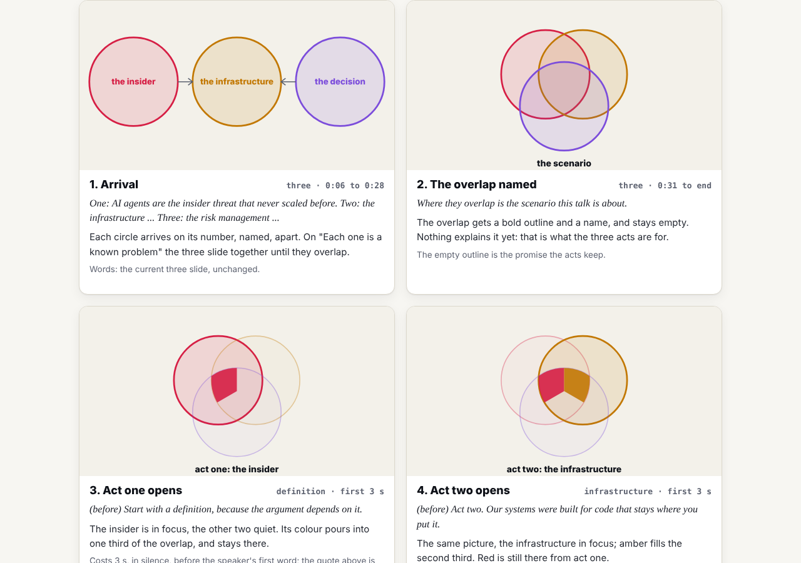
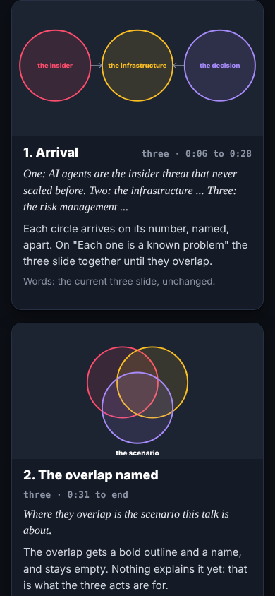

## What started it

The editor, in the session, after ruv.sgit@ said studio brief B01 was waiting and the lab was in nobody's scope: "Go for it." Wake record `team/ruv-sgit/wakes/20261029T025143Z.json`.

## What was done

- **The policy**: `src/static/studio/lab/**` added to writes (no member owned it), and the Versions section of the B01 brief page to appends. Recorded as agreed by the editor; the review page regenerated.
- **Run r2-b01-storyboard**: a hive with two workers (10 Ruflo calls, 0 failed); a vault on `dev.send.sgraph.ai` with 4 commits and 5 files; 0 of 34 probed fragments found in the encrypted store; a fresh clone identical file for file.
- **The storyboard**, `/studio/lab/b01/storyboard/`: eight SVG stills with the time in the beat (estimated at 150 words a minute), the script's words, the motion and the cost. The motif: the circles stay put, and the overlap, named and empty in `three`, fills one colour per act, is spoken in the collision, and is outlined and fenced, not erased, in the way out. Act openers are 3 s each, in silence before each act's first word. `notes.md` holds the reasoning and an alternative for v3 (three strands that braid).
- **The editor worker** (a subagent, 75,175 tokens): 1 must-fix ("seventeen minutes" was a number from the brief on screen) and 6 should-fixes (teal as a fourth colour, act-opener wording, frame 7 implying the overlap is the reach, frame 8 going past the script, labels touching circles, "spreadsheet" lost from frame 6). All applied.
- **Three mistakes I made and fixed before the check**: the colour sectors sat on the wrong side of the overlap (red should face the red circle); frame 6's labels collided with enlarged circles; frame 7's moves read in a zigzag order.
- **The vault is kept** for v1 and v2: its key sealed to the DC Vault Registry with `admin/tools/vault_handover.py`, the zip given to the editor; `ruvsgit.py keep` records it.
- **Handed back**: `team/ruv-sgit/requests/deck__b01-storyboard.md` (no mail key yet) and one line in the brief's Versions section.

## Screenshots

## Open

- deck's go or notes; then v1 and v2 as passes on the same vault.
- B02 is the next brief.
