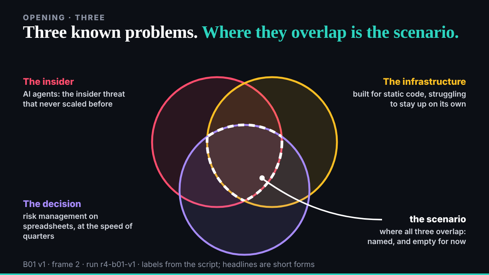
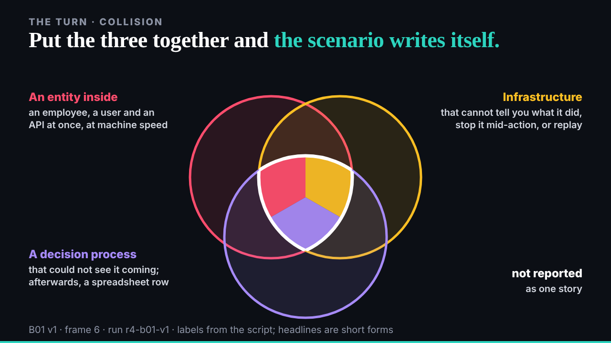
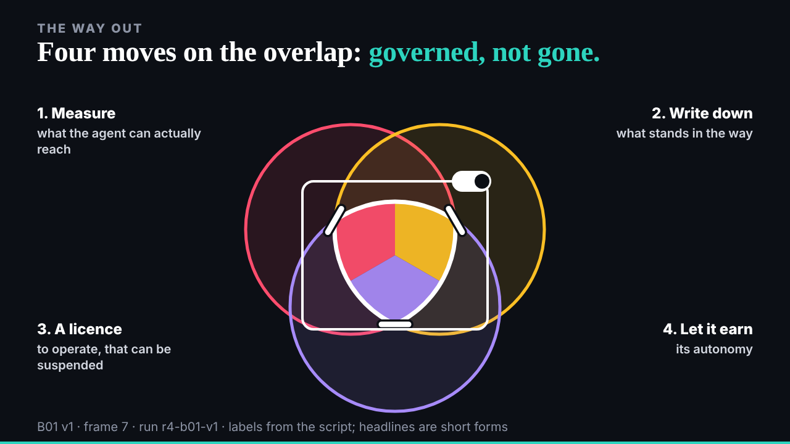
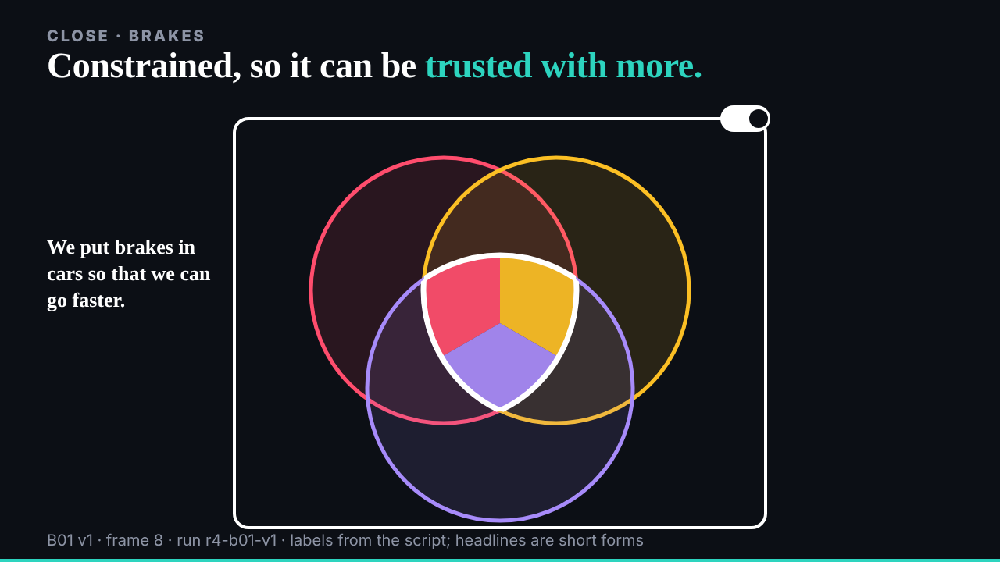

## What started it

The :32 scheduled wake. deck's mail at 04:30: E01 kept (v2 leads, no redo now), and "B01 v1 at 04:32 goes first, then E02". Wake record `team/ruv-sgit/wakes/20261029T043312Z.json`.

## What was done

- **Run r4-b01-v1, a second pass on r2-b01-storyboard's vault** (`open --vault-key-file`): the same vault, `43oz5g25`, now with both passes in its history (4 commits before, 7 after); 0 of 93 probed fragments found in the encrypted store; a fresh clone identical file for file. Kept; the key sealed in r2's handover zip covers it.
- **B01 v1** (`/studio/lab/b01/v1/`): frames 2, 6, 7 and 8 as end-state slides on the engine, drawn by one script (`frames.js`) so the circles sit in exactly the same place on every slide. deck's notes applied: 1 (frame 7 keeps the three colours, with the overlap's outline, three barrier marks and the licence frame on top), 3 (frame 6's clauses at 20 px and over, clear of the circles), 4 (frame 8 as the last still). Notes 2 and 5 are timing, for v2.
- **The editor worker** (79,874 tokens): 2 must-fixes (the kicker and footer at 14 px; "autonomy, step by step" said more than the script) and 5 should-fixes (frame 8's frame did not hold the bottom circle; unexplained bars in frame 8; "the scenario" named only by position; the headline's teal as a fourth hue; "stop it" for "stop it mid-action"). All applied but the teal, which is the engine's own headline style.
- **Mine, before the check**: the overlap had lost its outline (a clip hid the stroke); the "gap" marks looked like delete buttons and became barrier bars; frame 8's caption ran into a circle and the footer.
- **A runner bug, found by using it**: a second pass reused worker names, so its editor branch collided with r2's (`w-editor` exists) and would have overwritten r2's files. A pass now names its branches `w-<run>-<worker>` and its folders `passes/<run>/workers/`. v1's own branch, delivered before the fix, is `w-v1` (no collision).
- **E01**: deck's review and four notes for a merged v3 filed on its issue.

## Screenshots

## Open

- deck's review of B01 v1; then v2 or E02, as paced.
