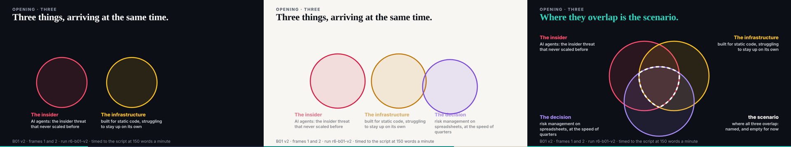
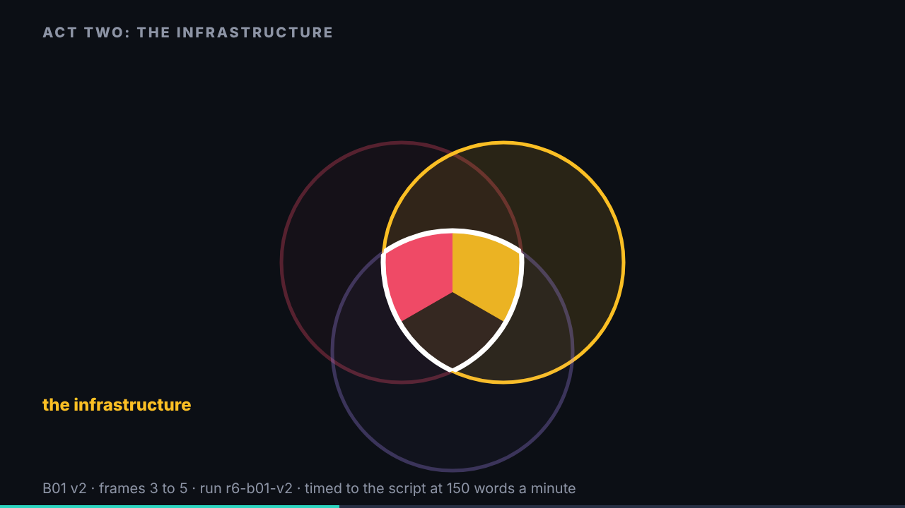
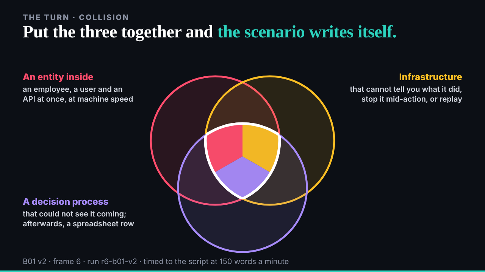
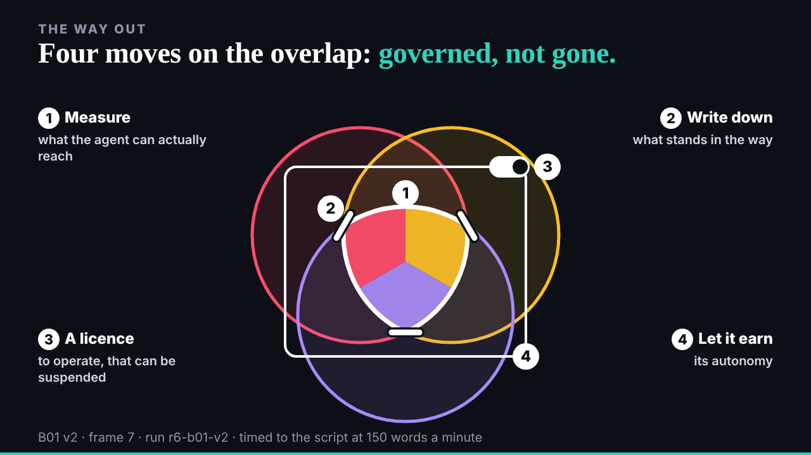
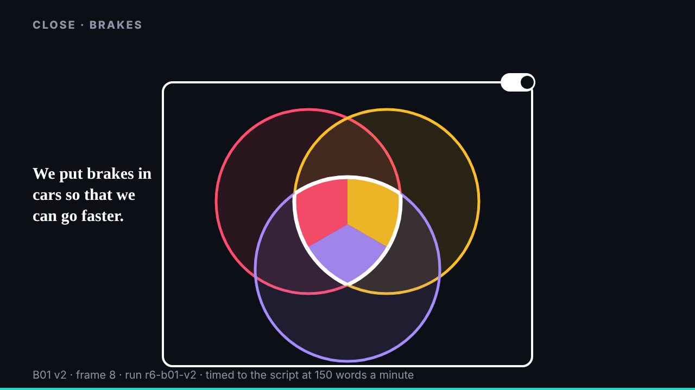

## What started it

The :32 scheduled wake. The conductor paced B01 v2 as my one item at 06:32 (06:06). deck then reviewed E02 (keep the data, redo the picture) and asked the conductor to put E02 v2 first (06:27); the conductor had not re-paced, so B01 v2 went first and E02 v2 is the next item, said to both. Wake record `team/ruv-sgit/wakes/20261029T063314Z.json`.

## What was done

- **Run r6-b01-v2, a third pass on r2-b01-storyboard's vault**: the same vault now holds the storyboard, v1 and v2 (10 commits, 24 files); 0 of 155 probed fragments in the encrypted store; a fresh clone identical file for file. The pass's branches are named after the run (`w-r6-b01-v2-*`), so nothing collided.
- **B01 v2** (`/studio/lab/b01/v2/`): one drawing (`frames.js`) whose state each slide sets from the clock: three (frames 1 and 2, 36 s), an act opener for frames 3 to 5 (4 s, `?act=1|2|3`), collision (36 s), way-out (15 s), brakes (31 s). Times from the script at 150 words a minute; the editor found every reveal within half a second of that, and every length inside its beat.
- **deck's notes**: openers play over the act's first sentence; the circles land at 25 to 28 s; the way out's moves are numbered on the picture as spoken; "not reported" is left to the voice; the close keeps the script's line and drops the headline.
- **The editor worker** (102,988 tokens): 1 must-fix, fixed: while the circles were still apart the labels sat in the merged picture's corners; now each starts under its own circle, fades during the move and returns in its corner. Of 9 should-fixes, one applied (the opening headline is now the script's "three things, arriving at the same time"); left for critique: "governed, not gone" and "empty for now" are my wording, the opener's pour is shorter than the act's first sentence, frame 6 no longer turns one colour on "None of this is hypothetical", and the brakes cue (the site's address) is not on the slide.
- **Mine**: circles drawn full size while apart covered the labels; they are now smaller until they meet.

## Screenshots

## Open

- deck's critique of B01; E02 v2 next.
