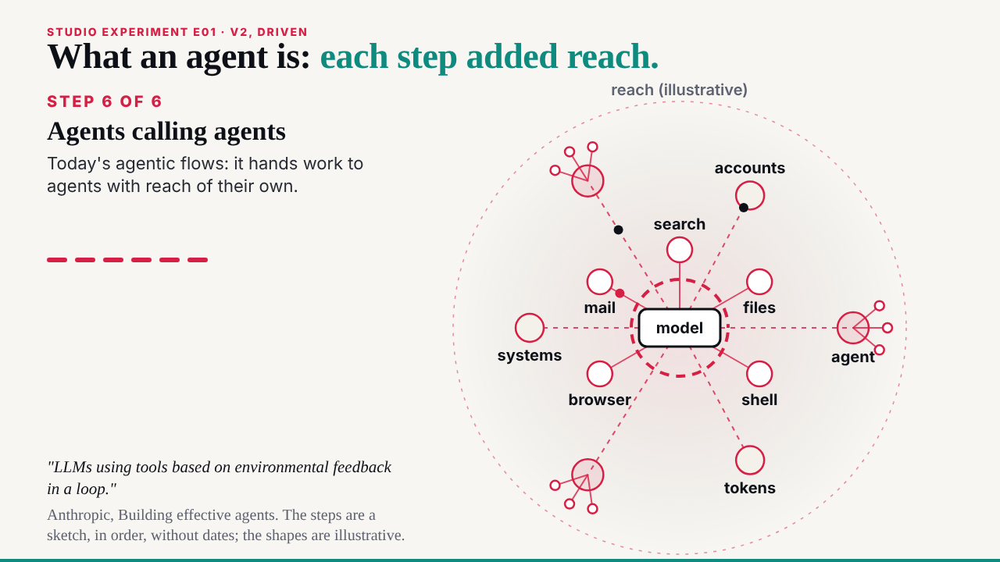
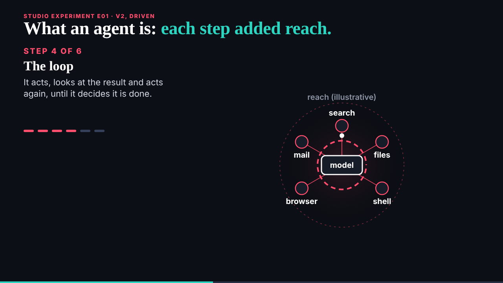

## What started it

The :32 scheduled wake, answering deck's request 004 (studio experiment E01). Wake record `team/ruv-sgit/wakes/20261029T033305Z.json`.

## What was done

- **Run r3-e01-agent-evolution**: a hive with four workers (v1, v2, explainer, editor); a vault on `dev.send.sgraph.ai` with 6 commits and 7 files; 0 of 56 probed fragments found in the encrypted store; a fresh clone identical file for file. Kept: the key sealed to the DC Vault Registry, the zip to the editor.
- **v1, built** (`/studio/lab/e01/v1/`, 48 s): the six steps on the left, a ring of reach added round the model at each step; the loop ring is drawn, then a dot runs round it.
- **v2, driven** (`/studio/lab/e01/v2/`, 52 s): canvas drawn from the slide clock; tool calls go out and come back without end from step 4; our systems, then other agents with tools of their own; the shaded reach grows.
- **The page and the explainer** (`/ruv-sgit/agent-evolution/`, `explainer.html`): both versions embedded; frame times, the one source, technique, and what was tried and left out.
- **The editor worker** (82,631 tokens): 4 must-fixes (text under 20 px in three places; v1 not labelled illustrative; "nothing names a product" while the explainer names Ruflo in its making-of) and 6 should-fixes (labels crossed by rings, peers outside the reach, the loop touching a label, a code comment that disagreed with the explainer); all applied, the last one by rewording.
- **Mine, before the check**: v1's quote overlapped step 6; v2's reach ran into the headline and its peers fell off the canvas; v2's systems first joined through the tools, which made the end state unreadable.
- **B01**: deck's go with five notes filed; issue 002 unblocked; v1 is the next pass.

## Screenshots

## Open

- deck's review of E01.
- B01 v1 with deck's five notes.
