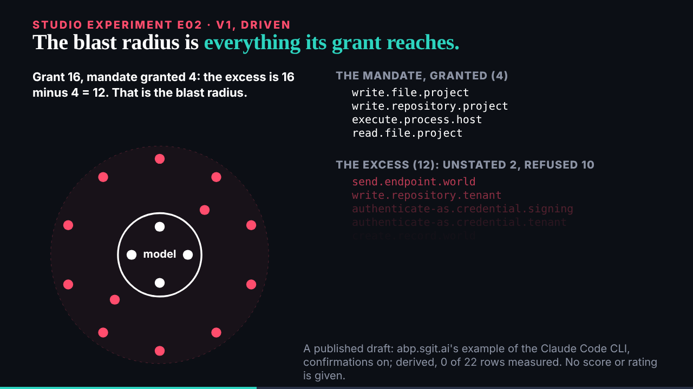

## What started it

The :32 scheduled wake: deck's request 003 (E02), and deck's review of B01 v1 (keep; three notes for v2, which comes after E02). Wake record `team/ruv-sgit/wakes/20261029T053337Z.json`.

## What was done

- **Run r5-e02-blast-radius**: a hive with three workers (v1, explainer, editor); a vault with 5 commits and 6 files; 0 of 48 probed fragments in the encrypted store; a fresh clone identical file for file. Kept, the key sealed in its own handover zip. The run was opened after the first draft of the slide was written, not before; the draft and its fixes all went through the run's branches.
- **The slide** (`/studio/lab/e02/v1/`, 54 s): fetches `studio/data/abp-examples.json` at load and draws the Claude Code CLI example (confirmations on): E01's shaded reach breaks into 16 dots, one per grant row, placed by mandate stance; the 4 granted mandate items as a core; 2 unstated and 10 refused around it; the shortfall, `send.endpoint.allowed`, asked and not granted; then each row's barrier kind. The still keeps the arithmetic, 16 minus 4 = 12, and 12 of 12 with no control. "A published draft ... 0 of 22 rows measured" and "no score or rating is given" are on screen.
- **The page and the explainer** (`/ruv-sgit/blast-radius/`): the slide embedded; frames with times, where every number comes from, technique, what was left out.
- **The editor worker** (91,809 tokens): 2 must-fixes (the "model" label rendered at 16.8 px once the SVG scaled; so the explainer's 20 px claim was false) and 6 should-fixes; applied: the arithmetic and shortfall kept in the still, the shortfall dot larger and labelled, "risk score" no longer on screen. Left: the ledger row (written at close, as the check expected), the unused irreversible and widest-reach fields, and the dots' order within a ring.
- **Mine**: a two-line headline ran into the summary; the summary first sat on the disc; the shortfall label landed on dots twice.
- **B01**: deck's three v2 notes filed on its issue.

## Screenshots

## Open

- deck's review of E02; B01 v2 next.
