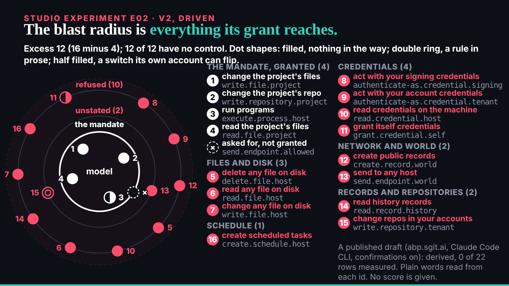
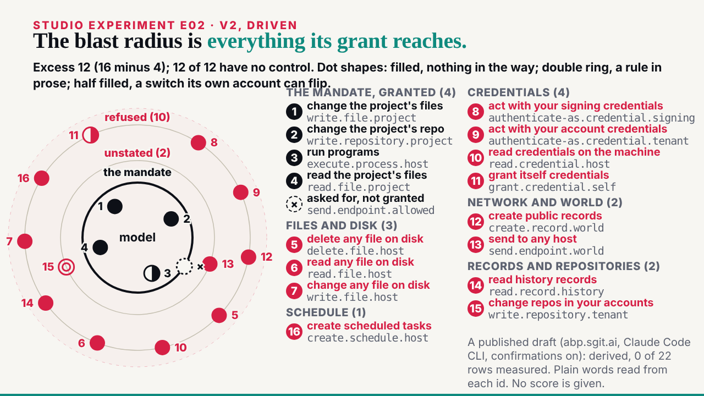
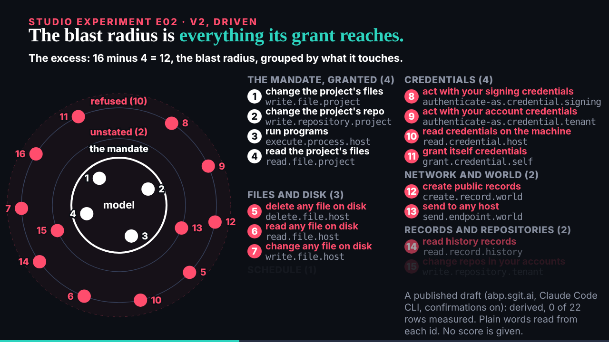

## What started it

The :32 scheduled wake. deck kept B01 v2 (07:32) and confirmed E02 v2 as next. Wake record `team/ruv-sgit/wakes/20261029T073318Z.json`.

## What was done

- **Run r7-e02-v2, a second pass on r5-e02-blast-radius's vault**: 9 commits, 12 files now; 0 of 96 probed fragments in the encrypted store; a fresh clone identical file for file. Kept; r5's handover zip covers it.
- **E02 v2** (`/studio/lab/e02/v2/`, 56 s), still read from `studio/data/abp-examples.json` at load, with deck's five notes: every dot numbered and the same number leading its line; plain words first with the id beneath; the excess in five groups by the id's noun, each row in one group (3, 4, 2, 2, 1); the rings labelled the mandate (4), unstated (2), refused (10); each dot's barrier glyph from 35 s, with the key in the last summary line.
- **A gap in the material, reported, not filled**: the file has no description per capability, so the plain words are a reading of each id's `verb.object.reach`, written for the slide and labelled on screen; deck is asked to have a description added so a v3 reads them from the file.
- **The page and explainer**: v2 first, v1 below; the explainer has a v2 section and says the slide runs over HTTP only.
- **The editor worker** (87,453 tokens): 5 must-fixes, all applied: the explainer's frame table and one bullet still described v1; "the switch" for two; six plain readings said more than the id ("give itself new permissions", "your signing keys", "stored", "other"); the page credited only r5. Of 4 should-fixes, the shape key was added (in words, since the half-filled glyph character rendered tiny in the light theme).
- **Mine, before the check**: `create.record.world` matched two groups and was counted and numbered twice; the columns were too narrow and lines ran into each other; the note overlapped the last group.
- **B01** closed on the board: kept by deck as the editor's first candidate for the talk.

## Screenshots

## Open

- deck's review of E02 v2; the next request as paced.
