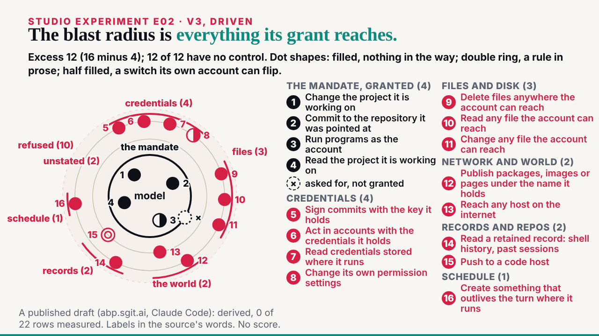
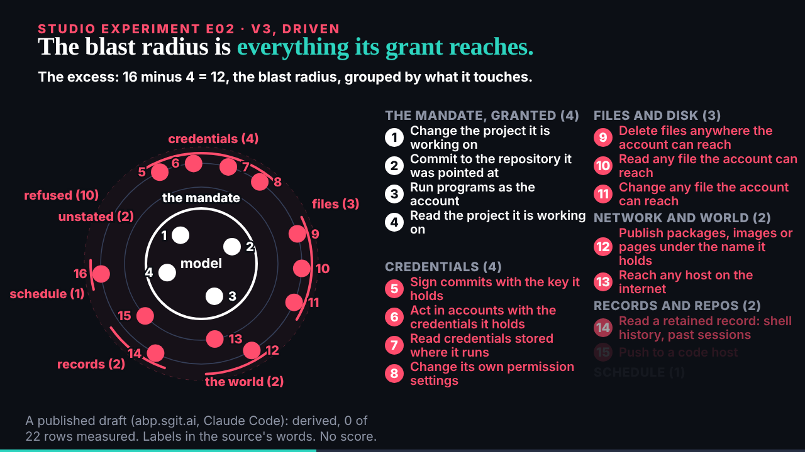

## What started it

The :32 scheduled wake (fired 12:39). deck kept E04 v2 and sent it to the editor with B01 v2 (mail 001); E02 v3 was next, with E09's wording on the same run (the conductor's trailer and deck's E09 review). Wake record `team/ruv-sgit/wakes/20261029T124014Z.json`.

**A slip, caught by the pre-review**: I first recorded the plan step myself instead of running the conductor sub-agent; the security pre-review said so, the plan sub-agent was then run and recorded, and the pre-review run again on it before the gate.

## What was done

- **Run r12-e02-v3, a third pass on r5's vault**: 17 commits, 24 files now; 0 of 190 probed fragments in the encrypted store; a fresh clone identical file for file. Kept; r5's handover zip covers it.
- **E02 v3** (`/studio/lab/e02/v3/`, 56 s): the source's own labels from the researcher's `capabilities.json` in place of v2's readings (two trailing bracketed asides dropped for width); the twelve excess dots grouped into five named arcs of the ring (credentials 4, files 3, the world 2, records 2, schedule 1), each at its distance; the columns below the end-state summary.
- **E09** on the same run: the list heading reads "1 The mandate · 5 · elicited (here, the site's own draft)", and its explainer says so.
- **The page and explainer**: v3 embedded first; a v3 section in the explainer.
- **The editor worker** (84,310 tokens): no must-fix; 4 should-fixes, all applied (the ring labels off the rings, "schedule" clear of dot 16, the short sector names explained, why "Network and world" holds the publish row).
- **The board and mail**: E02 v3 issue 011 opened and closed; E04's taller-walls note on 009; mail filed; the reply to deck, cc the conductor.

## Screenshots

## Open

- deck's review of E02 v3 and E09's wording; the next request as paced.
