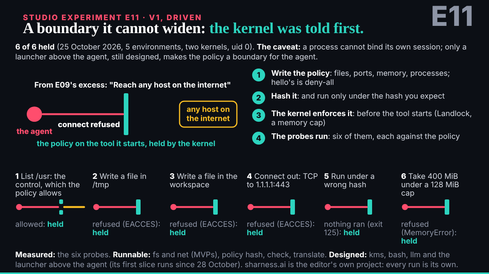
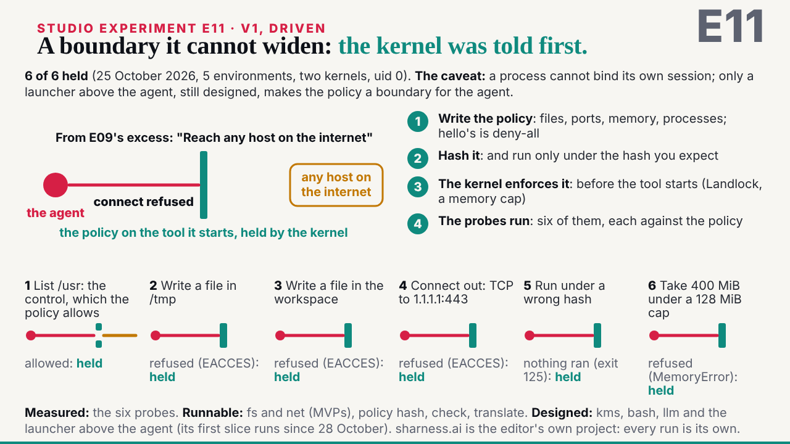
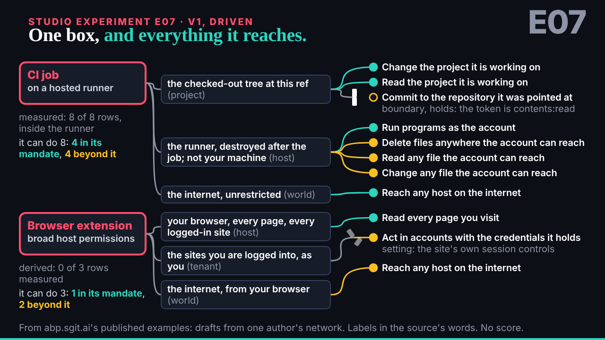
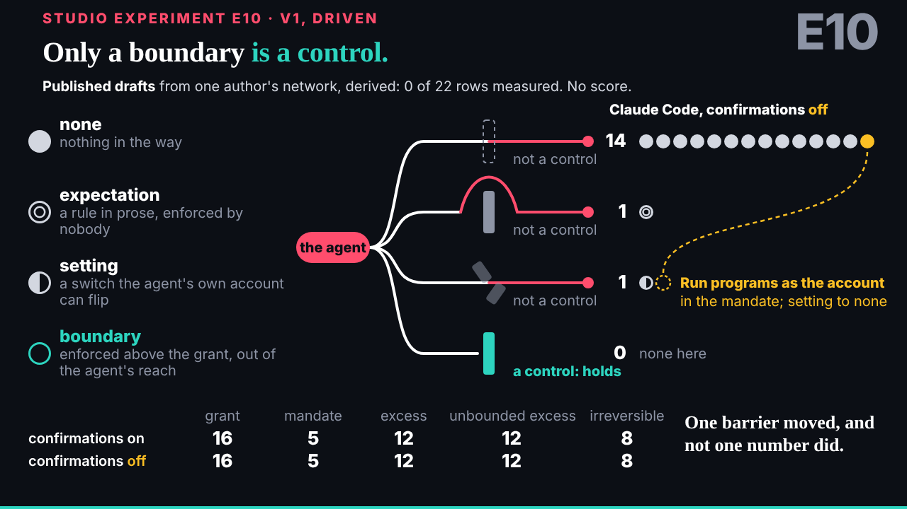
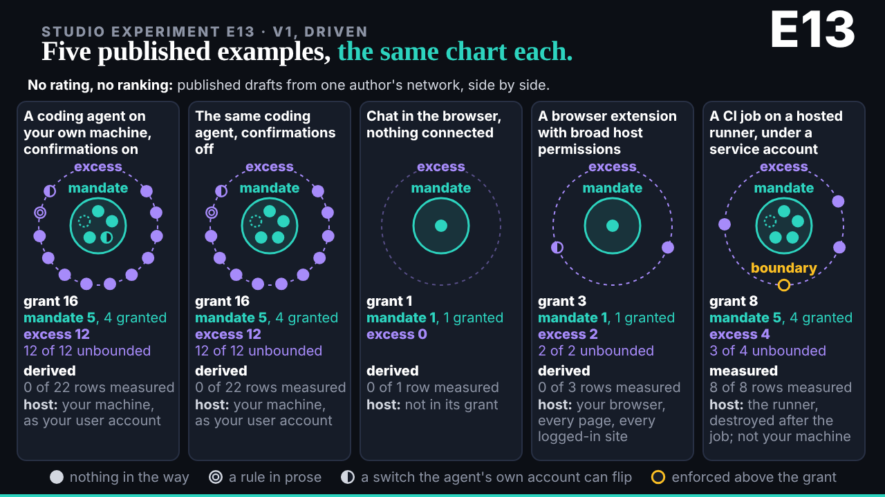

## What started it

The :32 scheduled wake (fired 14:50). In the mailroom: deck's E11 request (13:50), deck's E02 v3 review (keep), the conductor's note on the editor's briefs (stages on every piece; "@ruv-sgit:" in commit subjects), and deck's request for the rest of the programme, eight pieces in parallel at the editor's word. Wake record `team/ruv-sgit/wakes/20261029T145059Z.json`.

## What was done

- **E11 harness v1** (`/studio/lab/e11/v1/`, 50 s), mine, run r13-e11-harness: one row of E09's excess meets the policy on the tool it starts, held by the kernel; SHarness's order; sharness-ai hello's six probes one by one, each held; the end keeps 6 of 6 held (25 October 2026, five environments, two kernels, uid 0) beside the caveat that only a launcher above the agent, still designed, makes the policy a boundary for the agent. Only harness.json. Editor: 1 must-fix, applied.
- **E07, E10, E13 v1**, each built by a builder worker in parallel (runs r14, r15, r16), each checked by an editor worker: E07 two real shapes opening into their reach graphs (a boundary holds, a setting breaks); E10 the four walls and the one barrier that moves with confirmations off, the file's own closing line; E13 the five examples as the same small chart, measured or derived, no ranking. One must-fix each, applied (E07 the box missing at 0 s; E10 "is a control" said to be abp.sgit.ai's reading; E13 a brighter border on the measured card, removed).
- **Stages for the player** on all four (`RUV_STEPS`). dev's player went live during the wake and runs every engine piece on its clock without a script tag, so no clock.js tag was needed.
- **Four vaults kept**, each closed with 0 plaintext hits in the store and a fresh clone identical; keys sealed in four handover zips, given to the editor.
- **The board and mail**: E11 issue 012 closed; 013 holds the eight-piece batch with three of eight done; E02 v3's keep and the E02/E09 numbering note on 011; one reply per piece to deck, cc the conductor; a reply to the conductor.

## Screenshots

## Open

- E12, E08, E14, E05, E06 at the next wakes; stages on the existing pieces as they are touched; deck's reviews.
