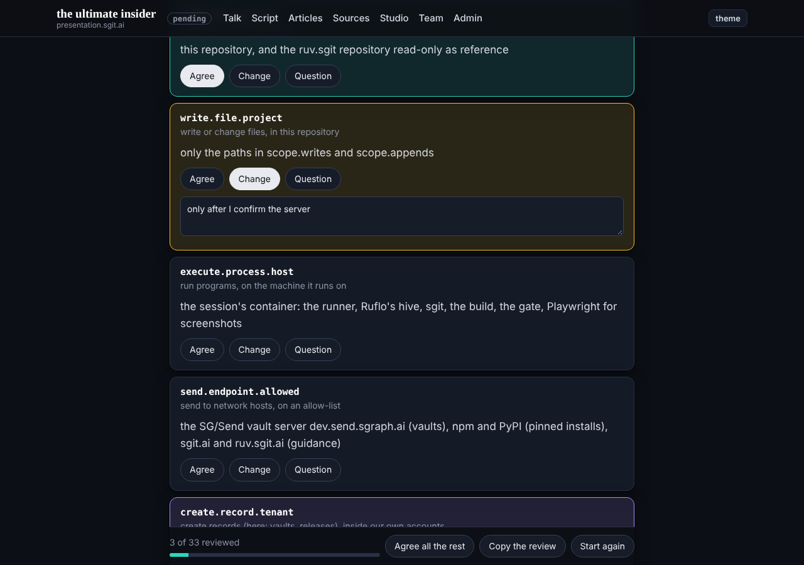
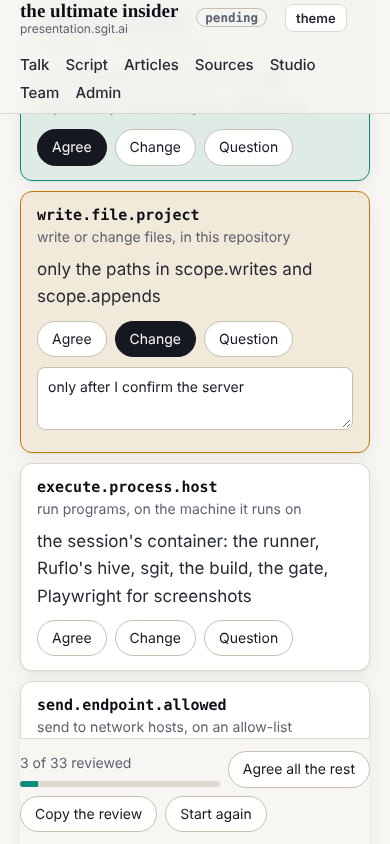

## What was asked

The editor, in the session: delete the test vaults; any vault that needs saving goes to the editor with its key sealed to the DC Vault Registry; vaults created inside or given to ruv.sgit@ are kept or not case by case, since one vault can take several ruv.sgit passes; release to `dev`; a page to review the draft policy.

## What was done

- **Started from `dev`** with `admin/tools/start.py`: dev, the conductor, deck, the researcher and security had shipped 45 commits since round 1 (the board, the mail vault, session keys, the handover tool, the hourly schedule).
- **The vaults:** smoke-0 was deleted in round 1; r1-article's vault deleted at 02:07 UTC, and a clone with its key afterwards failed. ruv.sgit@ has no vault now.
- **The keeping rule** in `policy.json` (`endings`, two new mandate rows, one new never) and `ROLE.md` ("Keeping a vault"): kept vaults leave with their key sealed to the DC Vault Registry by `admin/tools/vault_handover.py`.
- **Released to `dev`** (round 1's work and the delete), then this round.
- **The review page,** `/ruv-sgit/policy-review.html`, made by `tools/review_page.py` from `policy.json` (33 items, sha256 shown). Each item: agree, change or question, with a note; a verdict; a review to copy and paste into the session. Choices stay in the browser, keyed to the policy's hash. Tested in Chromium: choices survive a reload, no console errors, no sideways scroll at 390.
- **The article and `ROLE.md`** now say requests come through the mail vault, as `CLAUDE.md` says.

## Screenshots

## Open

- The policy waits for the editor's review on the new page.
- This session has not yet made its own session key (`team/ruv-sgit/key.json`), so no vault key can be sealed to it yet.
- The runner cannot yet take a second pass on an existing vault (`open` always creates one); needed before a kept vault is used again.
