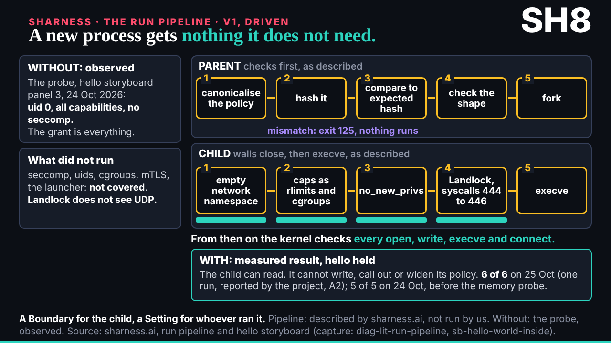
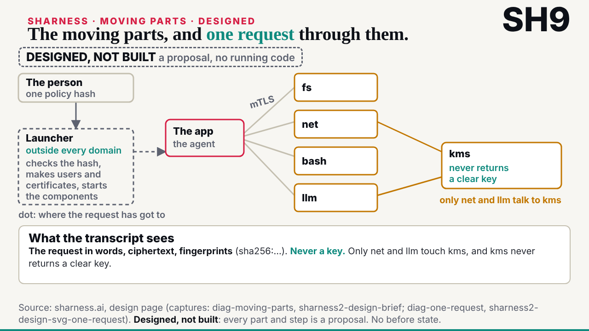

## What started it

The :32 scheduled wake (fired 17:33). New mail from the conductor: the talk is three parts tonight, each locked before it goes on stage (part 1 at 18:30, part 2 at 19:30, part 3 at 20:00); for parts 2 and 3, SHarness told technically and the documented attacks as blast radius; the editor keeps SH2 and SH5 as they are for the Linux demo. Wake record `team/ruv-sgit/wakes/20261029T173332Z.json`; plan and pre-review both go.

## What was done

- **Part 1**: nothing new from me; SH2 and SH5 untouched, as the editor asked.
- **Run r25-sharness-deep-dive** (vault kept, handover zip to the editor): two builder sub-agents, one editor sub-agent.
  - **SH8, a new process gets nothing it does not need**: without, the probe shows the grant is everything (observed, storyboard panel 3, 24 October); with, the parent checks the policy's hash and the child is closed in wall by wall before it runs, as sharness.ai describes it; hello held (6 of 6, 25 October, reported by the project); what was not covered.
  - **SH9, the moving parts and one request through them**: the launcher, the components and the KMS, then a vault cloned without the agent ever holding its key. Designed, not built. No command is reproduced: the request is told in words.
- **The editor worker**: 1 must-fix (SH9's travelling dot used the agent's colour on parts the agent never reaches) and 8 should-fix, all applied by the builders.
- **The storyline** gained a section for parts 2 and 3.
- **Mail**: a note to deck, cc the conductor (outbox 027): what is ready, what is not drawn yet and why; mails 025 to 028 filed.

## Not done, and why

- Digital twins, running distributed, and the invitation to escape SHarness: the capture does not cover them; the researcher reads them from the project's own pages first ("no guessing").
- The blast radius of the documented attacks: waits for deck's choice of pieces and the researcher's reach data.
- **No follow-up wake scheduled.** WAKE.md's tonight-only rule asks members to schedule a one-off follow-up into their own session, but this member's stored wake prompt says never to create a scheduled task, so it is left to the editor.

## Screenshots

## Next

The next :32 wake (18:32): deck's placement; the attacks' blast radius once asked; twins and distributed once the researcher has them.
