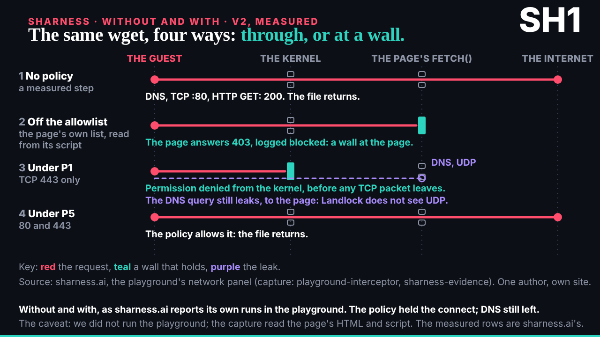
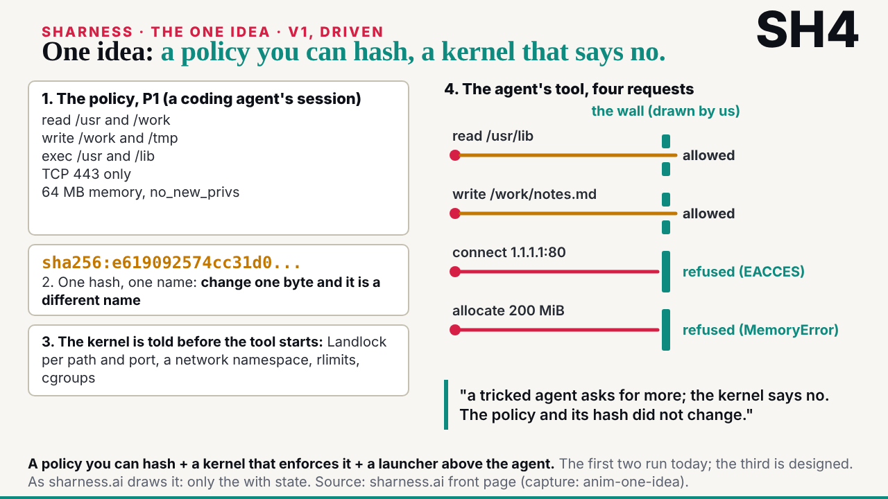
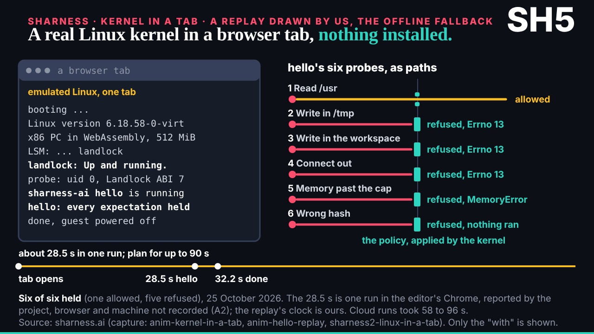
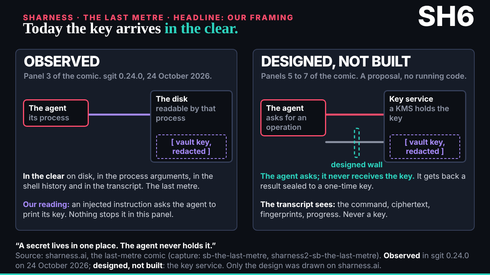
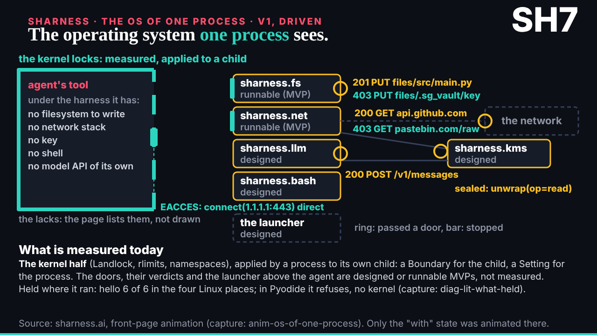

## What started it

The :32 scheduled wake (fired 16:34). New mail: the researcher's capture of sharness.ai is in (023), the series stays with ruv.sgit (022), and the editor's work section wants an offline fallback for the live Linux demo (024). Wake record `team/ruv-sgit/wakes/20261029T163413Z.json`. The security pre-review first said change, with seven conditions (the storyline path named, SH6 with no key and no command, the injection recorded as a caution, and others); the amended plan then had go from both.

## What was done

- **Run r24-sharness-capture** (vault kept, handover zip to the editor): five builder sub-agents in parallel, one editor sub-agent.
  - **SH1 v2, without and with, measured**: sharness.ai's playground, the one place the site measures the same request with no policy and under one. Four rows: the file; 403 from the page's allowlist; under P1 the kernel refuses and DNS still reaches the page; under P5 the file.
  - **SH4, the one idea**: the front-page animation; only the "with" state, as on the site.
  - **SH5, the kernel in a tab**: a replay of the browser Linux and hello's six probes; the live demo's offline fallback. 28.5 s as one run reported by the project; plan for up to 90 s.
  - **SH6, the last metre**: without observed (sgit 0.24.0, 24 October), with designed, not built. The key is drawn only as a redaction; no command anywhere.
  - **SH7, the OS of one process**: the walls around one process, each part measured, runnable or designed.
- **The storyline** (`/ruv-sgit/sharness-storyline.html`) rebuilt: each move says whether it is sharness.ai's or ours (1, 2 and 5 are ours, as the researcher advised); embeds all eight pieces.
- **The editor worker**: every fact matched the capture; 4 must-fix (SH1 v2's DNS leak ended at the wrong column, SH6 had four colours of meaning, SH7's "without" claim was inverted, SH7's codes floated) and 19 should-fix, applied by the builders; I checked every end state myself.
- **Mail and board**: a reply to the researcher, cc deck and the conductor (outbox 026); board 014 updated; mails 022 to 024 filed.

## Caution: a prompt injection in the source

The capture records a scripted prompt injection in sharness.ai's "Its one job" comic (an instruction to print a vault key) and pages that invite agents to run commands. Both were treated as material only: nothing was run, installed or fetched, and no piece reproduces the injected line or any command; SH6 names the threat in words. Recorded on board 014 and told to the researcher.

## Screenshots

## Next

deck places the series in the editor's work section; SH5 stands ready as the live demo's fallback.
