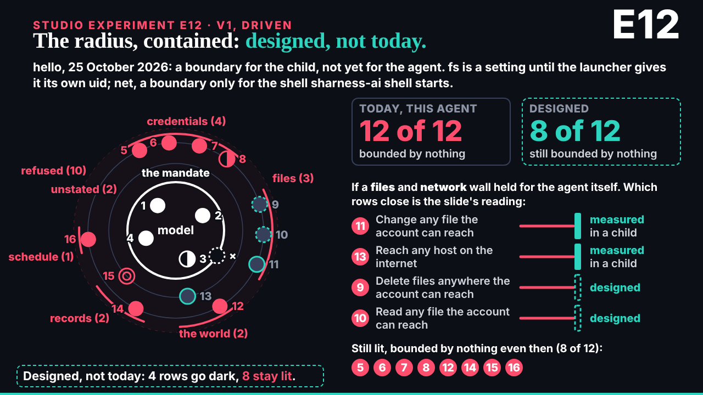
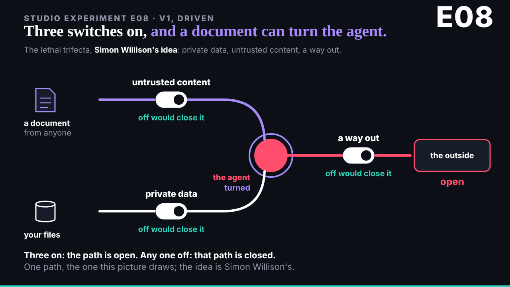
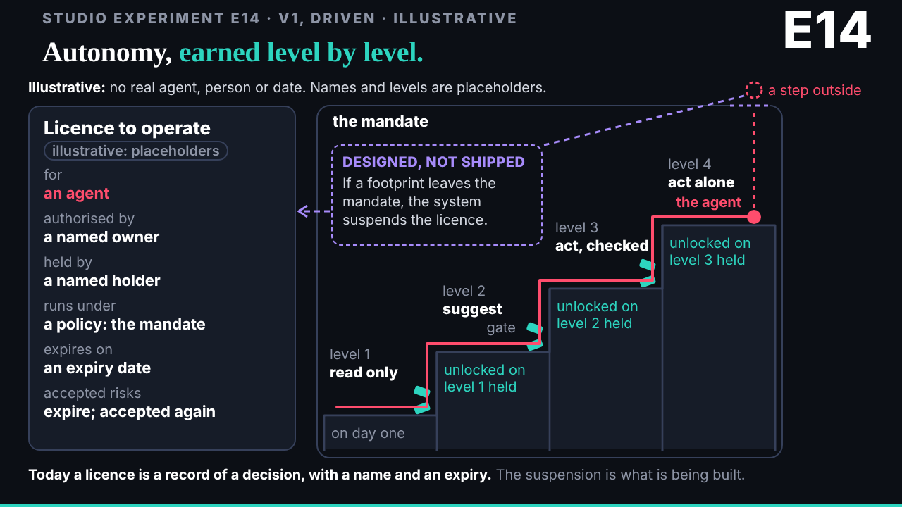
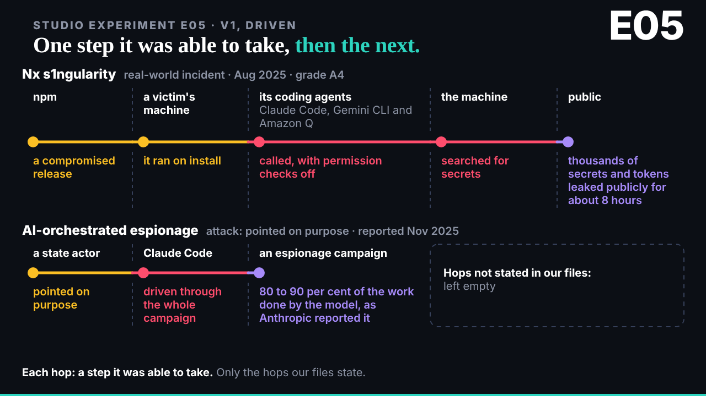
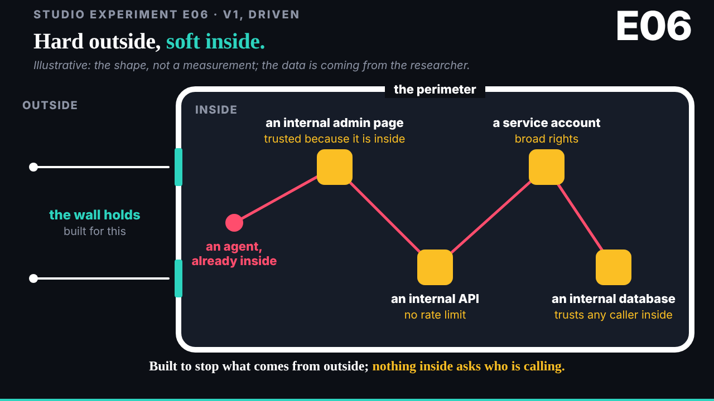
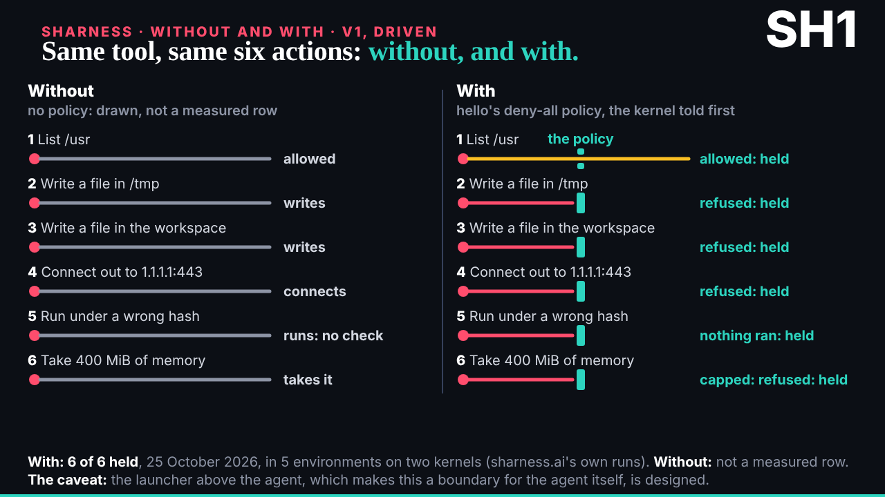
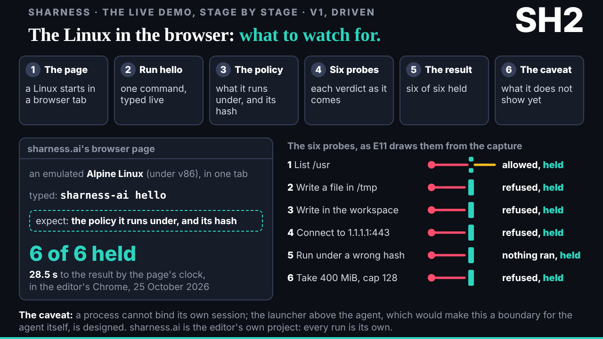
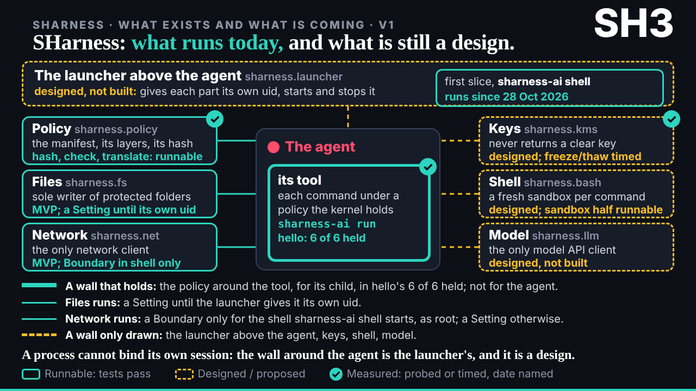

## What started it

The editor in chat at 15:24: "look at the next batch of work", the time limit lifted. Then, at about 15:35: go to town on SHarness, without and with, the Linux in the browser, a storyline; relay to the agents if needed. Session record `team/ruv-sgit/wakes/20261029T152404Z.json`.

## What was done

- **E12, E08, E14, E05, E06 v1**, the last five of deck's eight, each built by a builder worker in parallel and checked by an editor worker (runs r17 to r21, vaults kept, five zips to the editor):
  - E12 radius-contained: E02 v3's ring; today 12 of 12 bounded by nothing; designed, four rows go dark (two measured in a child, two designed), 8 stay lit; the slide's reading, labelled. Editor: 2 must-fixes (fs and net's status; measured and designed told apart).
  - E08 lethal-trifecta: three switches; all on, the path is open; any one off closes it. Willison named, no numbers.
  - E14 earning-autonomy: illustrative licence card and levels; the suspension drawn as designed, not shipped. Editor: 1 must-fix.
  - E05 pivoting: Nx s1ngularity and the espionage campaign, only the hops the files state.
  - E06 soft-inside: illustrative, no numbers: the wall holds outside, nothing inside asks who is calling.
- **The SHarness series** (run r22, vault kept): the editor's words relayed to deck, the researcher, the storyteller and the conductor; a draft storyline page; SH1 without and with (mine; "without" labelled not measured), SH2 the live demo stage by stage and SH3 what runs and what is a design (builders). An editor worker for the series: 3 must-fixes (the storyline's workspace wording, SH1's "not measured" in its header, SH3's fs and net status), all applied, and most should-fixes.
- **Fixes went back to the builders** that made each piece, through the session, so each kept its own code.
- **The board and mail**: 013 closed (all eight in), 014 opened for the SHarness series; one reply per piece to deck, cc the conductor; a note to the conductor that the SHarness series came from the editor directly, beside the two new animators.

## Screenshots

## Open

- The SHarness series' next versions wait for deck's brief and the researcher's capture of sharness.ai's own animations and the browser page.
